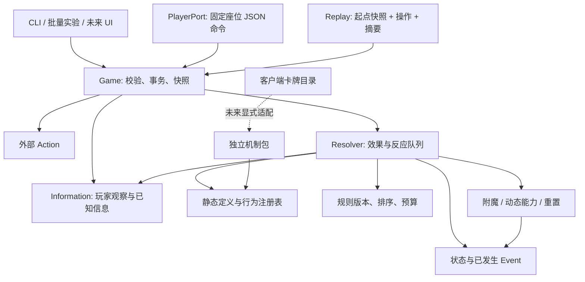

# 纯逻辑引擎设计

费用档变形共用已公布的进化封顶与退化降档规则，按物理池实际档位探测，完整有效查询在整批执行前捕获；原费用保留和生命周期保持独立。见[费用档契约](m5-evolve-published-rules.md)。

真实魔荚人的原生替代在公共变形重置前选择最终身体，只增加有限来源种类和私有抽选证明；原位置、生命周期、入场与升腾授予继续共享。源归因和当前承载者分别保存，见[契约](m3-native-transform-replacement.md)。

真实变形后的原随从召回使用普通亡语授予携带既有冻结复制材料，变形通知前完成安装，候选与随机仍沿原整批变形。有限授予、恢复和待校准边界见[契约](m3-transform-original-deathrattle.md)。

原生亡语保存完整当前随从时使用有限remembered_copy材料；原召唤入场通知前安装记忆，延迟交付沿原复制管线并保留原时钟。嵌套保存及明确重置政策见[契约](m3-frozen-deathrattle-copy.md)。

原本体的下次本人开始设值共用有限触发与守卫属性入口；指定开始截止使用既有本人区间，错过窗口不补发。有限字段、复制/死亡材料和无穷数值边界见[契约](m3-murozond-owner-start.md)。

战场随从与对手手牌的有限交换沿原物理召唤的第一体/额外体处理，占用的两处原位置保留，普通回手重置及组件材料共用既有生命周期。真实来源、原子分配和待国服窗口见[契约](m3-physical-hand-minion-swap.md)。

私密手牌检视只共用原实体抽样/展示，原生亡语获取记忆与独立按名程序分别持有后续事实；弃牌、计时、消费和交付沿原内核。范围、来源及待国服政策见[契约](m3-private-hand-inspection.md)。

双方手牌混洗按原配额原子分配，实际转手与原持有分别沿公共生命周期，隐藏位置重置跟踪；不伪造空手或抽牌。有限原实体入口与待国服抽样政策见[契约](m3-joint-hand-shuffle.md)。

脏鼠从当前手牌实体的实际获取历史连接原区域转移；真实原生变形来源无reset转手后保留声明并重置持有者见证，连续镜像仍用原同步。时间范围/溢出政策和官网缓存地址边界见[原手牌转手契约](m3-original-hand-entry-theft.md)。

格尔宾的原牌库光环通过独立物理入场请求接入既有玩家程序，直接时长绑定原附件与安装事件，不伪造施法。候选、容量、奇闻及保存契约见[原牌库光环](m3-deck-aura-entry.md)。

乌索尔将真实手牌法术经原存储变形和自动施法安装为光环，原材料索引连接已有玩家程序及每次自动施法；没有另造计时或目标结算器。接受事实、历史重施和玩家信息边界见[持续施法契约](m3-stored-spell-aura.md)。

真实牌库顶自动处理按当前物理顶牌逐次委托原召唤、施法、装备、地标移动和英雄安装；满场随从/地标复用普通抽牌，不伪造手牌出牌或战吼。原实体、续接和证据边界见[契约](m3-physical-deck-top-play.md)。

有界对手生命费用复用原玩家费用附件、纯支付投影和实际英雄生命账本；原出牌玩家与扣血玩家分别保存，超过声明上限明确拒绝，不回退账户或截断金额。结构、恢复和国服待校准政策见[支付契约](m3-qualified-next-card-costs.md#阿迦玛甘的有界对手生命支付)。

塔卡式发现把原选中卡面关联到既有原生亡语附件，在普通属性通知前保存，再由原死亡捕获和召唤流程执行；不制造手牌副本。真实37.0巨型排除使用有限关键词查询，原选择与生命周期边界见[契约](m3-discovered-deathrattle-memory.md)。

食物链复用完成出牌捕获的战吼后原实体属性，绍克三次发现仅为原PoolQuery增加精确印刷攻击力筛选；原任务、选择、费用和交付流程共享。原攻击依据、未知候选及待国服窗口见[契约](m3-food-chain-attack.md)。

真实双任务通过paired_quest及CastQuestChild沿原施法流程安装两个独立任务，原父施法和安装施法身份保留到恢复/终局；同手随从半体使用有限HandCombinationProfile及原手牌结算入口。原主任务互斥和法术相邻裂变保持，表达与待国服政策见[双任务与半体契约](m3-paired-quests-hand-combinations.md)。

真实私藏野兽使用有限ContrabandSideboardProfile，只有原侧板条目免原职业/符文限制，格式与副本核算仍共享；_TakeSideboardCard沿已有真实发现提供与物理交付管线消费原槽、创建新牌并安装减费。原乐队/构筑复制选择不变，无新增持久字段或Effect；细节与待国服政策见[私藏侧板契约](m3-contraband-sideboards.md)。

原法术余量复用真实伤害账本、原生参数与原墓地对象回手；每次值绑定实际施法/伤害，交付前安装，见[契约](m3-retained-spell-damage.md)。

原生囚禁复用既有亡语记忆，保存实际战吼、原目标驻留及休眠分配；通知前提交，死亡从冻结材料释放，见[契约](m3-native-imprisonment.md)。没有新增全局关联表。

欢迎回家复用重新开启和普通亡语授予，只为真实需要补齐场上地标载体；死亡、随机生成和历史仍由原公共管线执行，见[地标契约](m4-locations.md#欢迎回家的亡语授予)。

真实发现刷新保存完整原菜单和一次接受的风险，但控制选择不进入语义发现次数；原材料和未选整卡槽只含真实牌。伤害、死亡、交付和恢复沿原管线，有限表达与待国服窗口见[万能钥匙契约](m3-skeleton-key-refresh.md)。

真实抉择发现的配对交付复用同一选择和原创建请求，本人新体预置组合分支、对手取得普通印刷复制，绑定与完成边界见[契约](m3-choose-one-bribe.md)。

真实跟随法术使用有期限的原实体附件，出牌付款时捕获完整主体，完成整卡后按原顺序执行；创建、复制、移区、过期和恢复复用原流程，见[契约](m3-follow-hand-effects.md)。

真实当前技能伤害使用原健康规则附件，只增加永久self/HERO_POWER/ADD1的技能载体范围，旧技能定义及普通伤害管线保持，见[灵魂献祭契约](m3-soul-immolation.md)。

真实构筑复制来源使用独立侧板声明，复用原资格/副本核算、开局钩子和普通语义插牌；原始套牌与生成实体保持分离，见[契约](m3-deck-copy-sideboards.md)。

真实奇闻地标复用原抉择/构筑、物理换面/摧毁、容量填手和当前复制；临时法术重复在首次创建通知前安装，原引用及有限入口见[契约](m3-azshara-fabled-locations.md)。

真实奇闻的指定武器复用原消费材料、属性/关键词与亡语当前复制交付，只增加本人装备/手牌/牌库的有限取用；不建立随从装备槽。材料和待校准政策见[指定武器契约](m3-fabled-weapon-material.md)。

真实死亡武器洗回由原分配/死亡记录绑定物理对象，普通重置后只保留自身成长，再交现有物理移区与语义洗牌收据；接口、随机和材料边界见[契约](m3-growing-weapon-shuffles.md)。

露妮仅新增原手牌随从的有限未来保存组，沿原物理移区、属性安装、真实开始与普通溢出归还；完整组和续接私有，生命周期及待校准政策见[契约](m3-temporal-hand-return.md)。

托雷斯的命中次数绑定原物理圣盾，原健康批次决定防止及真正破裂；复制、保存和公开耐久沿现有生命周期与玩家投影，有限声明和待校准政策见[契约](m3-divine-shield-hits.md)。

奇闻巨龙家族复用原构筑包；原当前巨龙条件共享纯见证查询，费用与手动/自动施法分别沿原报价及唯一额外施法管线，见[契约](m3-arcane-dragon-fabled.md)。

本人自然法术伤害的原生替代由有限HealthRule声明接入同一健康包；先记录防止结果，再沿普通属性安装或原召唤继续义务执行。批次、来源和完整池边界见[契约](m3-nature-damage-replacements.md)。

真实武器的本回合攻击设值复用普通有序附魔和全局清理，仍用原装备引用与英雄派生攻击限制；内部无穷数值表示及待国服边界见[契约](m3-infinite-weapon-attack.md)。

真实武器的伤害替代在原健康包提交中逐包消耗原装备耐久，普通数值资格保持原批次冻结；原身份、缓冲通知及生命周期见[契约](m3-weapon-damage-replacement.md)。

真实头颅亡语仅移除目标的一个普通关键词，复用原物理引用和关键词消费层；巨型展开与独立生命周期保持，原始证据和待国服政策见[契约](m3-colossal-keyword-loss.md)。

真实牌库属性均分复用原起始条件及存储增益，整组应用后再通知；物理候选、随机余数、来源与恢复边界见[契约](m3-deck-stat-distribution.md)。

真实生成光环的额外期限保存在物理纯附件和原接受施法中，仍沿普通玩家效果安装及倒数；当前格式池筛选、嵌套接受、原生光环分类和玩家边界见[契约](m3-generated-aura-duration.md)。

真实面具来源复用有限随机生成，战吼与连击共享原实际产出绑定。法术/武器共用唯一历史账本，旧武器入口保持严格；具名域、费用和恢复边界见[契约](m3-mask-battlecry-combo.md)。

吉恩式原生手牌奇偶变形使用同费用双卡面声明及原升级器；初始主技能身份独立保存在玩家事实中，恢复不从Game.origin重猜。检查窗、技能适配、私有通知和保存边界见[契约](m3-native-hand-parity.md)。

原生手牌费用来源复用原报价/支付序列；有限`hand_adjacent`声明只读取当前物理邻位，生成对象不伪造手牌位置，已接受付款仍保存原报价。载体、保存和窗口政策见[相邻手牌费用契约](m2-adjacent-hand-cost-auras.md)。

原击杀复活读取既有致死来源和武器转交事实，继续交普通复活；乌索克的全体攻击复用物理驻留与强制战斗，有限表达及待国服政策见[契约](m3-source-kill-recovery.md)。

历史死亡亡语通过私有基础随从载体复用原亡语执行器，选择、原始卡面与完整继续义务独立保存；满场、额外授予排除和待国服政策见[契约](m3-historical-deathrattles.md)。

阿莎曼按实际手牌余量接受物理牌库复制数量，逐次选择与首次通知前减费复用原区域/复制/费用层；反应重查、原实体、恢复和信息边界见[契约](m3-physical-deck-copy-fill.md)。

宁静旷林的沉睡使用普通攻击限制和原激活玩家结束期限，仍由地标、附件及共同到期器执行；原目标、强制攻击、复制/死亡和恢复边界见[契约](m3-owner-end-attack-sleep.md)。

未来伙伴以同一玩家家族修订保存，完整池替换和原伙伴入口通过普通召唤相连；重复位置、空档、原随机及回溯恢复见[家族契约](m3-future-companion-families.md)。

动物伙伴消费者共用原卡牌配方入口，塔雅的永久逻辑数量复用玩家程序和普通召唤请求；来源资格、等待尾部、独立随机与待国服政策见[数量契约](m3-companion-quantity.md)。

真实魔网数值及额外效果在原CAST报价，永久玩家声明、逐单位随机/召唤/抽牌继续复用公共执行器；选择预览与物理施法区分见[魔网契约](m3-native-leylines.md)。

真实新兵长期奖励在原玩家程序中声明明确卡牌范围，存储卡首次通知与休眠缓存沿同一数值层校验；默认场上光环含义保持，见[新兵契约](m3-recruit-player-programs.md)。

真实随机治疗沿原分配解释器逐单位交付普通Heal，保留免法伤、原流、独立治疗历史及混合父根；精确国服资格/数值窗口见[契约](m3-random-split-healing.md)。

原手牌随机恶魔变形在既有完整池请求中携带冻结的局部属性/费用，原重置器在首次通知前安装完整数值；抽样、收据、生命周期和信息隔离保持，见[契约](m3-retained-demon-transforms.md)。

发现后的预备授予复用原创建附件，在首次通知前安装到原物理随从；手牌动作、报价与玩家接口统一查询当前授予，支付和回合锁继续走原预备执行器，见[契约](m3-discovered-prepare.md)。

古生物秘术保留同一原发现菜单，付款与创建继续交给原执行器；独立进度控制保护等待中的完整交付义务，见[契约](m3-corpse-discovery-keep.md)，国服选择/支出/通知窗口仍待校准。

闪回的原连击加攻保留为所选随机材料的创建增益，在首次入场通知前沿原附件层安装；普通磁力等池材料须绑定完整原池，见[契约](m3-past-pool-entry-grants.md)。

持有法力条件复用原支付/消耗收据作原子进度，并冻结到原出牌事实；支付投影、战吼重演与实际手牌驻留共享原管线，见[契约](m3-held-mana.md)。

成功弃牌的复制召唤先从原事件冻结当前材料，再由各实际主体接受普通召唤数量；原牌后续变化不重写材料，巨型及组件仍沿公共入场，见[契约](m3-discard-summon-copy.md)。

真实下一次治疗转换使用原有限玩家实例，在完整健康批次中接受/消费，普通健康规则负责计算；无属性实例的通知沿批次尾部发布，见[契约](m3-next-healing-conversion.md)。

真实英雄已攻击的条件目标使用原完成历史的本人布尔视图，原接受证明保存私有原游标，见[契约](m3-hero-attack-player-targets.md)；不能用当前攻击机会计数器重建旧条件。

真实休眠随从的自身增长绑定原物理驻留及原休眠实例，仅放行自身接收条件并共用普通属性安装器；自动二选一和唤醒沿原解释器，见[契约](m3-dormant-self-growth.md)。

真实发现保留原完整选项配方，提交记录构造后保持不可变；手动/自动接受、费用前缀与私有恢复证明见[契约](m3-original-discovery-offers.md)。菜单原窗口另冻结完整物理材料并随私有等待帧保留，见[原卡材料](m3-offered-card-materials.md)；未选项执行仍需独立真实来源。

真正的发现后消费者通过原实际交付对象和语义通知连接，选择事实保持不可变，原获取、区域、召唤与费用仍由原执行器负责；首要/派生、等待恢复及国服待校准边界见[契约](m3-discovery-delivery.md)。

印刷随从攻击力是独立池元数据，奇偶查询不借实体当前属性或执行覆盖；原地图余项和身份变化见[契约](m3-printed-attack-discovery.md)。

候选的印刷符文直接读取已有元数据，独立于法术学派和套牌分配；原地图续接与共享查询读取见[契约](m3-rune-discovery.md)。

登山地图以原提交类型构造首次查询，原实体当回合使用后的余项沿既有手牌跟随，不重新筛选或抽样，见[契约](m3-hiking-trail.md)。

原提交随从类型复用冻结卡面及支付附件；群山之灵沿原任务器接入，独立开始库存与每次原出牌最多一种类型的有限匹配见[契约](m3-played-minion-types.md)。

真实复生历史消费者可沿原复活批次筛选精确死亡发生，整批关闭后以实际交付组依次执行原生随机强制攻击；原驻留、原攻击窗口与恢复边界见[契约](m3-actual-reborn-resurrection-attacks.md)。

实际成功复生在原成功召唤记录保存原死亡连接，并核完整原入场/复生事件对；复用原执行器和时间线，后续整组复活攻击另守实际材料及窗口，见[契约](m3-successful-reborn-history.md)。

原死亡忍者直接洗回沿`ShuffleDeadMinion`与既有语义洗牌组，原死亡ID/墓地驻留、实体重置、原归因及玩家边界不变；真实洗牌任务和英雄复用公共生命周期，见[契约](m3-master-dusk-dead-shuffles.md)。

翼手龙蛋复用原具名交付，仅补一次对双方其他随从的原子健康属性转移；既有白板、旧敌方/英雄偷取和恢复管线保持，见[契约](m3-pterrordax-egg.md)。

真实法力值预算召唤通过原抽选根的实际返回身份续接，按印刷费用递推；过载回溯复用有效时间线，见[契约](m3-mana-worth-summons.md)。

真实幸运币筛选减费复用原手牌数量阶段，保存完整当前卡面与原付款事实；有限武器声明和隐藏边界见[契约](m3-coin-hand-costs.md)。

真实传奇商贩将原发现的未选配方交给一次语义洗牌；原创建、待执行义务与当前时间线证明见[契约](m3-discovery-remainders.md)。

真实拉卡利的故事复用原三回合玩家实例；固定具名填场在公共层捕获一次实际容量，再委托原有序召唤组，见[契约](m3-named-fill-story.md)。

真实时光流汇的三种形态组合已有地标、生成与场上发现；原发现结果的手牌复制仅增加有限接受控制，见[契约](m3-conflux-locations.md)。

阿沙隆的两轮进化通过原选择解释器和原驻留附件执行，完成后提交一个有限的两项永久程序；真实付费/自动primary入场共用普通附件安装，见[契约](m3-ashalon-adaptations.md)。

真实首张龙费用复用已提交CostQuoteInput的完整附件；当前种族和完整原前缀共用既有报价、付款及恢复管线，见[契约](m2-first-tribe-turn-cost-aura.md)。

真实卡的待兑现玩家实例使用[原实例单次消费](m3-once-player-effect-reward.md)门禁；消费先于移除反应，成功分支仍由原解释器执行，不改变普通移除和倒计时的既有契约。

固定入场生命允许零值，光环、生死、召唤计数和具名攻击续接仍使用原执行器。原始材料、受益驻留和未校准窗口见[零生命入场契约](m3-zero-health-summon-entry.md)。

完整可用法术查询共用真实实体材料化与手动出牌资格，副本仅用于纯查询，临时交付仍走普通创建。完整池、私有输入摘要缓存和接受窗口边界见[可用法术契约](m3-playable-spell-generation.md)。

原存储卡牌的完整随机池选面复用普通跨类型重置；原引用、完整候选和私有抽样/变形收据见[契约](m3-stored-pool-transforms.md)。

原随机法术结果的费用治疗使用来源绑定的有限请求、普通生成交付和共享健康批次；等待、回溯及私有收据边界见[契约](m3-generated-spell-healing.md)。
随机填手在公共层按实际玩家容量捕获数量，然后委托原生成批次；局部支付和到期继续沿原附件，见[契约](m3-pool-hand-fill.md)。
具名召唤的实际交付可在原入场后续接注册行为，沿原数量、一次接受及连续驻留保存；见[契约](m3-named-summon-followups.md)。
延系的自动随机准备可显式保留原接受和原组，普通伤害与成立冻结沿公共执行器；见[原组续接契约](m3-kindred-original-groups.md)。
真实填场按实际规则和完整物理占位捕获一次空位，数量与原随机批次共享保存及召唤执行器；见[容量填场契约](m3-pool-fill-capacity.md)。
免疫法强的分裂法术只改变原预算的法强政策，仍沿原活跃施法与单位结算，见[契约](m3-immune-spell-split.md)。
真实攻击窗口保存原防守驻留，显式改向另行捕获新目标，战斗与历史仍共用原管线；见[契约](m3-original-attack-defender.md)。
真实条件目标需要的已使用任务事实只从原冻结提交投影，本人DTO和原付款证明共同核对；见[契约](m3-played-quest-targets.md)。
原生圣骑士光环复用公开玩家实例和普通费用修正，对手时钟与双向归属的有限表达见[契约](m3-native-paladin-aura.md)。
原法术的残骸召唤分支只在原SpendResource增加有限容量门禁，继续使用原支付、通知和带施法归因召唤；见[契约](m3-corpse-spell-capacity.md)。
真实召唤后的流放奖励按原完整召唤收据交给既有关键词和本回合清理；有限原组续接见[契约](m3-outcast-original-summon.md)。
真实英雄“免疫到下个本人开始”复用原期限和英雄附件继承，有限载体许可见[契约](m3-hero-timed-immunity.md)。
真实普通随机法术洗入复用原抽选与语义洗牌组，有限请求及流放重复见[契约](m3-plain-spell-shuffle.md)。
真实流放发现复用印刷关键词，下一张减费复用原费用贡献及一次消费；有限条件与恢复边界见[契约](m3-printed-outcast-study.md)。
真实随机随从的计时休眠作为原入场材料在首次通知前安装，倒数与恢复沿原生命周期；见[契约](m3-pool-entry-dormancy.md)。
真实发现后的赠礼复制绑定同一所选创建材料，独立交付和生命周期沿原执行器；有限入口及待国服窗口见[契约](m3-selected-gift-copy.md)。
真实延系赠礼的减费随一次原发现交付，复用原准备角色、费用和回溯；见[迅猛龙先锋契约](m3-kindred-dark-gift.md)。
原生黑暗之赐生成来源通过有限请求绑定实际宿主上下文，再委托已有完整配对发现；见[契约](m3-native-dark-gift-generation.md)。
真实随机生成的固定属性与翻倍使用独立创建声明，在原获取通知前绑定实际新实体；五张洗入复用原语义洗牌组，见[创建属性契约](m3-generated-minion-stats.md)。

原实体关键词请求可转交既有期限声明，原驻留校验先于公共时钟安装；见[契约](m3-native-timed-grants.md)。

真实弃牌数派生双属性使用原账本及可校验生命贡献，增长与光环共同规范化；见[契约](m3-discard-derived-stats.md)。

随机存储随从种族可显式选择印刷或当前依据，原物理候选/费用/生命周期保持；见[契约](m3-current-stored-tribes.md)。

随机原随从授予以一次公共抽样连接既有原引用关键词续接，不重抽或重绑；见[契约](m3-random-minion-keywords.md)。

真实武器抉择仅补普通手牌入口，临时关键词与动态亡语沿原装备及公共生命周期；见[武器抉择契约](m3-native-weapon-choice.md)。

真实弃牌的当前事实与回溯保留的诊断日志分离核对，复用现有有效时间线查询并保持精确原事件验证；见[弃牌回溯契约](m3-native-discard-rewind.md)。语义洗牌沿同一有效时间线核对当前首插入及成员，原生伤害与内在费用共用完整状态操作事实，见[洗牌契约](m3-semantic-deck-shuffles.md)。有限触发授予可声明原随从引用，成功后仍沿原附件生命周期；具体见[原接收对象契约](m3-original-finite-grants.md)。

真实龙牌的当前种族/赐福条件、分阶段移除和回溯伤害继续复用原管线；只为实际地标需求增加有限随机入口。候选、原死亡、恢复及待国服窗口见[契约](m3-dragon-native-effects.md)，生成资格仍独立核对。

从本人牌库发现并授予黑暗之赐须保留原实体和当前材料，不能套用生成副本。有限原牌发现、共享配对、原授予/区域交付及恢复边界见[契约](m3-stored-dark-gift-discovery.md)；这不认证外部随从生成池。

真实具名亡语循环召唤新的基础实体，伤害后的固定入手复用普通批次和交付；已有静电震击定义保持，未知虚空灵魂来源继续显式未支持。完整依赖、保存与目录/生效补丁边界见[契约](m3-fixed-named-followups.md)。

真实原生伤害与攻击提供者仅扩展有限来源、嘲讽绕过和本体免疫条件，数值/目标/生命周期仍交原执行器。当前种族、占位和未实现克洛玛图斯来源边界见[契约](m3-native-health-attack-providers.md)，不能从登记数量认证正式标准支持。

真实条件消费者继续使用既有属性、攻击、施法和物理库存事实；跨冻结反应的原邻位组仅增加有限法术续接，冻结/死亡仍由公共执行器负责。保存、末次武器奖励及初始资格的边界见[契约](m3-conditional-consumers.md)，当前执行版本以原两份台账为准。

真实卡牌应组合已有公共效果，敌方随从持续嘲讽仅增加有限声明范围；生命设值、连击复制、武器死亡、随机额外效果与牌库逆序继续共用原执行器。新增范围及待国服边界见[配方契约](m3-public-effect-consumers.md)，下文历史初始范围不覆盖此后新增形状。

原延系检索按第一次实际抽牌的完整类型连接第二次物理检索；原生手牌额外效果只替换两个印刷关键词槽，独立授予继续保留。有限表达及未实现来源边界见[契约](m3-kindred-hand-bonus.md)。

真实抽牌条件只读原两次物理抽牌，来源奖励绑定原连续驻留；按实际消灭奖励保存原目标与死亡原因，继续委托普通死亡、抽牌和法力执行器。有限请求及待国服边界见[五费随从契约](m3-five-cost-native.md)。

真实原生法术参数绑定原亡语执行与物理材料，当前费用/亡语抽取连接原手牌奖励；首回合和后续正常抽牌共用可移除来源门禁。有限字段、公共执行及未覆盖继承边界见[亡灵资源契约](m3-undead-resource-native.md)。

真实英雄本回合生命变化目标读取原提交账本，随机随从增益仅抽选后交给原属性层；受伤召唤、不能攻击和实际过量治疗继续组合公共执行器，表达与待校准边界见[亡灵原生效果契约](m3-undead-native.md)。

上一张使用的印刷符文用原冻结历史查询；固定召唤组从完整原交付连接原目标强制攻击，保存、容量与时序边界见[符文与召唤组战斗契约](m3-blood-rune-native.md)。

真实英雄救援复用原英雄致死屏障、实际残骸支出与原身份恢复，公开一次性标记按原接受时钟退役；具体表达、替换及校准边界见[哈斯克契约](m3-hero-corpse-rescue.md)。

原生残骸获得倍率保留可移除来源和固有死亡基数；物理消费者检索、原目标支付及真实任务/地标/第二技能依赖见[残骸消费者契约](m3-corpse-consumer-native.md)。已有第二技能槽安装仍明确未支持，不能以首次安装认证整卡。

原随从残骸门禁在执行时重核实际来源、空位/复生/召唤对象，再沿原完整支付分支；原目标伤害与三个真实选项保持引用和信息边界，见[残骸触发与选择契约](m3-corpse-trigger-choices.md)。

真实固定召唤后的残骸奖励连接原完整交付和原支出，残骸raise按原实际容量/扣除单位生成固定新体；与原法力奖励共用交付连接器。入口、无残骸衍生物及待国服窗口见[残骸召唤契约](m3-corpse-summon-effects.md)。

真实回手禁止须绑定成功到达的原物理对象；控制归还和“下个本人回合结束”按实际原玩家区间计时，普通/对方/结束反应安装分别接受。有限入口和仍未支持的控制层叠边界见[时间效果契约](m3-temporal-spell-effects.md)。

真实首次复制的目标要求通过有限原生声明共用选择管线；召唤后的全法力奖励绑定原请求、实际交付和原支出，见[数值资源法术契约](m3-numeric-resource-spells.md)。

下一次延系必须只重复真实成立部分，原准备/替代分支、原付款及原接收对象分别表达；原生入口、紧凑计划与恢复边界见[延系部分契约](m3-kindred-components.md)。

真实随机牌库置顶与增益共享原CardReference；成功召唤奖励从原历史记录解析连续BoardPresence，再交原属性执行器。仅增加两个有限请求与显式保存校验，core362/schema287，见[原接收对象契约](m3-original-imp-recipients.md)。

固定衍生物洗入使用原语义洗牌批次；抽到时召唤委托原DrawRecord、HandProgress和物理卡牌召唤/补抽。强力裁决复用原受益玩家下一实际开始的费用回调，身份及范围见[固定洗入契约](m3-fixed-shuffle-followups.md)。

下一鱼人的价格与圣盾共用原CostModifier/冻结付款收据，在成功入场前交付；下一实际回合税费复用普通玩家实例与当前回合费用到期。无新执行器/账本，嵌套修正字段采用core361/schema286，见[原付款与未来价格契约](m3-paid-minion-price-keywords.md)。

原随从优先目标在共享自动CAST窗口按完整合法域与连续驻留接受，实际牌库施法只筛物理实体及存储费用；历史重施继续沿原批次转交同一偏好。新增分区字段与请求载荷采用core360/schema285，见[原随从优先施法契约](m3-original-minion-spell-targets.md)。

真实延系随从使用原on_play与上一自身回合查询，保持战吼、结束与亡语入口各自独立；固定跨系列衍生物、带归因召唤、复制和临时效果均沿公共层，无内核或保存变化。具体范围见[延系与鱼人依赖契约](m3-kindred-murloc-effects.md)。

原生亡语记忆仅保存真实召唤成长或原DrawRecord/HandEntry链接，位于既有附件并随原死亡/复制冻结；HAND通知前写入，真正召唤/弃牌继续委托公共执行器。core359/schema284、公开观察86的安全数值投影及复制材料引用验证见[契约](m3-native-deathrattle-memory.md)。

原生满面板休眠只声明dormant_board_full及空载荷原生能力，在原规范化按当前控制者/实际容量捕获已有AwakenCapturedMinion；去重依赖原队列而非私有pending集合。核心358/schema283，false保留旧指纹，身份/初始Scenario和接受窗边界见[契约](m3-full-board-dormancy.md)。

真实出牌随从奖励使用原完成PlayRecord/提交能力与首条真实入场，具名当前续接解析连续BoardPresenceReference后交原关键词/额外效果。无新运行时或状态，原来源与后续重入边界见[契约](m3-played-minion-keywords.md)。

规范基础角色的初始技能绑定仅由内容装配器在完整源引用下补齐，最终必须完成引用验证；默认代表工厂保持原内容。默认技能、完整基本图腾及原食尸鬼沿既有支付/健康/召唤/生命周期，无新运行时或保存字段，见[角色契约](m3-basic-hero-roles.md)。

原生连续来源条件只以NativeSourceCondition限定既有法强/费用能力，读取物理载体和当前控制者，复制仍保留原归因；本人回合英雄攻击另走有限原AuraSpec配对，规范化后共享装备/战斗。无新GameState账本，严格声明及付款窗口见[契约](m3-native-conditional-sources.md)。

真实1费根卡优先复用原扣款事实、分离玩家目标DTO、伪装落位、过载及指定卡牌交付。条件监听和卡牌正文不另建计数器；负生命属性不伪装为伤害或正奖励，见[现有机制配方](m3-one-cost-basic-cards.md)。

原生手牌连续镜像以独立hand_mirror声明和原物理来源绑定追随真实公开提交的对手随从卡面；全部载体先完成安装再捕获私有通知反应，当前复制/转手和退役复用原区域管线。无新GameState账本，严格来源与查询纯度见[契约](m3-native-hand-mirrors.md)。

私有随机手牌困住只以TrapRandomHandCards读取执行时的完整物理手牌、无放回选择并同步委托原LockHandCard；数量从原实际出牌历史计划，禁止出牌和到期仍交原owner时钟。无新账本、状态字段或选择器，见[契约](m3-renferal-hand-traps.md)。

原生reborn_policy安装到原印刷复生行，共用死亡/附件复制；局部法强先绑定原匹配DECK法术，再沿共享draw_one，实际CAST保存完整局部附件并交原健康预算。无新GameState字段或第二套结算器，空声明保持旧注册表签名；core354/schema280，范围见[契约](m3-native-reborn-fire-draw.md)。

原攻击者设属性仅以SetCapturedMinionStats守卫原MinionReference，再同步委托原SetStats；原生HandProgressSpec只增加有限有序HAND/DECK配对，仍每物理载体一个实例，战场结束另沿原主体。无新GameState字段或结算器，core353/schema279；移区失效、玩家边界与待CN政策见[契约](m3-stored-growth-cards.md)。

AttackRandomEnemyMinion将原攻击者驻留和执行玩家带过增益反应，执行时取当前敌随从，再将选中目标的原驻留交给既有ForceAttack。未知/未来引用由原codec边界校验，空池不取RNG，无新GameState账本；core352/schema278，见[野兽触发契约](m3-beast-trigger-cards.md)。

原手牌提交身份与实际召唤通知分别服务于持牌龙变形和恶魔入场成长。卡牌层读取原冻结种族与当前操作数，换面、预备、原驻留增益、伤害及固定家族随机召唤继续使用已有公共层，无内核或schema变化；见[原生入场卡牌契约](m3-entry-native-cards.md)。

原有序召唤组的有限bonus_effects声明在全部子项完成后奖励实际交付。bonus_receipts保存原驻留、完整候选/随机和有序已接受前缀，原Finish、bonus_candidates及GrantCapturedKeyword共享恢复、回放与生命周期；无新GameState账本，core351/schema278。残躯只在原水蛭主体查询当前有效来源，见[契约](m3-summon-group-bonus.md)。

整局洗牌历史由deck_shuffles在原随机插入发布前记录首个真实见证，显式同步组复用旧区域执行器；内在费用冻结完整原前缀，原actor与接收牌库分别验证。新增唯一deck_shuffle_history持久字段，core350/schema277；未知发起者明确拒绝，玩家投影不含私有历史。见[洗牌操作契约](m3-semantic-deck-shuffles.md)。

原牌库抽取通过DrawMatching明确接收玩家、原DECK及正向身份，仍由draw_one执行普通抽牌、爆牌、CWD和替换。跨控制权的待施放法术移区须原pending DrawRecord完整匹配，不放宽其他移区；无新保存字段，core349/schema276，见[原牌库与历史消费者契约](m3-deck-history-native-cards.md)。

CopyMinion可复用原BoardPresenceReference绑定真实战场驻留，每个复制在自身实际接受窗捕获当前材料，原驻留离开后不重绑。原复制执行器、来源和成功续接保持，严格FrameCodec只扩展该效果目标类型；core348/schema276，见[真实召唤依赖与复制驻留契约](m3-six-cost-native-cards.md)。

施法进度完成的SPELL转MINION由原HandProgressSpec精确事件/类型配对验证，并显式传给旧upgrade_face。实体、普通费用/附魔和公共出牌流程共享；授予能力的跨类转移仍明确拒绝，没有新保存字段、进度账本或转换矩阵。core347/schema276，见[持牌抽牌契约](m3-held-draw-forms.md)。

hand_play_locks以独立零数值Enchantment保存既有真实本人开始时钟，manual_requirement_error统一连接手动出牌、内部手牌入口及原付款证明。原物理抽牌组增加原成本排除与完整抽前复制材料，仍共用draw_one/CopyCard；core346/schema276，见[抽牌保留契约](m3-draw-retention-limits.md)。

physical_draw_groups仅保存有序槽、原DrawRecord/HandEntry关系与有限奖励，仍由原draw_one执行。替换补抽沿原链交付、额外触发抽牌不混入，组后选择携带原驻留；无新增GameState账本。core345/schema275，保存、费用及开局身份边界见[抽牌组契约](m3-physical-draw-groups.md)。

CopyEntryMaterial保存有限入场授予及其实际归因来源，首次入场前用原创建助手安装；CopyCard的印刷死亡复制核对不可变原DeathRecord。DiscardCard/DiscardMatching成功续接及ReturnSpentSpell复用原解释器/移区，core344/schema275边界见[原材料契约](m3-original-material-spells.md)。

原物理匹配抽牌可在整组结束后捕获受益：draw_beneficiaries只保存原DrawRecord ID和HAND CardReference，逐张仍由旧draw_one/FinishDraw执行。奖励统一捕获在第一份增益之前，过期驻留不重绑，不新增GameState账本；见[健康/抽牌受益契约](m3-health-draw-beneficiaries.md)。

当前手牌费用条件使用原纯`quote_unselected_cost`；需要伤害、加甲或死亡后的新局面时通过原InvokeBehavior具名续接。吸血保留真实SPELL来源关键词，技能复原选择当时当前主槽位；配方和空槽政策见[条件与资源法术](m3-health-resource-spells.md)。

有限法术目标请求绑定原活跃SPELL施法号，保存原分配或随从驻留；新增请求委派既有健康批、冻结和死亡抽牌，不增加GameState账本。四个注册类型由core342识别，schema274保持，见[目标与续接契约](m3-spell-target-sequences.md)。

六张有限伤害法术直接组合已有Damage/RandomDamageBatch、原健康结果、Draw及SummonByCard；当前种族匹配只是卡牌配方纯查询，不新增解释器或状态字段。捕获条件、同批目标和原生水蛭来源见[伤害续接契约](m3-health-sequence-spells.md)。

战场复制的成功续接保存在原CopyEntryMaterial与CardSummonDelivery中，不增独立账本。原复制来源、实际交付驻留、一次接受与完整Finish队列分别校验；隐藏受伤即死使用普通触发附件，见[复制续接与私有分身契约](m3-copy-followups-hidden-pairs.md)。

明确存储亡语声明只将真实退役收据接到原亡语解释器，不增加死亡账本。默认声明兼容旧定义语义，新的stored来源进入严格保存和计划证明；见[存储亡语契约](m3-stored-deathrattles.md)。

固定命名伙伴直接交给原归因召唤producer。FillHandWithCard在原区域模块读取真实规则/玩家容量，接受有限空位后返回普通AddToHand序列，无额外生成账本；来源、容量反应和边界见[固定伙伴契约](m3-fixed-companion-cards.md)。

原属性关系增加当前对手回合的闭合条件，实际开始捕获前只重算这种载体；原匹配抽牌增加最高实际牌库本地费用选择，原实体抽牌链与手牌报价分别保留。声明、保存和边界见[武器/回合/抽牌契约](m3-native-weapon-turn-draw-cards.md)。

随从的单位随机分配与单次随机伤害复用原SplitDamage、RandomDamage和命名续接；需要重查时在每段或各结束主体真正执行时读候选。原生BC/DR/复生各沿原生命周期，无卡牌专属计数或账本，见[原生随机伤害契约](m3-native-random-damage-cards.md)。

死亡复活和上回合法术返还直接消费既有不可变材料：原死亡查询交给实际归因的Resurrect，个人法术沿最近关闭本人区间的完整冻结出牌行交付基础新实体；不建立卡牌专属历史账本。无学派false行仍保留，完整政策和信息边界见[历史返还契约](m3-history-recovery-cards.md)。

区域批量销毁先移动全部捕获的牌库实体，再发布原销毁事件和原生主体；原单张续接复用同一发布助手。实体私有face_replaced记录显式卡面替换，原始牌库材料仍由开局事实提供，复制不继承来源信用。严格保存及待CN政策见[物理区域契约](m3-physical-zone-cards.md)，实际进度仅在两台账。

原生攻击后卡牌沿原CharacterAttackRecord与COMBAT致死材料组合奖励、物理招募和跟随攻击。ForceAttack保留原字段，角色操作数可用已有BoardPresenceReference绑定原驻留；解析、过期跳过、codec和战斗仍共用内核，无新模块/账本。窗口和待CN边界见[攻击续接契约](m3-attack-followup-cards.md)。实际进度仅在两台账。

传送门的实际自动施法向原池召唤入口交付完整cause，外层抽牌者不代替召唤来源。历史召唤收据按原日志中的施法接受事件绑定编号、物理来源及玩家，当前根仍校验完整当前施法，避免回溯后编号复用造成误绑；见[标准传送门来源契约](m3-standard-portal-summon-source.md)。实际范围与验证仅在两台账。

原生持续来源直接声明既有关键词、法强、条件属性、种族光环、顺劈与健康规则。旧卡牌主体显式交接实际召唤上下文，数量适用时委托原类型生产者；0攻击结构反击保留0量，不据承受端加法创造打击。表达、旧路径边界和待国服政策见[原生来源契约](m3-static-provider-cards.md)，实际范围与验收仅在两台账。

下一张指定牌复用原费用贡献、用途与付款证明，连击结构、实际临时手牌及当前种族分别筛选；完整数值费用只决定有限的生命支付资格。本人真实开始禁疗复用原英雄健康附件与owner时钟，原期限和临时手牌材料进入严格保存；见[费用资格与禁疗契约](m3-qualified-next-card-costs.md)。实际验证与下一项仅在两台账。

显式玩家健康来源保存原物理事实与受益方，普通玩家效果默认保持原语义；逻辑伤害委托原健康层，下一真实对手期间复用原实例/费用/时钟。严格捕获、解码、玩家隔离和统一格式常量见[玩家健康来源契约](m3-player-effect-health-source.md)，实际进度与验收仅在两台账。

实际下一次技能费用、整局随从设费、开局双方上限/充能水晶和本方治疗增加沿现有公共层组合，扩展约定见[持续费用与真实开局契约](m3-persistent-economy-cards.md)。实际进度、验证与下一项仍只在两台账维护。

定向战吼沿原物理引用、死亡、复制及转控执行器。新请求只保必要引用/参数；普通手牌转控从既有活跃付款证明读取原选择，避免同ID重入场重绑，无第二份保存状态。玩家生命条件仍是DTO协议；原健康payload续接仅匹配本次击杀。core325/schema268，见[契约](m3-targeted-battlecry-cards.md)。

条件战吼从原历史/当前属性取值，三个目标规则用原版本化玩家DTO协议；不用全知谓词枚举玩家动作。DrawMinionWithAttack只筛当前物理牌库并委托原RNG/MoveCard(draw=True)，无新抽牌账本或保存字段，core324/schema268。范围、材料和待CN边界见[契约](m3-conditional-battlecry-cards.md)。

基础原生战吼卡继续组合原属性、同批伤害、目标、冻结、物理抽牌与Imbue。当前武器/英雄攻击及敌手牌在命名主体中读取，负生命Buff保持属性语义，原目标预检和生命周期共享；无新内核字段或执行器。见[契约](m3-simple-battlecry-cards.md)。

原生亡语卡组合原DeathRecord、范围/分摊伤害、装备、Imbue和区域费用；当前状态条件经命名续接读取，不新增死亡执行器或账本。依赖以源DBF引用核对，完整法术复用、武器耐久单独解释；[契约](m3-death-followup-cards.md)记录材料与待CN边界。

所有成功法术主体统一逐次完成通知，手动整次出牌仍单独关闭；现有事件形状与状态布局保持。召唤归因区分原实际发起来源与上下文监听的cast/power，继续用原校验和执行器。攻击类卡牌绑定原完成记录，其他基础卡直接组合资源、招募和光环，见[契约](m3-basic-trigger-cards.md)。

source_stat_summons.py将原接受身材和有效当前身材衔接到现有SummonByCard。来源引用/因果约束、召唤数量、容量、入场和恢复各沿既有模块；不新增状态账本。原生结束卡牌只声明范围并组合效果，当前与接受时材料的边界见[契约](m3-native-end-cards.md)。

spell_targets.py仅维护随机到交付之间的原引用续接，仍由共享Destroy/健康批次执行；DrawIfCheap沿原DrawRecord与费用报价固定本次条件，不维护副账本。当前属性、牌库条件与手牌增益由卡牌主体组合原模块，见[属性与条件抽牌](m3-stat-draw-spells.md)。

有限法术序列只新增可序列化续接请求：递减波保留首次金额、死亡抽牌核对原批次完整死亡归因、抽牌改费绑定原hand交付引用。健康/抽牌、解释器与区域仍为唯一执行器；没有新GameState账本，普通健康入口默认语义不变。实际契约与待校准边界见[有限序列](m3-spell-sequences.md)。

手牌边缘与本人传说载体复用CostPresenceMatch/唯一固有费用阶段，原有条件仍守原HAND/BOARD域；当前条件的完整行进入原付款与恢复证明。印刷稀有度由内核目标筛选读取；Rarity.NONE表示有完整源证据的无标签，与未知分开，默认代表身份保持。health_followups.py以原事件核对和当前状态续接伤害结果，没有新生命账本或保存字段。core319/schema268，见[条件法术契约](m3-conditional-health-spells.md)。

敌方角色生命上限转给本方英雄由health_theft.py保原物理引用与一次抽选；英雄之间委托旧StealHeroHealth，随从减少复用普通Buff，英雄增加复用原上限投影。双方在首个事件前提交，仍交原死亡/触发/恢复，无新账本、保存字段或公开事件；core318/schema268。卡牌结束主体经命名InvokeBehavior逐个读取当前场面，见[角色转移契约](m2-character-health-theft.md)。

真实恐怖海兽另用两个原随从引用、剩余生命预算及逐次目标选择，沿同一普通附件安装器在首个事件前提交两端。原英雄接口政策保持，引用、自动选择及未校准窗口见[随从生命偷取契约](m2-minion-health-theft.md)。

显式无限随从伤害以infinite_damage.py的typed原引用请求进入原健康批次；仅该请求使用明确待CN校准的int32上限政策，同批PreparedHealth临时numeric_limit不持久化。防护、归因、历史和吸血共享，普通整数保持；core317/schema268，见[无限健康政策](m2-infinite-health.md)。

真实攻击变形沿原TransformCapturedMinion和BOARD驻留；次回合死亡消费者关联原物理出牌/成功入场/死亡，不增时间戳缓存。带来源归因的复活材料验证实际MINION和原组件，巨型/星舰等复用原创建及入场；core316/schema268，见[反应奥秘契约](m4-reactive-secrets.md)。

真实过量给英雄由excess_damage.py对同一批状态报价一次SPELL预算，原随从生命分配两份后只执行TARGET规则；原settle_health_batch统一提交实际结果、固有吸血、死亡和反应。只有typed请求可等待，PreparedHealth仅同批临时值，没有新顶层状态或执行器。core315保护新指令及语义，schema268布局保持；见[过量分流契约](m2-excess-damage.md)。

真实回手消费者以ReturnCapturedMinion守原MinionReference并调用原ReturnToHand；成功后接受后续效果，随机一次选择保原引用不重抽。存储武器攻击沿原BuffStoredCard/Enchantment，见[回手续接](m3-return-followups.md)。无新顶层状态，core314保护新效果与资格，原schema268布局保持。

实际敌英雄受伤次数、无随从固定费用及法术区域计数复用原完整伤害/场面/手牌操作数，不引入计数缓存。新增有限profile和范围由core313保护，schema268原布局保持；详见[伤害次数与区域费用](m3-damage-packets-zone-costs.md)。

原付款前的手牌邻居随PlayRecord保存物理引用，ModifyStoredCost沿原引用及改费；玩家下一种族修正沿CostModifier保有限用途，条件生命账户沿原HeroHealedTurnMatch与统一intrinsic_payment重演。没有可变折扣/治疗缓存或新资源账户，保存结构扩展由schema268/core312保护，见[邻居与下一费用契约](m3-submitted-neighbors-next-costs.md)。

三种真实当前条件费用在原condition_facts向量增加CostPresenceMatch typed变体，读取原完整手牌/双方场面/施法前缀；价格、付款与原边界继续由费用内核负责，卡牌不保存可变折扣缓存。原字段布局/schema267保持，新声明与解释由core311保护；见[当前条件费用](m3-current-presence-costs.md)。

原物理招募续接沿既有producer/material/delivery继续，CardSummonDelivery记录单次followup_started，ContinueRecruitedMinion绑定原成功主体和行为；入场反应后调用公共卡牌主体，额外副本与后续查询仍按原队列推进。选择边界和私有接受事件校验无漏重，玩家投影保持；schema267/core310拒旧记录，见[招募续接契约](m3-recruit-followups.md)。

真实卡牌的群体消灭与随机回手使用公共DestroyBatch/RandomReturnToHand，分别复用原标记/一次死亡协调及随机选择/拥有者回手；不用逐个死亡伪装同批消灭。字段布局未变，存档继续由现有schema与更新的mechanics签名共同拒绝不匹配版本。接卡的分段范围读取、副种族映射和完整衍生物约定见[卡牌内容包](cards.md)，执行证据仍仅在两份台账维护。

`assemble_faces.py`将明确审核的上下文本片段解析为不可变的新印刷卡面；`assemble_offers.py`从显式固定池捕获主/副候选与随机状态，再沿原选择器交付选定半边。创建、费用、生命周期和回放继续使用公共内核。现有三种时机及基本关键词范围、模板完整还原、未知内容拒绝和私有候选边界见[拼装契约](m4-assemble.md)；完整审核池、复杂片段及国服窗口仍未认证。

原生存储/创建溢出按实际分配事实与接收者复用CardDestructionRecord/B150独立接受；11非BOARD生产函数保原抽取/创建/交付，原监听后本牌主体沿原解释器，无新账本、模块、字段、账户或组合。BOARD回手普通死亡独立，未分类native来源仍明确拒绝。见[溢出契约](m3-native-overflow-body.md)，prototype-v282/core-effects-v276/schema247，观察82/命令12/replay1及生产FP保持；生成/返回政策与精确CN仍开放，实际执行与下一项只在两台账。

满手BOARD随从回手失败保留原owner/controller及死亡材料，标记普通消灭后由原死亡协调器记录/移除/适用亡语、残骸与复生；目的容量只决定失败，不成功回手重置或先改控制。正常回手和存储溢出保持独立，无新模块/字段/账户/组合；恢复/回放/信息复用原解释器，见[满手回手契约](m2-full-hand-return-death.md)。prototype-v281/core-effects-v275，schema246/观察82/命令12/replay1及生产FP保持。native存储burn与精确CN仍开放，实际执行与下一项只在两台账。

显式HAND/DECK销毁由DestroyStoredCard与原DestroyDeckCard共享原引用、移区和续接；原生on_destroyed从离区实体独立接受，当前复制沿原溯源政策，执行者为当前物理卡。没有弃牌/场上死亡替代或新触发器；context.destruction及恢复/事件/回放/信息沿原解释器，见[存储销毁契约](m3-stored-card-destruction.md)。prototype-v280/core-effects-v274/schema246拒旧1～245，观察82/命令12/replay1与生产FP保持；无新持久字段/模块/账户/授予或组合。未知native burn明确报错，分类/接受窗及精确CN仍开放，实际执行与下一项只在两台账。

已装备武器物理转控以TransferWeapon/EquippedWeaponReference保持原实体、owner和材料，明确安装引用；复用原equip_entity目的替换及WEAPON同区移区，源转出不死亡，更新双方槽/英雄贡献而不清攻击使用。引用、事件与waiting恢复/回放/信息沿原解释器，见[武器转控契约](m2-weapon-transfer.md)。prototype-v279/core-effects-v273/schema245拒旧1～244，公开转移使player-view-v81，命令12/replay1及生产FP保持；无新持久字段/账户/模块/组合。装备计数/精确CN窗口开放，实际执行和下一项只在两台账。

英雄当前生命赋值以SetHeroHealth写原damage，保留最大生命/护甲/附魔，物理目标替换失效不映射新英雄，死或待销毁目标不能复活。原实际英雄变化/事件封套、死亡检查、待选和回放共享；玩家仅公开数量/当前生命。见[剩余生命契约](m2-remaining-hero-health.md)。prototype-v278/core-effects-v272/schema244拒旧1～243，公开事件域升player-view-v80，命令12/replay1及生产FP保持；无新持久字段/账户/模块/组合。超上限钳制及精确窗口待CN，实际执行与下一项只在两台账。

效果直接法力消耗以SpendMana复用原临时优先投影、永久/临时/过载账目，ManaConsumptionRecord冻结实际两端和原来源/CAST；原费用保持。原法术法力输入合并付款与消费两完整前缀，无新公式，回调/恢复/回放/信息沿原解释器。见[直接消耗契约](m2-mana-consumption.md)。prototype-v277/core-effects-v271/schema243拒旧1～242，公开mana_consumed使观察player-view-v79，命令12/replay1及生产FP保持；一历史字段/两冻结费用字段，无新账户/模块/组合。精确CN/正式来源开放，执行与下一项仅在两台账。

直接护甲减少由LoseArmor复用当前安装英雄账户，固定量封顶/None全清，ArmorLossResult六字段冻结实际delta；原反应后回调保存原扣除上下文，伤害/生命/费用事实隔离。事件及帧恢复沿原管线，玩家仅公开正量armor_lost，观察player-view-v78、命令12/replay1及生产FP保持。见[直接护甲契约](m2-armor-loss.md)。prototype-v276/core-effects-v270/schema242拒旧1～241，无新持久字段/模块/账户/组合；事件窗口/精确CN开放，实际执行与下一项仅在两台账。

原生英雄技能次数由HeroPowerUseAuraSpec和既有原生能力保存，纯effective_use_limit按当前控制者活源取有限max/无限None；基准/已用/付款保持，来源生命周期与选择恢复/回放沿原管线。玩家有效上限共用查询，观察player-view-v77允许空上限，命令12/replay1及生产FP保持。见[次数贡献契约](m2-hero-power-use-auras.md)。prototype-v275/core-effects-v269/schema241拒旧1～240，一能力字段，无新模块/计数缓存/账户/组合；max/多槽/准确CN开放，执行与下一项仅在两台账。

双方英雄技能禁用复用原印刷HERO_POWER_SUPPRESSOR内核标记、公共手动资格/effect失败和被动原捕获状态；普通更新及安装/替换继续，已接受主体保留。来源生命周期/恢复/回放与玩家边界沿原管线，暂无新状态字段、模块、账户或组合。见[禁用契约](m2-hero-power-prohibition.md)。prototype-v274/core-effects-v268/schema240拒旧1～239，玩家接口和生产FP保持；内部枚举47非官方机制分母，精确CN/完整来源开放，实际执行与下一项仅在两台账。

周期法术费用以原every_nth_per_turn和FirstPlayCostFact.cast_rows/cast_history_length保存完整物理施法前缀，本人当前实际回合已接受物理根决定序号；原首张/周期随从继续手牌依据，付款与生命周期/恢复/回放/信息沿原管线。反制/无目标排除和全自动起源是明确本地政策，不能据历史数值公告认证CN。见[周期法术契约](m2-periodic-spell-cost-auras.md)。prototype-v273/core-effects-v267/schema239拒旧1～238，玩家接口及生产FP保持；两个冻结操作数字段，无新模块/账户/组合，实际执行与下一项仅在两台账。

下一次法术限定法伤以原next_spell_damage玩家实例和SpellCastRecord.spell_damage_effects保存待用/领取身份，成功物理主体接受时原子移交，整次主体可读、后续独立施法隔离，未使用在实际当前回合清理。普通与整预算法伤共享cast_id查询，主历史和预算嵌套CAST使用同一解码；等待/回滚/回放/信息沿原管线，无新运行模块或组合。见[限定窗口契约](m2-next-spell-damage-window.md)。prototype-v272/core-effects-v266/schema238拒旧1～237，玩家接口与生产FP保持；精确CN和完整来源开放，实际执行与下一项仅在两台账。

玩家本回合法术目标规则以原PlayerEffectSpec.turn_rule/target_policy和实例created_turn进入公共目标查询，来源离场后保持、真实结束清理统一退休，不占奥秘区；原Spell接受状态复用，非法术证明保持。没有新账户/状态字段/模块或组合。见[目标规则契约](m2-player-spell-target-rules.md)。prototype-v271/core-effects-v265/schema237，玩家接口和生产FP保持；自动精确CN/正式范围开放，实际执行与下一项仅在两台账。

原生关键词光环condition=controller_turn以当前控制者/实际行动玩家决定英雄免疫，真正开始前刷新已有贡献和缓存；结束效果保持旧回合，跳过不切换。条件改always仍核对原生声明，来源生命周期/恢复/回滚/玩家边界共享；没有新模块或状态字段。见[回合条件契约](m2-controller-turn-keyword-auras.md)。prototype-v270/core-effects-v264，schema236及玩家接口/生产身份保持；精确CN和完整范围开放，实际执行与下一项仅在两台账。

原生周期随从费用光环以CostAuraSpec.every_nth_per_turn和原FirstPlayCostFact.ordinal复用完整出牌前缀；无需新时钟、预算或模块，付款/生命周期/等待/回放沿原管线。仅REV_021必要实验，周期法术及其他起源明确未完成，不以手牌根推定施法。见[周期费用契约](m2-periodic-play-turn-cost-auras.md)。prototype-v269/core-effects-v263/schema236，生产身份/玩家接口保持；实际执行与下一项仅在两台账。

原生首张费用光环在原CostAuraSpec声明first_per_turn，以付款者当前实际回合的完整付费手牌前缀报价；来源进入不重置首张，实际付款冻结原价，生命周期/等待/回滚/玩家隔离复用原管线。FirstPlayCostFact保存原窗并与保留历史绑定，没有新费用模块/账户/状态缓存或组合。见[费用契约](m2-first-play-turn-cost-auras.md)。prototype-v268/core-effects-v262/schema235，正式池/间接起源/完整卡雷苟斯和精确CN仍开放；实际执行与下一项仅在两台账。

每局一次玩家约束可用旧PlayerEffectSpec永久标记与AddPlayerEffect实际提交表达，来源实体变化不重置；必要TOY_385实验以既有出牌历史判断条件，先标记后安排额外回合。没有新整局模块/状态字段/版本或组合。见[既有表达契约](m5-player-once-per-game.md)。仅付费手牌受限配方，其他主体/间接与精确CN仍开放；实际执行与下一项仅在两台账。

原生有限触发的reset=turn预算属于每物理附件，trigger_turn随实际新回合刷新双方；CheckLimitedTrigger冻结budget_turn防旧窗借新预算，先消耗再主体。默认实例次数及法术迸发/暴怒保持，分类结束组合明确拒绝。仅TOY_651必要实验；七族原行调查没有据标签数宣称范围完整。见[回合预算契约](m5-turn-scoped-limited-triggers.md)。prototype-v267/core-effects-v261/schema234拒旧1～233，玩家接口/生产FP保持；实际执行与下一项仅在两台账。

TransformDefiningHandCardFromPool复用完整版本候选、整数抽样和原生自身变形，保持物理接收者/获取/原始来源，未知符合条件候选不删池。完整私有request/context/本方回合见证/有序权重/结果/RNG证明局部重演并重算池，空池不耗RNG；等待与回滚沿原解释器。仅三必要来源及六目的受限实验，卷轴原形禁止手动为待CN政策。见[随机选面契约](m3-native-hand-transform-pools.md)。prototype-v266/core-effects-v260/schema233结构、玩家接口与生产注册表保持；实际执行和下一项仅在两台账。

原生回合变形来源以独立defining_hand_source能力保存原始卡牌ID及物理来源，HAND本方回合开始沿原事件解释器执行。TransformDefiningHandCard共享印刷重置，清旧附件后只保留同一来源/见证与接收者获取；三类来源固定原物理类型。外部变形/离手依明确本地退役政策；带来源的当前复制/转手明确拒绝。见[原生来源契约](m3-native-defining-hand-source.md)。prototype-v265/core-effects-v259/schema233拒旧1～232，玩家接口保持；固定目的卡面不是完整真实卡或正式随机池，未CN校准。实际执行和下一项仅在两台账。

TransformStoredIntoCopy通过双CardReference保持接收者实体/归属/区域/槽位/获取，清除旧卡面与附件后沿原CopyCard.current安装来源当前材料和新附件ID，原来源政策保持。自复制先冻结；来源/接收者stale则跳过，复合材料明确报错。完整安装后才发布私有变形通知，不新建或出牌；无新字段/账户/模块/组合。见[物理复制变形](m3-stored-copy-transform.md)。这不等于完整连续定义来源或国服认证，实际执行与下一项仅在两台账。

普通TransformStoredCard以CardReference捕获HAND/DECK物理卡牌，与原TransformCapturedMinion共享印刷重置、明确数值保费、epoch/实例更新及私有身份隐藏。法术/武器补上同一入口，不新增触发系统、状态字段、账户或组合。重复手牌回合源已有HandProgressSpec；普通变形清除旧监听，不能冒作泽鲁斯等真实连续变形来源。见[存储变形契约](m3-stored-card-transform.md)。完整来源/随机正式池/国服仍开放；实际执行与下一项仅在两台账。

物理手牌/牌库结构与手动出牌资格分别由hand_playable和manual_playable表达。后者默认true，当前卡面false可正常持有、抽取和复制，但原手动接受前验证/枚举、解释器入口及原付款收据都拒绝；变形与重置沿原当前卡面生命周期。没有新实体缓存、账户、效果执行器或组合，也没有把完整殒命暗影当成白板注册。见[资格契约](m3-manual-play-eligibility.md)；自动CAST、生成候选与完整来源/CN仍需独立证据。实际执行与下一项只在两台账。

永久不可交互场上载体以原无限期DormancyState共享场位、普通操作资格和休眠期间触发，显式原生permanent_dormancy声明禁止唤醒并与保存状态绑定。必要虚空传送门沿原自然结束主体及两次召唤执行，无新执行器/关键词/组合；普通条件和定时休眠保持。见[永久载体契约](m4-permanent-board-carriers.md)。混合UNTOUCHABLE标签不批量映射，其他主体、特殊移除及精确CN开放。prototype-v261/core-effects-v255/schema231拒旧1～230，观察76/命令12/replay1及生产64/合成3保持；默认注册表身份保持，实际执行与下一项只在两台账。

印刷支付账户由原CardDefinition.cost_payment不可变声明启动物理/生成及冻结费用代数，原MANA/HEALTH/ARMOR/CORPSES账户、费用覆盖、资格/付款和生命周期保持。创建、抽取、复制/重置/变形依据固定卡面，原等待/事务/回放/玩家隔离共享；没有新的支付器/实体缓存/账户/组合。见[印刷账户契约](m2-native-cost-payment.md)。两必要构筑代表与JAIL未适配原行分开，受限发现不等于正式池，精确CN保持开放。prototype-v260/core-effects-v254/schema230拒旧1～229，观察76/命令12/replay1及生产64/合成3保持；默认注册表指纹保持，实际执行与下一项仅在两台账。

直接牌库创建复用原AddToDeck/card_creation.install，只追加CreatedMinionGrant；数值/关键词/身份在首个创建及入库事件前完成，不经过手牌。所选DiscoveryMinionGift声明hand/deck_top有限目的地，原完整绑定/实际ChoiceResult/私有收据冻结并核对，甜美梦境+4/+5沿原top创建，正常抽取/复制/重置与事务/回放/玩家隔离共享。见[牌库创建契约](m3-deck-creation-grants.md)。八配方受限实验保留12原描述与四未知主体，完整族/正式池/精确CN开放，无新执行器/账户/组合。prototype-v259/core-effects-v253/schema229拒旧1～228，观察76/命令12/replay1及生产64/合成3保持；实际执行与下一项仅在两台账。

真实普通赐福配方复用原CreatedMinionGrant/成对发现与战斗，休憩饱足声明+2/+2扰魔、梦境行者声明冲锋、鹰身人之爪声明普通圣盾/风怒；没有新机制模块或组合。见[普通配方契约](m3-dark-gift-keyword-recipes.md)。七配方受限实验保留全部12原描述，五特殊主体/正式池/精确CN未覆盖，不能凭已有self重复或存储复制推称完整接入。原prototype-v258/core-effects-v252/schema228、观察76/命令12/replay1及生产64/合成3保持；实际执行与下一项仅在两台账。

黑暗之赐的独立成对发现基础复用原DiscoverFromPool/POOL_DISCOVERY，显式版本赐福库存保存三种不同资格绑定，原选择解释器注入完整ChoiceResult后由原AddToHand原子交付所选配方。创建identity仅借原附魔保留，私有收据不提供给玩家；恢复/回放/回滚及原复制/重置共享。见[成对发现契约](m3-paired-discovery.md)。疯狂生物只接受限3费随从与四配方实验，12本地描述保留，未知主体/其他来源/正式池/精确CN开放，不泛化动态主体或组合。引入时prototype-v258/core-effects-v252/schema228，观察76/命令12/replay1和生产64/合成3保持；实际执行与下一项仅在两台账。

随从创建的普通数值/关键词授予复用原AddToHand/card_creation.install，末尾minion_grant保存不可变CreatedMinionGrant；原附魔和能力在首个创建/入手/烧毁事件前安装，原费用、来源、附件ID、生命周期、waiting/回放/回滚及玩家接口共享。只包含普通数值和七个真实赐福必要关键词，没有任意战吼/亡语/触发程序、新账户/模块或组合。见[创建授予契约](m3-created-minion-grants.md)，四真实隔离配方及两普通随从验证，狡诈拷问者仅传说发现来源证据；完整成对发现/正式池及精确CN开放。引入时prototype-v257/core-effects-v251/schema227，观察76/命令12/replay1和生产64/合成3保持；实际执行与下一项只在两台账。

满血保附魔复生是原复生返回规则的可选政策：原两关键词授予和AbilityInstance携带reborn_policy，冻结死亡材料决定规则，原复制入口重建新印刷本体并保留授予/附魔、重分ID，再消费全部复生和重算外部光环。普通1血复生保持；来源、期限、选择恢复/回放/回滚与玩家边界共享，无新模块/关键词/动作/事件或组合。见[复生契约](m2-full-health-reborn.md)，只有回荡恐怖描述/附魔与淡水鳄完整必要隔离配方；成对发现/完整池和精确CN开放。引入时prototype-v256/core-effects-v250/schema226，观察76/命令12/replay1及生产64/合成3保持。实际执行与下一项只在两台账。

[其他命名基础对照](m0-nonpower-named-foundation-map.md)核对52个来源标签与现有独立声明/读取，休眠、巨型、泰坦、灌注等复用原入口。黑暗之赐的满血保附魔复生有真实差异：普通复生固定1血且不复制附魔；已有冻结死亡材料与附件层是复用基础。印刷替代支付及永久不可交互物体仍逐载体核查，不由标签自动生成新执行器或外推酒馆规则。此为静态来源说明，实际执行/下一项仅在两台账。

[命名power标签对照](m0-named-power-foundation-map.md)将本地93命名标签与原公开声明/读取、载体类型及契约关联，保留全引用和完整原行pin。它是静态查阅路由，没有新增执行器或卡牌，不能代替完整来源/机制范围/正式池与CN证明。HandRepeatSpec(echo=False)和Echo副本费用政策已有分离；FORGETFUL、免沉默与视觉/模式标签按真实载体解释，不统一生成新能力。实际进度和下一项仍只在两台账。

本局永久英雄技能加伤复用命名阶段定位当前英雄、GrantHealthRule无到期附件和原HERO_POWER报价；技能换槽保留载体，英雄替换沿原持续附件复制重分ID，旧英雄不重复提供。提交前/交付后等待、支付/反制/事务/回放和玩家接口共享，无运行模块、关键词、账户或协议变化。见[永久加伤契约](m2-whole-game-hero-power-damage.md)，只有野火与火焰冲击完整必要隔离适配。官方22.0.2支持跨技能保留，精确CN/完整来源仍开放，不建立组合族；实际验收与下一项只在两台账。

原生英雄技能伤害加成复用原HealthRule的DAMAGE/SOURCE ADD、HERO_POWER分类和当前友方控制者；原英雄技能主体声明基础值，实际伤害报价读取有效来源，生命周期/选择恢复/回放与玩家接口共享。没有运行模块、关键词、持久状态或协议变更；见[英雄技能加伤契约](m2-hero-power-damage.md)。只有完整AT_003英雄之魂和HERO_08bp火焰冲击必要隔离适配，永久本局消费者/完整来源与精确CN开放，不建立组合族。实际验收与下一项只在两台账。

独立亡语禁止复用原自然/主动接受、公开目标规则和解释器；原生随从来源属性决定当前门禁，一个DeathRecord收据区分明确未接受的自然亡语，结构材料/尸体和已接受计划保持。来源沉默/离场/复制/休眠沿原实体生命周期，原英雄致死协调器及队列覆盖校验共享，不扩展特殊授予或组合。见[亡语禁止契约](m2-deathrattle-prohibition.md)。只有死亡守望者/装死/血法师三个必要完整隔离代表；prototype-v255/core-effects-v249/schema225，Keyword46，观察76/命令12/replay1及生产64/合成3保持，精确CN与完整来源开放。实际执行/下一项只在两台账。

持续冻结防护复用原关键词光环、Freeze、current复制与稳定刷新；一个CANT_BE_FROZEN属性阻止新增并清除已有冻结截止，来源离场不恢复旧截止，攻击次数和召唤限制保持。原unfrozen/freeze_unchanged、等待/回放/事务与玩家接口共享，无新持久字段/模块/组合，见[冻结防护契约](m2-freeze-prevention.md)。原沉默标签按载体解释，不推出全局免沉默；只有活化龙息/寒冰箭必要隔离适配。prototype-v254/core-effects-v248/schema224、Keyword45，观察76/命令12/replay1与生产64/合成3保持。精确CN和完整来源开放，实际结果/下一项只在两台账。

延系的独立基础复用原最近已关闭本人回合、冻结提交种族/单学派、完整匹配行与on_play/IntrinsicCostSpec；国服公告定义为上一回合，不是上一张牌。只有三个完整隔离代表，未改运行模块、持久状态、关键词或协议，见[延系基础契约](m3-kindred-basics.md)。按延系身份抽牌/下一次重复等真实消费者与精确CN仍开放，不建立组合族。实际执行和下一项只在两份台账。

攻击期间免疫作为原战斗属性，共享原宣告窗口/验证后交换攻击者角色；原有效武器/本体、普通防护与目标资格复用，平时及防守不免疫。原ActionWindow捕获已有入场引用，同ID新入场不继承旧攻击；无新攻击流程、状态账户或组合，见[基础契约](m2-attack-scoped-immunity.md)。只有完整长弓/愤怒的小鸟必要隔离代表；prototype-v253/core-effects-v247/schema223拒旧1～222，Keyword44、观察76/命令12/replay1与生产64/合成3保持。实际结果和下一项只在两份台账。

法术伤害加成系数是原Damage末尾的默认1操作数：原健康窗口按实际来源控制者/学派取得S，再执行base+k*S，基础值不乘；批次冻结、独立重算、原结果/事务/等待和玩家隔离复用。仅必要AT_004完整raw/pin隔离代表，无新伤害管线、状态账户或组合，见[加成系数契约](m2-spell-bonus-multiplier.md)。prototype-v252/core-effects-v246/schema222拒旧1～221；观察76/命令12/replay1及生产64/合成3保持。实际结果与下一项只在两份台账。

主动疲劳由单次TakeFatigue与空牌库Draw共享原玩家计数和无来源伤害，主动入口不产生抽牌事实。可选on_fatigue取得原事件名义数值及递增时捕获上下文，在原伤害检查点后继续；防护不撤销递增，终局/事务/帧/回放沿原解释器。只有必要ETC_068隔离代表；准确CN及完整来源开放，见[共享疲劳契约](m2-explicit-fatigue.md)。实际进度与下一项只在两份台账。

牌库属性总量分配复用原起始随从费用和条件、当前DECK有序物理捕获与两普通存储增益；商余计算为纯卡牌行为，无新内核模块/状态/协议或RNG。已接受引用离区按原epoch守卫跳过，其他计划不重分配；生命周期、付款、等待恢复/回放及玩家隔离共享。见[属性分配契约](m3-deck-stat-allocation.md)。必要CATA_213仅完整隔离实验，隐藏余数顺序/精确检查点及CN待校准；实际进度与下一项只在两份台账。

单次随机获取及仅生成实体初始减费可复用原CheckDeckCondition、印刷候选GenerateFromPool(count=1)和CostSpec创建前装入；不新增执行器/状态字段或协议。原同ID牌/玩家费用不改，当前/基础复制、移动/重置、来源离场及等待恢复/回放沿原生命周期；见[生成实例费用契约](m3-conditional-generated-costs.md)。必要JAIL_806仅隔离有限实验池，完整正式池与精确CN开放；实际进度与下一项只在两份台账。

当前牌库数量条件普通战吼目标可由原IF_AVAILABLE随从域、带版本的纯玩家目标谓词（只读本人deck_count）及原付费输入/目标证明表达，无需新增条件flag。原CheckDeckCondition/Damage/来源吸血与解释器、等待恢复/回放共享；原提交和实际主体条件为不同原窗口，精确CN待校准。见[条件目标契约](m3-deck-count-conditional-targets.md)，必要BAR_916仅完整隔离实验；实际进度与下一项只在两份台账。

当前牌库数量条件持续自身攻击仅扩原StatRelationSpec的CONTROLLER_DECK_COUNT及两可选阈值字段，旧四操作数保持None；当前controller全部DECK数量复用B91查询，原条件层/派生缓存/事件归一/活跃与生命周期/捕获域共享。无新模块/状态字段/效果/执行器/动作或组合，新动态授予仍拒绝；见[自身攻击契约](m3-current-deck-count-attack.md)。必要JAIL_311完整实验、精确CN/正式池待校准；实际进度与下一项只在两份台账。

当前牌库数量条件费用扩展原IntrinsicCostSpec的current_deck_count及显式阈值/比较符，旧条件新字段保持None；单个物理SPELL固定减费复用原intrinsic-before-local/本地/外部/最低费用/账户管线。完整原有序DECK匹配进入旧Stage条件槽，临时CostQuote与实际CostUseReceipt各一current_deck字段绑定原支付依据，后续区域变化不重定价。原CardDefinition/Stage布局保持；见[当前牌数费用契约](m3-current-deck-count-costs.md)。必要JAIL_307完整实验、未签名来源不认证，精确CN/正式池待校准；实际进度与下一项只在两份台账。

当前物理牌库数量由DeckCountCondition(card_count,comparison,scope=current)声明，严格非负整数，at_most/at_least含等号；所有当前DECK槽位均计数，原构筑容量/原事实不代替当前数量。复用原CheckDeckCondition解释器及Draw/帧/回滚/玩家投影，原七条件语义及Check四字段保持，无新持久计数或执行器。必要JAIL_456仅完整实验，BAR_916目标/吸血与持续定价/属性独立界定；见[当前牌库数量契约](m3-current-deck-count.md)。精确CN待校准，实际进度与下一项只在两份台账。

起始无法术由原DeckCondition('starting','no_spells')有限谓词表达，scope/predicate两字段保持；原构筑全部定义查验后以PoolQuery(SPELL)判断不存在，当前区域/费用/卡面/硬币不改写原事实，未知opening/定义拒绝。原其他语义及CheckDeckCondition/check/register/帧/回滚/私有投影保持，无新payload、状态或执行器；JAIL_806仅raw依据，完整随机获取/减费主体及合法池另行处理；见[起始无法术契约](m3-starting-deck-no-spells.md)。精确CN待校准，实际进度与下一项只在两份台账。

起始不同印刷费用种类由冻结DeckCostDiversityCondition(min_distinct_costs,cost_basis,scope)声明，只允许严格非负整数及printed/starting；原构筑全牌型费用逐行查验后去重，0合法，同费重复只计一种，种类数≥显式最小值。原六类条件、CheckDeckCondition/解释器/帧/回滚/私有投影共享，无新状态或执行器；TLC_100仅raw需求证据，≥10是卡文推定未CN确认，自定义地标与完整适配另行处理；见[费用种类契约](m3-starting-deck-cost-diversity.md)。实际进度与下一项只在两份台账。

起始套牌随从费用求和由冻结DeckMinionCostSumCondition(total_cost,cost_basis,scope)声明，只允许严格非负整数及printed/starting；原构筑每槽MINION的印刷费用相加精确比较，重复分别计入，非随从排除但所有定义查验，空随从和0。原五类条件、CheckDeckCondition/解释器/帧/回滚及私有投影共享，无新持久字段或执行器；CATA_213仅raw需求证据，属性分配与完整适配另行处理；见[费用求和契约](m3-starting-deck-minion-cost-sum.md)。精确CN政策待校准，实际进度与下一项只在两份台账。

绑定原随从的单次开始/结束死亡可以由GrantLimitedTrigger/LimitedTriggerSpec的原附件、原来源及固定施放者条件表达。原消耗前守卫、消费后RuleContext.trigger、Buff当前到期、EndTurnSpec(either)、Destroy/死因及帧共享，无新计时或执行器；完整腐蚀术/力量的代价只作必要隔离实验，精确CN时序/来源与全部生命周期仍待校准；见[延迟死亡契约](m3-bound-minion-death.md)。实际进度和下一项只在两份台账。

原手牌跨回合期限由ScheduleHandRemoval保存完整原引用和目标本人真实结束计数，GameState.hand_deadlines保留不可变根与关闭收据。原CardReference、owner_turn_history、RemoveFromGame、选择帧/回滚/恢复/回放及私有玩家投影共享；准确原手牌生命期与三结束窗为待国服校准的明确内部政策。只在可见手牌槽显示剩余结束次数，完整根与控制队列私有；见[期限契约](m3-hand-deadlines.md)。实际进度与下一项只在两份台账。

起始套牌印刷费用上限由冻结DeckCostCeilingCondition(cost_limit,cost_basis,scope)声明，只允许非负整数、printed/starting，原构筑全部牌型逐条查验后≤比较，当前改费或换牌不重写原事实。原PoolQuery/CheckDeckCondition与四类既有声明共享，无新持久字段、计时器或执行器；见[费用上限契约](m3-starting-deck-cost-ceiling.md)。JAIL_860真实消费者复用实际开局、持久玩家实例、原本人回合事实、精确实例消费和普通法力操作；第五本人自然结束为待M6的本地政策，不提升旧合成第六开始夹具为官方证据。实际验收与下一项只在两份台账。

当前牌库所有随从费用严格比较由冻结DeckMinionCostCondition(cost,comparison,cost_basis,scope)声明，只允许非负整数、less/greater、local/current，等号不满足，非随从排除但所有定义完整查验。原local_cost/CheckDeckCondition和SummonFromZone共享，原三类条件及其查询主体保持；只有AV_100隔离适配，派发时来源保存费用捕为阈值、条件原执行窗读牌库，命中只招募一个原实体。无新模块、持久字段、效果、执行器、事件、动作或组合，新增一个四字段typed payload；见[随从费用比较契约](m3-current-deck-minion-cost-comparison.md)。引入时prototype-v239/core-effects-v233，schema215和观察/命令/回放保持。精确CN层/窗/空子集待校准，实际结果与下一项只在两份台账。

起始套牌费用奇偶由原两字段DeckCondition的starting/all_even_cost或all_odd_cost有限值声明，读取原MatchSetup/original_deck全部牌型固定印刷cost，0为偶数，所有定义完整查验；当前/保存费用及手牌外部报价不代替。原费用/派系主体、CheckDeckCondition/check/register与开局/费用/技能生命周期保持，无新模块、payload、持久字段、效果、执行器、事件、动作或组合。只有GIL_692隔离适配，显式HERO_POWER设1费并绑定原物理技能；见[起始费用奇偶契约](m3-starting-deck-cost-parity.md)。引入时prototype-v238/core-effects-v232，schema215及观察/命令/回放保持。原印刷费用/开局窗/技能形态政策待CN，实际结果与下一项只在两份台账。

起始套牌法术派系由冻结DeckSpellSchoolCondition(spell_school, scope=starting)声明，原MatchSetup/original_deck与SPELL子集事实明确；非施法牌排除、已知None法术失败、每条原定义完整查验，空子集全称真为待CN内部政策。原两类条件/分支执行器保持，PoolQuery、OpeningHook、ReplaceHeroPower及目标/Damage共享；只有SW_448与精确关联EX1_625t隔离适配。无新生产模块/模型字段/效果/执行器/动作/事件或组合，新冻结两字段payload注册；见[起始法术派系契约](m3-starting-deck-spell-schools.md)。引入时prototype-v237/core-effects-v231，schema215及原观察/命令/回放保持。精确CN空法术/开局窗未校准，实际结果与下一项只在两份台账。

当前牌库费用排除由冻结DeckCostCondition(cost, cost_basis, scope)声明，仅显式local/current和严格非负整数；原DeckCondition两字段及固定谓词保持，原CheckDeckCondition/check执行器共享。原local_cost及PoolQuery费用区间读每物理实体保存费用、完整查验定义后聚合，不要求无关metadata，未知仍拒绝，不借用手牌外部报价或消费用途。新三字段payload显式注册，无新模块、持久字段或执行器。必要ICC_853原4费4/4中立传说亡灵，只授原吸血/嘲讽；见[费用排除契约](m3-current-deck-cost-exclusion.md)。引入时prototype-v236/core-effects-v230，schema215原结构及拒旧1～214、观察74/命令11/replay1保持；费用依据与精确国服窗口待校准，实际执行及下一项只在两份台账。

当前空牌库只扩原DeckCondition的current/empty有限谓词，保留scope/predicate两字段，starting/empty拒绝。只查询指定玩家已验证的物理DECK列表是否为空，不依赖无关卡面metadata；无随从/无中立/无重复不能代替空。原其他谓词主体、所需metadata守卫、CheckDeckCondition类/check/register及帧/恢复/回放/事务共享；未知存档定义仍拒绝。无新模块/模型/状态/字段/执行器或组合。必要DAL_554原7费6/6中立传说无种族，按冻结正文六次原Summon，Token原6费6/6元素，见[结构条件契约](m3-current-deck-empty.md)。引入时prototype-v235/core-effects-v229，schema215布局及拒旧1～214、观察74/命令11/replay1保持；精确国服政策待校准，实际执行及下一项只在两份台账。

当前牌库无随从牌只扩原DeckCondition的current/no_minions有限谓词，保留scope/predicate两字段。按每物理实体当前CardDefinition.kind及原PoolQuery(kinds=(MINION,))完整遍历后聚合；空为真，非随从牌型不等于全法术。仅类型查询不要求无关职业metadata，未知定义仍明确拒绝；原无重复/无中立的所需元信息守卫保持。原CheckDeckCondition类/check/register、已选分支与解释器/恢复/回放/事务共享，无新模块/字段/执行器或组合。必要RLK_211原5费邪能法术和RLK_211t原3/3吸血恶魔只复用单次Summon先二再条件二，见[有限类型契约](m3-current-deck-no-minions.md)。引入时prototype-v234/core-effects-v228，schema215布局及拒旧1～214、观察74/命令11/replay1保持；精确国服政策待校准，实际执行及下一项只在两份台账。

当前牌库无中立牌只扩原DeckCondition的current/no_neutral有限谓词，保留scope/predicate两字段。按每物理实体当前卡面及原PoolQuery(include_neutral=False)/matches_metadata完整元信息遍历后聚合；重复/别名/其他职业不当中立，早先中立不掩盖后续unknown。原CheckDeckCondition类、check执行器和register完整保持，分支只在执行时选一次，后续改变牌库不反向改选；原帧/恢复/回放/事务/玩家共享，无新模块/状态/字段/执行器或组合。必要DMF_241完整8费7/5圣骑士传说德莱尼，只复用原四关键词授予，见[有限条件契约](m3-current-deck-no-neutral.md)。引入时prototype-v233/core-effects-v227，schema215布局及拒旧1～214、观察74/命令11/replay1和生产代表保持；国服精确政策待校准，实际执行及下一项只在两份台账。

本局历次本人回合实际承伤费用由hero_damage_taken_costs.py有限纯消费者表达，读取B76完整原DamageRecord和hero_damage_taken(own_turn_only=True)，不传当前turn而缩小为一回合。原目标/active_player/damage_dealt含护甲计量、完整所有行及原实体/顺序/伤害游标冻结；已接受根允许后续伤害但保持旧价。两个冻结类型、默认None卡牌声明及显式私有stage叶，原物理/生成报价、付款、typed帧和解释器共享，无新State/Player/Entity字段、伤害器、事件、动作或组合。只支持普通随从一个profile，其他公式合并拒绝；必要TTN_462完整9费4/4术士史诗无种族隔离声明，见[承伤费用契约](m3-hero-own-turns-damage-costs.md)。引入时prototype-v232/core-effects-v226/schema215拒旧1～214，观察74/命令11/replay1及生产代表保持；精确国服政策未校准，实际执行及下一项只在两份台账。

实际伤害历史由DamageRecord保存原完整HealthResult，GameState只加damage_history与next_damage_id；health_history.py共用两健康流的存储/物理目录/严格解析及一次边界事件遍历，原healing_history API和有限消费者保持。damage_records/hero_damage_taken/hero_power_damage只读原实际单位、目标归属/历次本人回合及直接技能原卡面来源，护甲与失血区分，系统FATIGUE无卡牌信用、未知正量来源拒绝。首次原事件捕获前整批提交，原数值/转换/吸血/检查点/生命周期/typed帧/回溯共享，无新伤害执行器/事件/动作或组合。仅BAR_547完整8费8/8法师传说亡灵隔离声明，另两raw仅证据，见[伤害历史契约](m3-damage-history.md)。引入时prototype-v231/core-effects-v225/schema214拒旧1～213，观察74/命令11/replay1及生产代表保持；直接/间接技能信用与精确国服政策仍待校准，实际执行及下一项只在两份台账。

hero_healed_this_turn在原IntrinsicCostSpec提供固定healing.hero-this-turn-v1条件，按报价玩家的原目标英雄/全局回合/正实际恢复判断；一HeroHealedTurnMatch冻结完整全部治疗前缀，进入原Stage.condition_facts有限类型。三个纯函数复用原B74查询，原before-local固有操作、物理/生成报价、付款、等待/恢复/回放及玩家边界共享，无新模块、State/Player/Entity/CardDefinition/Stage字段、执行器/Effect/事件/动作或组合。仅ICC_700完整3费3/3中立稀有亡灵隔离声明、CORE仅raw证据，见[本回合英雄被治疗费用契约](m3-hero-healed-turn-costs.md)。引入时prototype-v230/core-effects-v224/schema213拒旧1～212，观察74/命令11/replay1与生产代表保持；准确目标/窗口/转换/吸血/英雄更换与层序待CN，实际执行及下一项只在两份台账。

实际治疗事实由healing_history.py复用完整原HealthResult及原整批数值/吸血，首次原事件捕获前一次提交；HealingRecord冻结完整原包，State只有连续游标和历史。healing_records/restored_health/hero_was_healed严格纯查询分别表达原来源单位与目标英雄本回合正恢复，未知成功来源明确报错；零/受阻/转换和原生命周期/等待/恢复/回溯/玩家边界共享，无新治疗执行器/Effect/事件/动作或组合。仅必要DAL_799完整5费4/4德鲁伊史诗野兽、突袭及普通复制战吼隔离声明，见[实际治疗历史契约](m3-healing-history.md)。引入时prototype-v229/core-effects-v223/schema212拒旧1～211，观察74/命令11/replay1及生产代表64/合成3保持；归属、整批可见窗与精确国服规则待校准，实际执行及下一项只在两份台账维护。

套牌之外出牌费用复用原PlayerPlayedClassCostSpec/Fact与完整物理出牌根，有限profile读取OpeningState.original_entities及两方original_deck，按source_id与实际payer筛选。两nullable原身份操作数进入原冻结证明、严格字典及typed恢复；旧职业/turn要求两项None，Scenario未知物理来源明确报错。四个纯函数共享原开局/报价/付款/FrameCodec，无新生产模块、State/Player/Entity/开局/出牌/卡牌/阶段字段、执行器/Effect/事件/动作或组合。仅必要DRG_109完整8费8/8法师史诗元素隔离声明，见[原开局物理身份费用契约](m3-player-nonstarter-play-costs.md)。引入时prototype-v228/core-effects-v222/schema211拒旧1～210，观察74/命令11/replay1及生产代表64/合成3保持；物理变形/转移及精确国服窗口/来源/层序待校准，实际执行及下一项只在两份台账维护。

本局本人实际尸体单位费用由player_corpse_spend_costs.py直接读原B71完整corpse_spend_history及spent_corpses查询；固定/上限/CORPSES付款共享实际单位，零行/另一payer保留，退款不抹原量。两冻结费用类型、一默认None声明及显式player_corpses叶进入原报价/一次付款/字典和typed帧；原State/Player/Entity、CorpseSpendRecord、资源/上限/付款/FrameCodec源码保持，无新执行器/事件/动作或组合。仅必要RLK_744完整9费8/8邪恶符文亡灵隔离适配，见[本局实际尸体费用契约](m3-player-corpse-spend-costs.md)。引入时prototype-v227/core-effects-v221/schema210拒旧1～209，观察74/命令11/replay1及生产代表64/合成3保持；精确国服窗口/来源/费用顺序待校准，实际执行及下一项只在两份台账维护。

成功实际残骸消耗由原resources.py、resource_operations.py及PaymentPlan登记同一完整有序State前缀；CorpseSpendRecord保存实际单位/余额/时钟和实际具备的来源，上限复用原结果及operation_id，pending完成后历史保留。corpse_spends/spent_corpses只读状态；零成功保留零行、退款不抹原单位、增益/略过/失败不计量，原等待/回滚/回溯和终局共享。原付款纯投影同步账户与记录，私有完整事件包绑定有效原前缀，不向玩家导出；一冻结模型、一State字段和一内部付款标记，无新模块/资源执行器/Effect/事件/动作/真实适配或组合，见[成功残骸消耗契约](m3-corpse-spend-history.md)。引入时prototype-v226/core-effects-v220、schema209拒旧1～208，观察74/命令11/replay1及生产代表64/合成3保持。精确CN政策未校准；实际执行和下一项只在两份台账维护。

本回合本人使用牌数费用在原PlayerPlayedClassCostSpec增加有限cost.player-played-card-count-turn-v1，显式card_class=None；普通物理MINION沿原完整手牌出牌根按实际payer/已捕获全局turn筛选，旧整局指定职业profile保持。原played_cards、完整卡面/获取/付款收据、全部有序行/turn/action、原报价/支付/前缀/字典及typed帧共享；无新字段、模型类型、模块、事件/动作或执行器。原已付金额保留原turn，不在回合推进后重新定价；None只用于新全牌型profile，不默认成旧圣骑士。仅必要AV_134霜狼将领完整普通4费3/3中立稀有隔离适配，原TID_077声明种族对齐生产elemental、raw/pin保持，见[本回合出牌费用契约](m3-player-played-turn-costs.md)。引入时prototype-v225/core-effects-v219，schema208字段/布局保持及旧1～207拒绝；观察74/命令11/replay1、生产代表64/合成3保持。接受/反制/开局前根来源与费用层顺序待CN校准；实际验证及下一项只在两份台账维护。

不同本人已施放法术派系费用在原PlayerSpellCountCostSpec增加有限profile cost.player-distinct-spell-school-count-v1，普通物理SPELL沿原hand/payload接受资格按非空原印刷派系去重；旧普通MINION次数profile及counts_for保持。原冻结价格行增加spell_school，原注册卡面逐行核对，包括未计入行；无第二历史、State/Player/Entity/CardDefinition新字段、模型类型、模块、Effect/事件/动作或执行器。同一原报价/付款/完整前缀/字典及typed帧恢复共享，仅必要TTN_085诺甘农的智慧完整Draw(2)隔离适配，见[不同派系费用契约](m3-player-spell-school-costs.md)。引入时prototype-v224/core-effects-v218/schema208，拒旧1～207，观察74/命令11/replay1及生产代表64/合成3保持；本人归属、未结接受窗、费用层顺序及准确国服规则仍待校准，不能仅凭卡文外推全自动来源。实际验证及下一项只在两份台账维护。

previous_owner_turn_elemental在原IntrinsicCostSpec提供固定MINION/elemental最近已关闭本人区间条件，旧previous_owner_turn_type继续按本牌种族/学派；原完整true/false关系、报价与一次付款共享。保留证明按已冻结selected.query.kind核对提交行，支持法术查询随从；同条件操作原序保留，不开放混合条件或另一数量公式。有限查询及CS2_118/WW_025必要声明对齐生产race18的小写elemental，未改全局匹配或raw/pin。没有新模块、模型类型、字段、Effect/事件/动作或执行器，仅必要TRL_313完整普通伤害/费用隔离适配，见[上回合元素费用契约](m3-previous-owner-elemental-costs.md)。引入时prototype-v223/core-effects-v217，schema207布局与旧1～206拒绝保持，观察74/命令11/replay1及生产代表64/合成3保持；实际验证及下一项只在两份台账维护。

连续本人回合元素数量费用由player_elemental_streak_costs.py读取原完整owner/play前缀，复用原历史守卫、完整类型收集器、区间进展检查和通用物理卡面行；无新回合/出牌/付款执行器、State字段或可变连续缓存。固定原印刷ELEMENTAL、实际payer、每本人区间一次；开放空区间暂延续、关闭空区间断段、本牌提交前报价为待CN校准的有限政策。两冻结费用类型、一个默认None声明和显式player_elemental_streak叶沿原报价/一次付款/字典及typed帧；旧bool与其他数量费用保持，仅必要WW_025隔离适配并复用CS2_118，见[连续元素数量费用契约](m3-player-elemental-streak-costs.md)。引入时prototype-v222/core-effects-v216/schema207拒旧1～206，观察74/命令11/replay1及生产代表64/合成3保持；实际执行和下一项只在两份台账维护。

query_owner_turn_history在原owner_turns.py纯读取完整本人区间/冻结提交卡面，保留全部true/false、空/current/pending/interrupted区间及outside原提交；共用完整提取的原守卫与种族/单学派匹配，旧最近closed查询及其unknown范围保持。两冻结只读值不进入State、专用codec字段或玩家接口；沿原frozen模型自动类型集合，无显式注册，无新模块/字段、时钟/连续缓存、执行器或组合；需要连续数量的费用消费者另审原窗口与完整前缀。仅必要CS2_118隔离声明，见[完整本人回合类型关系契约](m3-owner-turn-type-history.md)。prototype-v221/core-effects-v215/schema206及观察74/命令11/replay1、生产代表64/合成3保持，无协议迁移；执行与下一项只在两份台账维护。

成功召唤图腾数量费用由player_summon_count_costs.py消费原完整successful_summon_history，选择复用原_matching_rows、当前成功时种族及实际payer；同一完整有序前缀/选择/数量/分配/时钟进入原固有报价和一次付款。原窗口完整重取，紧凑精确前缀允许后续追加而不认证未签名原来源；无新State字段、召唤/支付执行器或组合。两冻结费用类型、一个默认None声明及显式player_summons叶进入原严格字典和typed帧，仅必要OG_028隔离适配，见[有限成功图腾费用契约](m3-player-summon-count-costs.md)。prototype-v221/core-effects-v215/schema206拒旧1～205，观察74/命令11/replay1及生产代表64/合成3保持；执行与下一项只在两份台账。

成功随从召唤由successful_summons.py在原minion_summoned发布时统一记录，普通出牌及现有效果入口共享；一冻结记录保存原分配/玩家/事件和印刷/当前种族，两私有State字段进入原严格保存/恢复/回放。summoned_minions/summon_count只读原历史，未知种族过滤明确报错；无新召唤执行器/Effect/事件/卡牌或组合机制，原玩家视图不接收私有台账，见[成功召唤历史契约](m3-successful-summon-history.md)。引入时prototype-v220/core-effects-v214/schema205拒旧1～204，观察74/命令11/replay1及生产代表64/合成3保持；实际执行和下一项只在两份台账维护。

英雄生命阈值费用引入时只扩展hero_missing_health_costs.py与原HeroMissingHealthCostSpec/Fact的有限profile：本人当前health≤15固定减5，原缺失生命差值默认保持；最大生命/护甲/历史伤害不替代当前值。完整原英雄身份与max_health/health继续进入原报价/付款/严格字典和typed读取，原窗口整份重查、紧凑保留英雄允许后续生命/替换而不认证未签名来源。必要AV_141t冰雪之王洛克霍拉完整raw/pin，原突袭/风怒、生命周期、选择和回放共享，见[英雄生命费用契约](m3-hero-missing-health-costs.md)。prototype-v219/core-effects-v213，schema204布局与拒旧1～203保持，观察74/命令11/replay1及生产代表64/合成3保持；无新模块/类型/字段/执行器，实际执行和下一项只在两份台账维护。

本人当前英雄护甲费用由player_armor_costs.py纯消费原hero_id、Entity.armor和完整原分配payload；线性减费与无甲0费两个真实有限profile共享同一护甲事实，不以生命或历史增甲替代。原窗口整份重查，紧凑分配允许后续合法护甲/英雄变化而不认证未签名来源。两冻结类型、一默认None卡牌声明和显式player_armor叶进入原费用/付款/保存，无新护甲、生命、群伤、状态、事件或执行器。必要AV_108裂盾一击/TOY_907安全护目镜完整raw/pin，原DamageBatch(5)/GainArmor(6)复用，见[当前护甲费用契约](m3-player-armor-costs.md)。prototype-v218/core-effects-v212/schema204拒旧1～203，观察74/命令11/replay1及生产代表64/合成3保持；实际执行和下一项只在两份台账维护。

本人当前武器攻击力减费由player_weapon_attack_costs.py纯消费原equipped_weapon、Entity.attack和完整原分配payload；英雄总攻击/印刷攻击不替代，原破损或doomed槽保留身份而计0。原接受窗重取整份事实，紧凑分配允许后续合法变化而不认证未签名来源。两冻结类型、一默认None声明和显式weapon_attack叶进入原费用/付款/保存，不新增装备、战斗、状态、事件或执行器。必要NEW1_022完整raw/pin、CORE原行仅证据，见[装备攻击力费用契约](m3-player-weapon-attack-costs.md)。prototype-v217/core-effects-v211/schema203拒旧1～202，观察74/命令11/replay1及生产代表64/合成3保持；实际执行和下一项只在两份台账维护。

本回合抽牌减费只扩展player_draw_count_costs.py的原有限profile与普通Spell入口，原DrawRecord/drawn_cards按实际payer及当前全局turn筛选，此前回合/对手/疲劳完整保留但不计量；旧接受根仍用原turn和数量，新报价重新筛选。原本局profile、完整事实、数量公式、报价/付款/phase证明/保存/恢复复用，无新模块/字段/账本或执行器。必要TTN_841只返回原临时英雄攻击Buff，见[抽牌费用契约](m3-player-draw-count-costs.md)。prototype-v216/core-effects-v210，schema202布局及拒旧1～201保持，观察74/命令11/replay1和生产代表64/合成3保持；实际执行和下一项只在两份台账维护。

本局本人实际抽牌费用由player_draw_count_costs.py复用原draw_history/drawn_cards，完整原DrawRecord/选择/金额进入共享固有报价；原窗口重查全部字段，紧凑历史允许合法phase和原cast/replacement链接推进，不认证未签名来源。两冻结类型、一个默认None声明和显式player_draws叶，无新State/Entity/Player字段、抽牌账本/缓存或执行器；必要TOY_530见[抽牌数量费用契约](m3-player-draw-count-costs.md)。prototype-v215/core-effects-v209/schema202，观察74/命令11/replay1及代表64/合成3保持，实际执行和下一项只在两份台账登记。

普通随从与法术共用minion_death_costs.py的原两类有限死亡数量输入，普通Spell入口只扩大原声明类型门槛。实际死亡、完整原记录/选择/金额、费用与一次付款、原Draw(2)、选择恢复和回放均复用，无新模块、公式、状态/卡牌/阶段字段或执行器；必要BRM_001见[死亡数量费用契约](m3-minion-death-costs.md)。prototype-v214/core-effects-v208，保存布局schema201不变，观察74/命令11/replay1及代表64/合成3保持；具体执行及下一项只在两份台账登记。

本人回合生命变化费用由hero_health_change_costs.py消费原不可变事实及纯数量，完整前缀/金额进入共享固有层。单一默认None卡牌声明及显式阶段叶保留原物理/生成/付款/历史/恢复/玩家管线，无新State/Entity/Player字段、生命或费用执行器、事件/动作或计数缓存；必要SCH_140见[费用契约](m3-hero-health-change-costs.md)。prototype-v214/core-effects-v208/schema201，观察74/命令11/replay1及生产代表64/合成3保持；实际执行和下一项只见两份台账。

实际英雄生命变化由单一不可变事实及hero_health_history.py纯数量记录，原数值/支付/英雄/本人区间继续共享。GameState只有完整历史/游标两个字段，无新生命执行器/事件类型/卡牌字段或Player累计缓存；原同批捕获、回溯有效时间线、负上限终局、保存与私有信息沿原机制，见[基础契约](m3-hero-health-changes.md)。prototype-v212/core-effects-v206/schema200，观察74/命令11/replay1保持；该B56事实基础的现行费用消费者见[费用契约](m3-hero-health-change-costs.md)，实际执行及下一项只见两份台账。

原生牌库自身监听只在原HandProgressSpec增默认HAND的zone，DECK限定普通随从单事件完成回调；原候选/AdvanceHandProgress/移区更新能力ID及SummonStoredCard共享，无新模块/状态/候选字段/执行器。原手牌顺序保持，牌库来源及旧候选受原ID/实际驻留检查；DECK内部计数不投影玩家进度。必要CFM_637及准确CN/后置来源边界见[基础契约](m3-deck-self-listeners.md)，prototype-v211/core-effects-v205/schema199，观察74/命令11/replay1保持；实际执行及下一项只见两份台账。

最高/最低费用弃牌只扩展原DiscardMatching.selection的两个值，复用原物理候选、纯quote_unselected_cost.amount、同值物理抽选及DiscardCard；不支付/消费用途，空/唯一极值不消耗RNG，旧random/first与逐次反应后重查保持。没有新模块、字段或执行器。必要BT_301/TRL_551和准确CN/多张来源边界见[基础契约](m3-extreme-cost-discard.md)，prototype-v210/core-effects-v204/schema198，观察74/命令11/replay1保持；实际执行及下一项只见两份台账。

成功弃牌的独立复制由原CopyEntryMaterial.discard_copy/DiscardRecord和原CopyCard扩展表达：原接受上下文一次冻结局部材料，多个交付共享材料且分配独立实体/附魔/获取，旧手牌期限清理；原CopyCard/附件/材料应用/容量/帧和解释器复用，没有新模块/状态/执行器。新profile只支持原受影响玩家current手牌追加，不能借作普通召唤；原HAND/DECK复制保持。必要TRL_252及国服政策边界见[复制材料契约](m3-discard-copy-materials.md)，prototype-v209/core-effects-v203/schema197，观察74/命令11/replay1保持；实际执行及下一项只见两份台账。

普通成功弃牌材料由原DiscardRecord绑定，在既有BuffStoredCard/ReturnToHand.discard使用原墓地实体/epoch；原数值附魔、保留物理移区、新手牌获取、帧和解释器共享。旧获取期限清除，普通战场回手仍重置；原材料满手失败用新epoch终结，没有新模块/状态/执行器。原材料只接受普通数值成长及原受影响玩家回手，不开放任意墓地CardReference或复制。必要UNG_836及精确CN边界见[原材料契约](m3-retained-discard-return.md)，prototype-v208/core-effects-v202/schema196，观察74/命令11/replay1保持；实际执行及下一项只见两份台账。

自身被弃后的印刷新本体召唤已由原on_discard/DiscardRecord及Summon/入场表达，无新内核、模块、协议或状态。必要KAR_205新本体3/4使用独立实体/原印刷安装，原弃牌实体和事实保留；原满场、召唤限制/死亡/选择/恢复/事务及玩家共享。该新本体政策不泛化到原材料保留/回手/复制，精确CN待校准。见[原能力契约](m3-discard-summon.md)，prototype-v207/core-effects-v201/schema195、观察74/命令11/replay1保持。

原生本牌被弃主体由CardDefinition.on_discard/原印刷附件声明，成功弃牌后捕获原DiscardRecord及RuleContext.discard，交原BehaviorCall/解释器/帧；source为本牌，player为弃牌时控制者，无额外play/cast。原监听及手牌工作后追加为本地政策，on_select新上下文不自动继承discard；生命周期/恢复/replay/玩家共享，无新模块、状态计数、事件、动作或授予。仅BT_300必要Draw(3)，材料/批次/完整U59/CN开放。见[公共契约](m3-own-discard-bodies.md)。当前prototype-v207/core-effects-v201/schema195拒旧1～194，观察74/命令11/replay1保持。

按本局成功弃牌数量持续自身加攻仅扩展原StatRelationOperand/CONDITIONAL_ATTACK正系数声明，读当前controller原discarded_cards，写原conditional_attack派生整数。原弃牌提交后、监听捕获前纯刷新，数值/活动资格/生命周期/捕获域/恢复/replay与玩家共享；无新模块、执行器或字段，新的条件授予继续拒绝。仅ICC_841必要原生实验，精确CN/完整U59开放。见[公共契约](m3-discard-count-attack.md)。当前prototype-v206/core-effects-v200/schema194拒旧1～193，观察74/命令11/replay1保持。

本局成功物理弃牌沿原HAND到GRAVEYARD管线，在实际原事件确定后、监听捕获前提交不可变DiscardRecord，复用原卡/原因SourceAllocationFact及获取身份。GameState只加discard_history/next_discard_id，纯discarded_cards查询不推进对局；原事件、检查点、选择、随机、恢复/replay/玩家隔离共用，没有新弃牌执行器。无真实卡适配，连续加攻/返还材料和精确CN开放。见[公共契约](m3-discard-history.md)。当前prototype-v205/core-effects-v199/schema193拒旧1～192，观察74/命令11/replay1保持。

玩家整局种族突袭由原PlayerEffectSpec默认空keyword_auras及不可变PlayerKeywordAuraSpec声明，原实例/当前种族/连续关键词并集、突袭攻击、生命周期/恢复/replay及玩家公开效果共享。只支持persistent/tribal/RUSH，没有新模块/执行器/状态字段；必要BOT_238只接隔离战吼、夹具原技能，五种动力装置/CN/完整族开放。见[公共契约](m4-player-keyword-auras.md)。当前prototype-v204/core-effects-v198/schema192拒旧1～191，观察74/命令11/replay1保持。

目标是能独立计算局面变化的传统炉石模拟器。客户端查询/反编译材料保留为辅助工具，不能成为运行引擎的依赖。当前主工程开发版本 `prototype-v221` 用合成机制和少量真实代表卡验证架构；历史基础契约与后续扩展在本文分别保留。执行与完整阶段验收以[项目状态](project-status.md)为准，不宣称覆盖正式卡池或官方全部时序。

原生光环的当前卡牌身份筛选复用原玩家属性ID匹配；AuraSpec/KeywordAuraSpec默认空card_ids、原扁平附件aura_card_ids，仅原生普通战场声明，原数值/关键词和生命周期/JSON/完整帧/恢复/玩家隔离共享；未知/非随从ID冻结前报错，非空授予后置。无新模块/执行器/缓存。见[基础契约](m2-card-identity-auras.md)。当前prototype-v203/core-effects-v197/schema191拒旧1～190，观察74/命令11/replay1保持；完整身份/别名及精确CN开放。

原生顺劈由CardDefinition.cleave默认False声明及纯本体附件提供；当前原生随从或当前有效装备武器决定最终受击随从左右相邻包，同批原DamageBatch与一次CombatExchange保持主目标反击/次数/磨损，完整有序额外包严格校验；无新伤害执行器或英雄缓存。沉默/复制/转控、等待恢复/事务/回放/玩家隔离沿原管线。见[基础契约](m2-cleave-combat.md)。当前prototype-v202/core-effects-v196/schema190拒旧1～189，观察74/命令11/replay1保持；授予/复合及精确CN后置。

随机改打错误敌人的必要食人魔步兵表达复用原RequestChoice的sample_size/零项自动on_select，刷新实际窗口、抽等权keep/redirect，再抽当前错误敌人并调用原RedirectAttack；原攻击机会/战斗/生命周期/恢复/事务和玩家隔离保持。内部choice_skipped/计数沿旧接口，不请求玩家选择；没有新增随机/攻击执行器、模块、Effect或状态字段。见[独立表达契约](m2-wrong-enemy-attacks.md)。引入时prototype-v201/core-effects-v195/schema189拒旧1～188，观察74/命令11/replay1保持；精确CN资格/空池/内部计数/反应时序与其他来源开放。

随机强制攻击只修原RandomForceAttack角色受击范围：攻击者仍限随从，受击允许当前存活英雄，原结构关系、有序一配对一权重/一次RNG和ForceAttack及动作窗/战斗保持。等待已选引用恢复、英雄替换取消、正常次数、事务和玩家信息共享，无新Effect/状态/声明/模块/事件/动作。见[基础契约](m2-random-forced-attacks.md)。引入时prototype-v201/core-effects-v195/schema189拒旧1～188，观察74/命令11/replay1保持；仅钢鬃掠夺者隔离适配，英雄资格/随机/强制/原暴怒时序待CN，U44整族开放。

学派限定法伤在原CardDefinition/AbilityInstance末尾各加默认空spell_damage_schools，正数原生普通随从提供；纯spell_damage_sources同时支持原普通包与原随机分配预算，按当前/捕获学派匹配，None只通用，省略参数保留聚合标量。原批次/预算/原贡献证明和生命周期/等待/恢复/信息共享，无新伤害执行器、缓存、事件或动作。见[基础契约](m2-school-spell-damage.md)。引入时prototype-v201/core-effects-v195/schema189拒旧1～188，观察74/命令11/replay1保持；精确学派/预算/通用查询待CN，动态/存储授予及其他来源后置。

本回合临时控制在原ChangeControl新增until_end_of_turn/source_id默认参数，纯Enchantment.control_return_player_id保存实际前一控制者。共享原物理转控与到期/沉默/移除撤销，变形/跨区取消，当前复制不带物理归还；原结束反应/等待/死亡/信息共享。无新机制模块、时钟、事件或动作。见[基础契约](m2-temporary-control.md)。引入时prototype-v201/core-effects-v195/schema189拒旧1～188，观察74/命令11/replay1保持；准确冲锋/沉默/变形/结束/满场归还待CN，休眠满场死亡和重叠临时来源明确不支持。

指定当前种族的持续费用光环由原CostAuraSpec默认空tribes_any声明，仅印刷普通友方随从纯负数减费；CostSpec/空范围GrantCostAura保持，非空授予拒绝。原CostQuoteInput完整附魔重算当时当前种族，生成用新卡初始身份；matches_cost_contribution由原报价和紧凑物理/生成验证共享，来源/付款关系/有序层/零费/有限用途/原付款冻结沿原管线。原生完整卡面/数量校验覆盖当前/死亡/捕获域，无新报价器/状态或缓存。见[基础契约](m2-tribal-cost-aura.md)。引入时prototype-v201/core-effects-v195/schema189拒旧1～188，观察74/命令11/replay1保持；精确种族/来源/支付窗待CN，U23整族未完成。

指定当前种族的持续属性光环在原AuraSpec加入默认空tribes_any，扁平能力以aura_tribes_any重建声明；仅印刷普通非融合场上always/非相邻，原GrantAura不扩展。原同时属性层以has_any_tribe/current筛选，旧已结算生命来源选择、生命撤销钳制、死亡/生命期/战斗/等待/恢复/玩家共享，无新数值执行器或派生缓存。见[基础契约](m2-tribal-stat-aura.md)。引入时prototype-v201/core-effects-v195/schema189拒旧1～188，观察74/命令11/replay1保持；准确受益身份/健康/来源/死亡/攻击窗待CN，U23整族未完成。

指定当前种族的持续冲锋光环在原KeywordAuraSpec加入默认空tribes_any，只开放必要原生普通场上CHARGE/always/非相邻。has_any_tribe/current共享双种族/all排除与未知报错；原外部aura_keywords并集、生命期/死亡/攻击次数/接受/等待/事务/恢复/玩家共享，无新冲锋执行器或状态字段，不扩展可选授予。见[基础契约](m2-tribal-keyword-aura.md)。引入时prototype-v201/core-effects-v195/schema189拒旧1～188，观察74/命令11/replay1保持；准确受益依据/来源/死亡/攻击窗待CN，U23整族未完成。

独立武器存在条件自身攻击扩展原StatRelationSpec的CONTROLLER_HAS_WEAPON/CONDITIONAL_ATTACK/正量，装备条件复用equipped_weapon。Entity.conditional_attack为原状态依赖的自身派生整数，原数值和外部光环后加条件、再零下限；本地受伤量与最终自身生命层保持。原事件规范化及健康钳制后刷新、model/FrameCodec原捕获域校验，原战斗/接受/磨损/生命周期/恢复/玩家共享；新条件授予仍拒绝，无新GameState/Player字段、事件、动作或执行器。见[基础契约](m2-weapon-presence-attack.md)。引入时prototype-v201/core-effects-v195/schema189拒旧1～188，观察74/命令11/replay1保持；精确数值/装备/事件/死亡/接受/准备/显示待CN，U22整族未完成。

独立武器存在条件冲锋扩展原KeywordAuraSpec的self/controller_has_weapon/CHARGE，仅普通印刷非融合本体；equipped_weapon共享原当前槽耐久/销毁谓词，零攻击武器仍满足。Entity.conditional_keywords单独保存GameState依赖的自身派生贡献，原本体/永久/外部同名并集保持，事件前及时规范化，model/FrameCodec在原捕获状态域校验。原冲锋/召唤限制/攻击次数/接受及生命周期共享，未新增GameState/Player字段、事件、动作或条件授予；见[基础契约](m2-weapon-presence-keyword.md)。引入时prototype-v201/core-effects-v195/schema189拒旧1～188，观察74/命令11/replay1保持；精确存在/事件/死亡/接受/显示待CN，U22整族未完成。

独立受伤来源对当前武器的持续攻击扩展原AuraSpec默认friendly_minions/always与有限friendly_weapon/self_damaged形状，仅印刷普通非融合来源，原扁平附件保存范围/条件。stat_auras.py重算当前控制者武器的aura_attack，原生命钳制后和事件前分别规范化，不创建永久增益；原装备回合贡献、死亡、磨损、准备战斗、恢复/replay和玩家视图共享。本武器攻击profile的条件授予及其他条件明确不支持，本项无新GameState/Entity/Player字段、事件或动作；见[基础契约](m2-self-damaged-weapon-aura.md)。引入时prototype-v201/core-effects-v195/schema189拒旧1～188，观察74/命令11/replay1保持；精确来源/健康/事件/死亡/战斗窗口与层序待CN，U22整族未完成。

独立受伤持续风怒扩展原KeywordAuraSpec：默认condition=always保持旧外部/手牌光环；self/self_damaged/WINDFURY仅印刷普通非融合本体，原关键词并集合并，条件消失保留其他来源。事件前只规范化本体条件，原伤害/治疗回调与waiting上下文及时更新；原最大攻击次数和已消费次数共享，不反复授予或重置次数，原准备战斗/生命周期/恢复/replay/玩家合法攻击保持。受伤profile仅支持风怒，其他已知条件见各独立契约；新条件授予明确拒绝，本受伤profile未加状态字段、计数器、事件或动作；见[基础契约](m2-self-damaged-keyword.md)。引入时prototype-v201/core-effects-v195/schema189拒旧1～188，观察74/命令11/replay1保持；准确关键词/攻击接受窗、健康与非活动显示待CN，U22整族未完成。

独立受伤持续加攻扩展原StatRelationSpec/typed附件与stats.py纯查询：SELF_DAMAGED/CONDITIONAL_ATTACK/正整数amount，按既有健康结果在原数值和光环后、零下限前计算，不改基础攻击、伤害或永久附魔。连续受伤不叠加、满血撤销，原已准备战斗和死亡冻结保持；原FINAL_ATTACK自身生命等式只约束自身生命关系。仅印刷普通非融合随从；新条件可选授予明确拒绝，原生命周期/恢复/replay/玩家当前攻击共享。没有新状态字段、事件、动作或任意表达式图；默认空关系完整指纹保持，关系amount改变其附件格式。引入时prototype-v201/core-effects-v195/schema189拒旧1～188，观察74/命令11/replay1保持。见[基础契约](m2-self-damaged-attack.md)，条件层序/健康钳制/准确窗口/非活动显示待CN，其他条件关键词/其他条件/特殊来源及U22整族仍开放。

独立本局原职业出牌数量由play_history.py的played_cards单一card_class筛选和纯matches_played_class复用原完整FrozenPlayedFaceFact，用既有PoolQuery/matches_metadata明确排除中立，不以当前英雄或变形重判。player_played_class_costs.py仅单一可玩印刷职业的普通随从减费、最低零，完整原卡面/获取/窗口/有序游标/物理上界与selected冻结到player_played_class，原付款/恢复/replay/玩家价格共享，后来出牌不重价。原反制/未结手牌根计入本地profile，自动施法/召唤/技能不添根，新付款前自身不计入；精确CN时点/退款待校准。没有新GameState/Entity/Player字段、事件、动作、出牌台账或递归原报价；默认player_played_class_cost=None及显式数量叶改变指纹/保存格式。引入时prototype-v201/core-effects-v195/schema189拒旧1～188，观察74/命令11/replay1保持。见[基础契约](m3-player-played-class-costs.md)，费用层顺序/特殊来源/正式卡面与CN仍开放。

独立本局实际过载水晶量由overload_history.py在原overload_added发布处保存不可变OverloadRecord，只累加实际正量；初始余额/转锁/解锁/0量不增加，纯overloaded_crystals查询不改变账户。原玩家/owner回合/动作及mana_changed事件对和完整目录校验，玩家与pending两端严格int，拒绝数值相等的布尔/浮点冒充。player_overload_costs.py仅普通随从的cost.player-overload-v1，以实际payer本局水晶量减费、最低零；完整原记录/窗口/游标/分配与数量冻结进入player_overload，共享报价/付款/恢复/回放/玩家价格，后来真实过载不改原付款。GameState仅新增overload_history及next_overload_id两个字段；没有Player累计缓存、第二套法力执行器、新Entity/Player字段、玩法事件或外部动作。默认player_overload_cost=None及显式原量叶改变指纹/保存格式。引入时prototype-v201/core-effects-v195/schema189拒旧1～188，观察74/命令11/replay1保持。见[基础契约](m3-player-overload-costs.md)，精确发布窗/费用层顺序/特殊来源与CN仍开放。

独立死亡随从次数费用由普通随从或法术通过minion_death_costs.py复用完整原DeathRecord及DeathQuery，仅友方本局/双方本回合两个profile，每原死亡记录减一费、最低零。controller取死亡时归属；武器/地标销毁保留完整前缀但不计随从量，不按实体或卡牌ID去重。完整原turn/记录/selected/游标/分配上界和数量冻结进入minion_deaths，原付款/恢复/回放/玩家报价共享，后来死亡或回合推进不重价；序列化复用原_death_from_dict，不另造死亡结算/记录器。默认minion_death_cost=None及显式minion_deaths改变指纹/保存格式，无新Entity/Player字段、事件或动作。现行prototype-v214/core-effects-v208/schema201仍拒旧1～200；普通法术入口不改变保存布局，观察74/命令11/replay1保持。见[基础契约](m3-minion-death-costs.md)，精确死亡可见窗/层顺序/特殊复制及CN仍开放。

独立本局法术法力费用由player_spell_mana_costs.py复用原PlayRecord和submitted_cost，按实际payer原SPELL/MANA物理付款根的真实法力消耗减费、最低零。获取前/跨回合/临时法力保留；替代账户及无付款自动施法不增加，反制/未结付款计入本地profile，精确CN待校准。完整原类型/账户/法力两端/获取/有序前缀/分配上界和数量冻结进入player_spell_mana，共享报价/付款/恢复/回放/玩家费用，后续恢复法力或新增付款不重写原报价；不递归报价或另造计数器。默认player_spell_mana_cost=None及显式player_spell_mana改变指纹/保存格式。无新Entity/Player字段、事件或动作。引入时prototype-v201/core-effects-v195/schema189拒旧1～188，观察74/命令11/replay1保持。见[基础契约](m3-player-spell-mana-costs.md)，特殊归属/层顺序/特殊复制/CN及整族仍开放。

独立本人本局技能次数费用由player_hero_power_count_costs.py复用原hero_power_history，按实际payer原manual接受根每次减一费、最低零。获取前/此前回合/旧技能使用保留，effect及自动失败不加手动量，完成/中断可正常推进。原完整行/游标/支付身份/分配上界和数量冻结进入player_hero_powers，共享报价/付款/恢复/回放/玩家价格，不按今天历史重新定价。默认player_hero_power_count_cost=None及显式player_hero_powers改变指纹/保存格式，无新Entity/Player字段、事件或动作。引入时prototype-v201/core-effects-v195/schema189拒旧1～188，观察74/命令11/replay1保持。见[基础契约](m3-player-hero-power-count-costs.md)，未结窗/效果归属/层顺序/特殊复制/CN仍开放。

独立本人本局施法数量费用由player_spell_count_costs.py复用原cast_history，按实际payer的原hand已接受主体根每次减一费、最低零。反制及repeat/effect/draw/history不加本人原根数量，获取前历史计入；精确未结窗和重复归属待CN校准。PlayerSpellCountCostFact冻结完整有序原施法行、游标、分配上界及数量金额，进入原固有报价/付款/恢复/回放/玩家价格；紧凑历史允许原自动主体合法推进，保持原身份和冻结数量，不以今天历史重新定价。默认player_spell_count_cost=None与显式player_spells改变指纹/保存格式，无新Entity/Player字段、事件或动作。引入时prototype-v201/core-effects-v195/schema189拒旧1～188，观察74/命令11/replay1保持。见[基础契约](m3-player-spell-count-costs.md)，层顺序/特殊复制与CN仍开放。

独立英雄缺失生命费用由hero_missing_health_costs.py提供当前payer英雄max_health-health每点减一费、最低零的纯操作数。复用原生命/上限政策及英雄替换，物理与生成报价一致；HeroMissingHealthCostFact冻结原英雄身份、归属、分配上界、健康数量与金额。原付款/恢复/回放/玩家价格共享，紧凑历史绑定保留原英雄身份并按旧数量重算，不从今天的健康重新定价。默认hero_missing_health_cost=None和显式hero_missing_health改变指纹/保存格式，无新Entity/Player字段、事件或动作。引入时prototype-v201/core-effects-v195/schema189拒旧1～188，观察74/命令11/replay1保持。见[基础契约](m3-hero-missing-health-costs.md)，费用顺序/特殊复制/精确CN待校准。

独立手牌数量费用由hand_count_costs.py提供friendly_other/enemy每张减一费、最低零的纯操作数。物理quote_input明确source_id，生成保持None并按额外新牌假设；同名不替代物理身份。HandCountCostFact保存双方有序HAND物理ID、原分配上界/来源及数量/金额，进入原固有阶段；原真实提交必须含本人HAND来源，已接受费用不随后续获取改写。共享报价/付款/恢复/回放/玩家价格，不保存对手卡面或写费用缓存。默认hand_count_cost=None及显式hand_cards改变指纹/保存格式；引入时prototype-v201/core-effects-v195/schema189拒旧1～188，观察74/命令11/replay1保持。见[基础契约](m3-hand-count-costs.md)，生成假设/费用顺序和特殊来源待CN。

独立场面数量费用由board_minion_costs.py提供有限friendly/all每个减一费、最低零的纯操作数；原base之后、原条件/本地/外部层之前进入共享intrinsic报价。完整双方BOARD目录、原分配上界和数量/金额保存到BoardMinionCostFact；原手牌付款先冻结，物理来源不能借未来上界或计入尚未入场的自身。真实选择恢复、历史校验、玩家价格/枚举沿原管线，不写实体费用缓存。所有定义新增默认None声明、固有阶段显式board_minions导致指纹与schema变化；无新Entity/Player字段、事件或外部动作。引入时prototype-v201/core-effects-v195/schema189拒旧1～188，观察74/命令11/replay1保持。见[基础契约](m3-board-minion-costs.md)，休眠/将死驻留与费用顺序待CN，其他真实公式继续开放。

原生模块化构筑由modular_decks.py保存有限蓝图/功能模板/完整两个模块与外观选择，只编译实际请求的完整普通印刷随从；原主卡格式资格与共享传说身份组保持。双方配置独立，原实体/开局/复制/沉默/复活及私有信息复用，无新效果或保存字段；未知模块明确拒绝，注册表指纹绑定选择和卡面。当前规则201/效果195/schema189，观察74/命令11保持。见[基础契约](m3-modular-deck-basics.md)，完整主体/池/导入/CN开放。

独立奇闻由fabled_decks.py声明有限主卡/伴生构筑身份，宿主expand_fabled_cards可显式展开，DeckSpec仍传完整物理原卡组；普通30槽内含伴生；奇闻强化版复用容量声明40张/九伴生，沿原实体/洗牌/换牌执行。只有完整本职业合法原组豁免不可收藏及成员空稀有度，成员身份组仍最多一份，原禁限/数量/符文保持，侧板及异职业特殊来源后置。原构筑身份固定，声明进入指纹；无新效果、状态或保存字段。规则201/效果195/schema189，观察74/命令11保持，见[基础契约](m3-fabled-basics.md)，精确CN及整族仍开放。

独立卡组容量由deck_size_rules.py按每副原主卡的单一合法来源校验，不改双方共用格式默认值；禁限/原职业/数量/符文保持。初始生命复用原OpeningHook与SetStats，没有新状态/效果格式或第二套开局。声明进入指纹，原构筑身份固定；多来源优先级明确拒绝，组合后置。当前规则201/效果195/schema189，观察74/命令11保持，详见[基础契约](m3-deck-size-basics.md)。

独立虚空由void_decks.py保存玩家私有VoidCard原牌驻留，SendDeckToVoid随机留一，GetFromVoid逐次消费原牌并复用普通区域/获取/满手烧牌。本人开始收益复用整局玩家效果，普通自然抽牌保持；没有新的玩家字段或命令。当前规则201/效果195/schema189，私有历史校验成员但不认证历史随机来源，精确国服政策仍待校准。见[基础契约](m3-void-deck-basics.md)。

独立游客由tourists.py按原始主卡组中的单一本职业来源开放有限审核目的地池；原印刷职业、普通禁限/数量/生成过滤保持，DK目的地复用原符文。声明进入指纹，原构筑身份固定，无新状态/效果格式。见[基础契约](m3-tourist-basics.md)，当前不开发组合机制。

固定对战面板由game_boards.py保存公开board_id并解析显式有限印刷形态族；局面、构筑配置、观察和原玩家输入共同保存编号。实体创建、普通Transform及upgrade_face选择完整形态，原解释器执行其行为；未指定／未映射明确报错。详见[基础契约](m3-game-boards.md)。

独立 E.T.C. 侧板由sideboards.py保存玩家原构筑成员与消费槽，DeckSpec显式输入侧板；主牌库大小不计成员，普通禁限/职业/符文/合计副本检查复用。DiscoverSideboard生产原RequestChoice，选中走普通AddToHand；共享选择、获取、回放与私有信息边界，不增加组合矩阵。布局schema171，规则182/效果176，观察74/命令11保持。详见[基础契约](m3-sideboard-basics.md)，完整正式禁牌/其他来源和国服校准仍开放。

原玩家输入对齐已有惰性BOARD最小公开行，按原注册声明和冻结惰性物理事实校验；不补玩家隐藏身材，完整原状态仍验证真实用途。只修正校验，效果／状态／命令格式保持。

独立交互物由interactables.py声明不可触碰的BOARD载体与UseInteractable；手牌投入复用原RemoveFromGame，次数查询原真实本人区间，主体与Finish走共享解释器。玩家只见使用状态与合法句柄，原获取／用途收据留在私有快照。详见[基础契约](m4-interactables.md)。

永久复制对手手牌复用RemoveFromGame与CopyCard：原组整批私有移除，普通current复制逐张推进，没有临时历史或取回；必要来源仅隔离适配。无新模块／字段／版本，精确材料和窗口待CN，见[独立表达契约](m3-permanent-hand-basics.md)。

预备模块 `hs_sim/engine/prepare.py` 只维护独立关键词规则，复用手牌动作、资源支付、费用附件与实体生命周期；明确状态由 `HandPreparation` 入快照，详见[预备契约](m3-prepare.md)。当前开发目标先完善独立基础机制，不扩展组合机制。

法术石基础复用`HandProgressSpec(amount_basis='event_amount', upgrade_cost_policy='clear_local')`。每实际事件只完成当前阶段，单位收据与原见证一起保存；默认单位计数和普通升级保留费用不变。没有新增法术石模块，详见[基础契约](m3-spellstone-progress.md)。

实际Overload正增量发布overload_added，复用event_amount进度；mana_changed仍是可用法力变化。初始化、转锁和解锁不产生新增事实，详见[过载契约](m3-overload-facts.md)。

阴谋回合成长复用repeat手牌进度，圣契持续减费复用玩家AddCostModifier与明确类别ID；没有新增模块或快照字段。两项分别表达，详见[独立基础契约](m3-scheme-libram-basics.md)。

共同spell_cast_accepted内部事实覆盖各物理来源，普通手牌进度按cast ID去重/升级；失败尝试和被回溯撤销的旧日志分别处理，详见[基础契约](m3-spell-cast-progress.md)。

治疗实际量、尸体实际获得和原英雄攻击声明已分别证明复用事件/普通手牌进度，未新增内核模块或字段；资格与待校准政策见[独立契约](m3-spellstone-qualifications.md)。

紫水晶的原伤害来源资格复用HealthResult及普通单位进度，来源后续转控不改写原归属，见[冻结来源契约](m3-amethyst-qualification.md)。未新增内核模块、事件或字段。

出牌与装备资格复用completed原PlayRecord和weapon_equipped，分别排除召唤、自动安装与死亡，见[独立资格契约](m3-spellstone-play-equipment.md)。红宝石完整主体需正式池，隔离适配明确报错；未新增内核模块、事件或字段。

等级法术由独立mana_ranks模块按最大水晶5/10同步手牌/牌库及新获取，复用upgrade_face；可选静态族/政策版本进入注册表指纹，未声明时既有规则与指纹保持，见[阈值契约](m3-mana-ranks.md)。未增加实体字段、事件或schema。

未鉴定由独立unidentified模块在实际手牌材料完成后固定抽选四结果，当前形态保存身份；可选族/政策版本进入注册表指纹，复用随机、区域和换面，无新字段/事件/schema。换牌与复制等精确政策待M6，见[身份契约](m3-unidentified-basics.md)。

谐振/失谐两个形态互为HandProgressSpec下一阶段，复用原连续身份/见证与换面，表达本人结束的独立持牌轮换；无新模块/事件/字段/schema。精确国服窗口待M6，见[轮换契约](m3-harmonic-basics.md)。

饮料有限使用复用三个印刷余次形态与成功主体尾部AddToHand；每次单独支付，新后继不复制前杯本地费用，末杯无后继。无新关键词/模块/字段/schema，精确国服窗口待M6，见[续杯契约](m3-drink-refill-basics.md)。

地图原发现选项与当回合实际收牌的物理身份由hand_choice_followups.py私下保存；普通池、选择、区域和出牌管线继续复用，奖励只选择原未选项，不重抽候选。严格恢复与本人最小投影见[跨动作发现跟随](m3-hand-choice-followups.md)，精确窗口及完整池仍待M6/M0。

下一张德莱尼的一次增益与两次复制复用PlayerEffectSpec、minion_play_accepted、冻结提交种族和RemovePlayerEffect；两次使用两个命名阶段，来源回手再打出允许领取旧效果。没有新模块或字段，当前付费物理入场政策待CN校准，见[独立匹配契约](m3-next-draenei-basics.md)。

抽到时召唤复用repeat手牌进度、原成功HAND抽牌事实、RevealHandCard、SummonStoredCard和Draw，移动同一物理随从到声明场面，补抽仍属原抽牌者；没有新增模块、字段或版本。满手／满场／优先级为待CN校准政策，见[独立抽取契约](m3-draw-summon-basics.md)。

换牌库与手牌换牌库底部复用一次捕获的原物理引用和MoveCard，保留原实体、原顺序及既有恢复／信息政策；没有新Swap模块或字段。必要本回合结束临时保存／取回已补独立模块，其他来源和精确CN朝向／窗口仍开放，见[独立区域契约](m3-zone-exchange-basics.md)。

地标有序换面已经由LocationFaceReference/AdvanceLocationFace表达，保留原物理实体和使用生命周期，只替换印刷面与epoch；过时缺入口描述不作为新模块依据。接口和边界见[地标换面契约](m4-locations.md#场上有序换面)。

伪装模块 `hs_sim/engine/disguised.py` 分离手牌出牌者与初始落位方。PlayCard及PlayRecord保存board_player_id，原支付和历史保持actor；minion_plays在反制接受后通过原区域写入路径设置controller，入场监听与主体已处于所选场面。详见[伪装契约](m3-disguised.md)。

回合调度使用独立`QueueTurns`/`SkipTurns`，保存被延后的自然后继，真实开始沿原流程执行，跳过不建立自身区间。临时关键词和冻结用实际自身序号计时，详见[回合基础契约](m3-turn-scheduling.md)。本批只补独立基础，不扩展组合机制。

独立比费使用`Joust`和`joust_result(ctx.event)`，复用物理牌库查询、存储费用与公共解释器；胜负及选中引用一次捕获，卡牌奖励使用现有效果。玩家只见揭示卡ID/费用，不追踪隐藏牌库实体。牌库顺序、复杂费用与空池仍是待国服校准的内部政策，详见[比费契约](m3-joust.md)。

独立进化是`adapt-options-v1`配方库：`register_adapt_options`显式注册必要选项/植物，`adapt(ctx, target_ids, registry)`返回已有RequestChoice和附件效果。没有新增Effect类型、持久状态或第二套选择逻辑；静态注册表在宿主对局冻结，来源包需显式版本。详见[进化配方](m3-adapt.md)。

本文描述已实现的原型契约。目标范围、开发优先级及未来阶段以 [长期实施计划](roadmap.md) 为准，执行进度见 [项目状态](project-status.md)。

## 模块与依赖

真实法术授予亡语继续组合已有`Buff`、`GrantKeyword`、`GrantDeathrattle`及带实际载体归因的`SummonByCard`，没有第二套附件或死亡管线。跨系列可收藏召唤物保留完整身份，是否可作当前标准根另由合法池决定；见[剑龙骑术契约](m3-granted-deathrattle-cards.md)。

`hs_sim/cards/`承载按效果分批审核的真实内容，独立`build_registry()`入口以自己的内容身份扩展历史代表底座。有限配方和源数据指纹分开维护，复用原CardDefinition与唯一结算器；历史代表默认身份不变。目录分类在`hs_sim/card_effects.py`，只作人工规划提示，不进入执行器；见[内容包契约](cards.md)。

- `model.py`：实体、玩家、区域、静态定义、事件和不变量。实体 ID 不复用；owner 与 controller 分开；附魔/动态能力有独立 ID，死亡前状态保存为不可变 `DeathRecord`。

- `actions.py`：`PlayCard`、`UseHeroPower`、`UseHandAction`、`LaunchStarship`、`UseLocation`、`UseMinionAbility`、`UseInteractable`、`Attack`、`EndTurn`、`SelectChoice`。表示意图，不能直接修改状态。

- `effects.py`：伤害/批量伤害、治疗、召唤、抽牌、增益、摧毁、护甲，以及沉默、授予能力、回手/变形/复制/转控/洗入等内部指令。

- `registry.py`：显式卡牌定义、纯行为回调、目标校验。回调接收状态副本并返回效果；未知定义或行为必须报错。

- `rules.py`：场地上限/手牌默认上限、触发排序、结算预算与规则版本。复杂时序集中于此及 resolver，不能分散到每张牌。

- `resolver.py`：唯一状态写入层；执行效果、捕获触发、统一死亡检查、刷新光环。

- `choices.py` / `continuations.py`：请求选择、恢复解释器队列及帧的类型白名单编码，保存捕获上下文、原结算预算与结束回合状态；见 [选择契约](m3-choices.md)。

- `construction.py` / `opening.py`：版本化构筑策略、职业/数量/符文校验、原始卡组记录及洗牌、换牌、硬币和开局回调；见 [开局契约](m3-opening.md)。

- `lifecycle.py`：供结算器调用的附件操作、印刷能力安装、一次性能力消费、缓存重算与重置辅助函数。卡牌行为不能直接调用它修改对局。

- `stats.py`：按获得顺序重算局部加法/设值，解析执行时属性引用；光环和伤害分别处理，交换/翻倍操作数只取值一次。详见 [属性运算契约](m2-stats.md)。

- `stat_auras.py`：原属性光环声明校验、有限受伤来源的当前武器攻击贡献与事件前规范化；共享原属性/健康/装备层，见[基础契约](m2-self-damaged-weapon-aura.md)。

- `equipment.py` / `hero_powers.py`：武器派生贡献/装备/耐久、英雄技能激活条件/计数/替换及英雄替换原语；由结算器统一调度，见 [武器与技能契约](m2-equipment-powers.md)。

- 英雄牌出牌复用 `hero_powers.py`，通过 `hero_card` 与 `hand_playable` 区分初始英雄；当前职业独立保存。`starships.py` 的不可变发射历史与再次发射共用原有发射阶段，见 [英雄牌与历史契约](m4-heroes-history.md)。

- `costs.py` / `intrinsic_costs.py` / `board_minion_costs.py` / `hand_count_costs.py` / `hero_missing_health_costs.py` / `player_spell_count_costs.py` / `player_hero_power_count_costs.py` / `player_spell_mana_costs.py` / `minion_death_costs.py` / `player_played_class_costs.py` / `player_overload_costs.py` / `overload_history.py` / `resources.py` / `payment_projection.py`：出牌与技能共享报价和分阶段支付；物理及生成报价先执行定义顺序的固有费用，再执行原本地与外部层，完整typed阶段和历史条件由纯生产者保存，不写实体费用缓存。费用用途与事件归一化沿用原公共层，见 [固有费用契约](m5-intrinsic-costs.md)及[费用资源契约](m2-resources.md)。

- `spell_cost_proof.py` / `spell_acceptance.py`：付款前原报价/完整局面证明，原提交与较晚主体两窗分别捕获所需费用事实，原接受计划及共享来源用途贯穿选择、回溯、Finish和终局；见 [手动法术费用契约](m5-spell-cost-matching.md)。

- `paid_hand_acceptance.py`：非Spell真实手牌根的完整付款前投影及Finish尾部义务，允许completed后的真实选择仍pending；所有挂起请求保存完整原选择边界证明与私有事件摘要，恢复时认证原work及尚欠尾部，不新增玩法事件或检查点。见 [固有费用与付款证明契约](m5-intrinsic-costs.md)。

- `hand_actions.py`：声明式交易/锻造、独立费用、形态与附件保留、动作条件及结算；共享玩家边界与回放，见 [手牌动作契约](m3-hand-actions.md)。

- `starships.py`：死亡组件合并、建造实体与独立发射操作；构成随实体/死亡记录保存，生命周期由 `install_base` 安装，见 [星舰契约](m4-starships.md)。

- `locations.py`：地标放置、使用、耐久、冷却、早开与销毁；复用场位、目标、事务、能力和选择帧，见 [地标契约](m4-locations.md)。

- `quests.py`：公开任务区域、实例/阶段保护、进度/重置/奖励与挂起恢复，见 [任务契约](m4-quests.md)。

- `player_effects.py`：与来源/英雄独立的玩家规则实例、公开持续目标/咒符、带守卫的回合计时；触发、法伤和属性光环接入共同结算层，见 [玩家效果契约](m4-player-effects.md)。

- `minion_abilities.py`：有限次主动能力实例、泰坦激活规则、共享行动次数和可恢复完成事件，见 [泰坦契约](m4-minion-abilities.md)。

- `dormancy.py`：独立休眠状态与带实例标识的倒计时队列，见 [休眠契约](m4-dormancy.md)。

- `game.py`：创建场景、无副作用合法性检查、事务提交、合法操作枚举、快照和分叉。

- `information.py`：独立于 `GameState` 的逐玩家知识台账；事件时点记录、可见句柄、只读投影与过滤日志。进入快照/摘要，但不进入卡牌捕获上下文，见 [信息契约](m3-information.md)。

- `zones.py`：手牌/牌库插入、物理移动、复制、定向抽取、弃牌、重排和私有选择；与静态池共用印刷过滤谓词，使用捕获引用防止跨区误操作，见 [区域契约](m3-zones.md)。

- `nondeath_removal.py`：使用原捕获引用和移动层，把一批实体同时移入私有 setaside；不建立死亡、弃牌或销毁事实，沿原检查点、事务和恢复。见[独立移除契约](m3-nondeath-removal.md)。

- `pools.py`：独立生成库存、目标/模式绑定、印刷元数据过滤、身份去重/显式权重、发现与随机生成；未知合格候选在抽样前拒绝，见 [生成池契约](m3-generation.md)。

- `player_api.py`：固定座位、可见观察修订值、命令编解码与共享玩家条件上下文；调用原有事务器，返回过滤结果。见 [玩家操作契约](m3-player-api.md)。

- `replay.py`：保存起点快照、规则/机制版本、完整 RNG 状态、成功操作及每步状态/事件摘要，重新执行验证。

- `synthetic.py`：少量明示为测试用途的机制定义。

- `representative.py`：`representative-m5-v64` 实验包，显式适配 305 条真实内容记录（含三个协议、三个泰坦能力、两个任务线阶段及四项灾变描述）和测试英雄，校验对应数据快照指纹。原始标签不会自动变成行为。

- `health_rules.py`：批次准备、伤害/治疗修正、转换/重定向和规则轨迹；核心提交与固有吸血共用结算，见 [规则层契约](m2-health-rules.md)。

- `combat.py` / `targeting.py`：批次伤害准备/结果及法伤汇总；共用的目标域、候选与空目标策略。

- `targets.py`：独立的目标版本、证据和覆盖清单校验；“数据存在”“机制实现”“内部测试”“官方校准”分别记录。

- `target_predicates.py`：声明式当前攻击力/生命/最大生命/损伤/耐久范围、受伤、当前关键词及印刷/当前种族筛选；普通目标与独立Battlecry/Combo主体共用，原事实重建与实时可用性分开。规则参数进入注册表指纹，玩家接口先拒绝对方暗牌结构过滤；见[接口契约](m5-target-predicates.md)。

- `tribes.py`：有序添加/设定/移除随从种族，全集与指定排除使用不可变状态表示；共用纯身份附魔、捕获引用和生命周期。目标、跨区查询、磁力和武器条件共用当前/印刷查询，原接受证明保留完整修改，公开/自身视图只提供有效种族；见[动态种族契约](m5-dynamic-tribes.md)。

- `player_target_inputs.py`：显式版本化的玩家DTO条件与紧凑原观察、物理引用绑定；完整付款证明重建投影，普通记录重建原候选，BC/Combo实时复查资格，回溯保存初始及当前观察窗。见[原输入契约](m5-player-target-inputs.md)。

`generated_body_targets.py` 将四种真实整牌物理来源连接到完整独立主体授权、after-install条件/目标/RNG窗口与普通根分离；复用既有生成、族重复及结果保留解释器，原玩家投影不进入公开状态，见[契约](m5-generated-body-targets.md)。`generated_choose_one.py` 在原child安装前接受完整抉择政策/分支/RNG，普通分支目标仍在入场后接受，实际dispatch和活动证明不借用出牌或施法身份；其他来源及抉择混合声明缺口保持，见[分支契约](m5-generated-choose-one.md)。`historical_body_targets.py` 为五种实际历史战吼入口注册专属来源和声明范围，每次真实调用分别接受执行者条件、完整目标/RNG及原玩家观察，活动证明保留自己的完整序列与父完成义务，见[历史契约](m5-historical-body-targets.md)。

## 不可破坏的约束

普通卡池发现的原始结果在共享选择入口绑定，并随不可变已选进度保留到原交付；场上发现复用原offer结果，不修改历史选择事实。边界、兼容与未完成的实际收件连接见[原始选择契约](m3-pool-discovery-receipts.md)。

1. 每个实体恰好位于一个区域；区域列表是顺序真值。只有结算器写入运行状态。

2. 对外读取状态得到副本；行为回调同样得到副本。内核扩展处理器是受信任代码，在事务副本上运行。

3. 整个外部操作先在分叉状态执行。校验失败、扩展异常、结算预算耗尽，均不能改变原状态、事件、历史或随机数状态。

4. 使用唯一、可复制的 `random.Random`；随机伤害候选按实体 ID 规范化，显式选择池保留调用方的稳定顺序，抽样结果在挂起时提交。回放禁止用系统时间和全局随机数。

5. `Event` 是已经发生的事实，不是待执行指令。事件日志用于诊断，不冒充完整事件溯源。

6. 允许在队列执行完毕或正式等待选择时保存快照。等待边界必须同时保存 pending 与完整结算帧，包含冻结候选、队列、捕获上下文、RNG 和累计预算；不能将状态藏在回调闭包中，也不能在运行中的处理器内取快照。

7. 机制回调代码不序列化；快照/回放要求匹配注册表、效果处理器和规则版本。修改回调语义必须提升机制版本。

8. `attack_bonus`、`health_bonus`、`cost_modifier`、`keywords` 与光环字段是派生缓存。属性增益和能力变更必须写入附件，由内核重算；玩家 `mana` 同样为资源账目派生缓存。稳定边界拒绝缓存不一致和已经过期的当前附件。

9. 玩家只读输出按白名单构造，使用逐玩家句柄和事件游标。身份在后来公开时不能回填旧日志；洗入牌库退休当前追踪句柄。观察读取不改状态，知识与日志随事务一起提交或回滚。

10. `board` 是随从与地标的共享有序场位，不能把每个场上对象都当角色。`Entity.kind` 必须匹配定义，`is_character` 仅包含英雄/随从；地标使用耐久与冷却，普通战斗和随从计数明确排除地标。

## 基础结算约定（prototype-v113历史契约，后续扩展见各模块）

这些是可替换、可测试的原型约定。未通过官方对局校准，不把 FIFO 顺序当成官方规则。

1. 一条效果执行后捕获其事件触发。`DamageBatch` 在整批伤害完成前不处理触发和死亡，攻击双方的伤害属于同一批。

2. 事件发生时快照触发来源及上下文；来源后来死亡，已捕获的触发仍可执行。回调返回的过期目标效果按明确的 no-op 事件记录。

3. 每个效果检查点统一收集活跃的死亡随从、失效武器及地标，离场前保存属性、位置、控制者、有效关键词及附件记录；当批死亡光环来源的贡献仍进入最后状态；武器记录额外保存耐久与来源位置。整批移出战场，仅按符合条件的随从累计尸体并合并星舰组件后，才产生资源/死亡事件及反应。墓地实体之后仍可能变化，亡语读取最后状态应使用 `ctx.death`。

4. 同一检查点先执行捕获的普通触发，再执行收集的亡语，再执行收集的复生，最后继续调用者后续效果。跨方排序为当前玩家优先，再按入场顺序/实体 ID；同一实体的多个能力按保存顺序执行。队列中的各条效果仍有自己的检查点，可以产生新的触发和死亡反应。这个选择必须在未来时序校准时单独验证或替换。

5. v76手动随从在支付后进入独立待结算区，card_committed反应结束后进入minion_counter_check；通过反制才入场/磁力合体。召唤事件发生于入场后、战吼前；`card_played` 在牌的 on_play 效果完成后发出。法术提交后进入反制检查、目标替换、主体执行三个阶段；攻击宣告到伤害之间有可序列化窗口。奥秘按捕获顺序逐项实时检查，成立后先消费/揭示，再运行行为；全部特殊“当/之后”顺序仍待 M5/M6。

6. 攻击/生命光环同时从活跃来源重算；生命光环来源资格以原稳定生命判定，移除时保留剩余生命并钳制到新上限。禁止将派生值永久叠加。

7. 英雄死亡在检查点判定；同批双方英雄死亡为平局。对局结束后不再执行后续队列。胜负与复杂触发交互尚待校准。

8. 队列执行、生成效果数量和死亡稳定化有预算；能拒绝无限产出效果的迭代器，不能中断受信任 Python 回调内部不返回、不产出的死循环。

9. 回合结束事件及其反应先结算，再解冻达到期限的当前玩家角色，然后成批删除到期附件、重算光环并发出到期事件；若反应又产生本回合到期附件，继续清理直到稳定或预算耗尽。之后切换回合，清零双方在场角色的本回合攻击次数、清除临时法力并按新回合过载重算行动方法力、发出回合开始事件并抽牌。

10. 选择请求的检查点后保存反应与余下队列。选择提交后执行请求反应、选择反应、聚合回调、选中分支及原后续工作；失败回滚到上一个已提交边界，预算跨所有选择累计。详见选择契约，抉择在出牌提交前的完整调度仍未实现。

11. 星舰发射阶段延迟普通死亡移出，能力按随机顺序逐条读取执行时局面；阶段深度进入选择帧并在最外层结束时清理。英雄死亡保持立即终局。其官方依据与实现推断分别登记，见 [星舰契约](m4-starships.md)。

这些约定及复制/沉默/复生的保留规则详见 [M1 生命周期契约](m1-lifecycle.md)。数据来源的补丁号不改变执行语义：本地 36.6.0 数据和目标热修清单均不能把上述原型约定变成官方规则。

伤害指令显式区分效果、法术、战斗、技能与疲劳；仅法术类别使用来源控制者当前法伤，整批准备时冻结来源修正。所有出牌目标由共享 `targeting.py` 校验与枚举，包括非角色区域及空目标规则。接口和限制见 [M2 伤害与目标契约](m2-damage-targeting.md)。

同批伤害的固有吸血在死亡检查前完成；冻结期限、潜行消耗与生命光环见 [战斗状态契约](m2-combat-status.md)。

`InvokeBehavior` 将注册行为的读取延后到效果实际执行时，成功发射可附带可保存的 followup。`SplitDamage` 逐点重新查询角色，生成牌可原子初始化费用。协议等专用描述使用 `choice_only`，禁止创建物理实体，详见 [协议契约](m4-protocols.md)。

## 当前功能范围

- 从明确场景或经过构筑策略校验的卡组开始；普通开局包括洗牌、随机/固定先手、双方换牌与硬币。完整正式合法池和特殊构筑卡仍未全部完成。

- 随从/法术/武器/地标/英雄牌出牌、法力消费、双方攻击、回合切换/恢复法力/抽牌、空牌库疲劳、满手牌烧牌与满场召唤失败。

- 嘲讽、圣盾、冲锋、突袭、风怒、剧毒、免疫、复生、冻结、潜行、吸血的原型子集；已加入武器和英雄技能公开动作；英雄牌出牌已接入，特殊英雄规则仍待 M5/M6。

- 有序加法/设值附魔、属性交换/翻倍、动态关键词/亡语/触发/攻击光环、到期与沉默；回手、单实体洗入、变形、两种复制和控制权转移。

- 固定种子、事务回滚、快照/分叉、动作回放与摘要校验；目标域支持区域/类型/关系与必选/条件必选/可选策略；真实代表卡仍只覆盖实验子集。

## 状态与回放版本

主工程开发规则为`prototype-v174`、效果包为`core-effects-v174`、快照schema168，拒旧1～167；观察74/命令11/外层replay1，内容包保持。当前补齐公开固定对战面板与必要印刷形态选择，复用创建、变形、存储换面、恢复和玩家观察；已有基础机制保持。无依据抉择组合专用扩展已撤下，实际执行及完整阶段仍以项目台账为准。

v113历史基础的默认规则为 `prototype-v113`、效果包为 `core-effects-v113`。快照 schema 110 保存必需的固有费用阶段、完整历史条件边界、非Spell原付款/关闭/中断事实及每个挂起选择的完整原边界证明，另保存真实自身回合区间、冻结提交卡面和启动发布/中断的typed进度，另保存手牌submitted报价、原两窗费用事实、完整分阶段支付前证明、真实Rewind费用锚点和跨入口费用用途历史，另保存结束回合source-only持续条件、完整原pre-install批次证明及仅供比较的目录边界，另保存英雄技能source-only持续条件及同步已安装执行身份的完整原根证明，另保存亡语声明的接收种族与持续来源条件，复用原Capture接收身份及整批接受证明；另保存独立连击双窗口收据及完整接受证明、战吼/亡语完整接受证明，另保存producer_mode、完整候选/所选载体与MT19937前后状态，另保存自然/主动/异阶段结束调用的issuer、完整Selector/Request/profile、真实cause及双父关系，另保存每结束主体完整重复计划/位置、共享守卫与额外新局面证明，另保存自然结束批次/能力主体/实际执行及完整挂起证明，另保存根/批次技能次数来源及完整重复位置，另保存根技能完整能力、主体批次/捕获/执行状态及挂起身份，另保存成功手牌获取历史/实体最新关联与冻结资源条件、手牌进度声明/实例/消费见证及原出牌腐蚀候选、实体/区域引用的 zone_epoch、有限次触发声明/次数、法术候选及捕获能力上下文、不可变出牌历史/结果与动作窗口关联、奥秘区域/实例、嵌套动作窗口、玩家长期效果、任务区域/进度、有限次能力声明/消耗、休眠以及实体类型、地标冷却以及发射阶段深度/结束标记、费用作用域与组合舰体的组件列表/建造状态、属性/附件、战斗状态、装备位、耐久、技能计数、武器死亡记录、费用修正、资源账目，以及 pending 选择、独立结算帧、构筑配置、开局记录，以及独立 information 玩家知识/过滤日志、generation_context 目标与模式；只接受严格整数 schema110；加载 schema 1～109 时明确拒绝并要求原引擎，没有默认补字段或隐式迁移。

动作回放的外层格式仍为 schema 1，因为其结构仍是起点快照加成功操作摘要；v113回放内的 `origin.schema_version` 为 110。外层格式没变不意味着旧起点快照兼容。恢复必须同时满足规则、机制签名和卡牌注册表指纹要求。

## 验证与后续演进

优先验证：非法操作无副作用、双向伤害、同批死亡、亡语连锁、护甲/圣盾、嘲讽/攻击次数/召唤限制、光环幂等、触发快照、预算回滚、随机复现、分叉隔离、快照恢复及回放篡改检测。

支付证明的性能优化只在一次纯校验调用内复用已验证的提交局面，不跨效果执行、状态变化或存档恢复缓存。实时队列顺序、来源授权、原接受窗口与关闭义务仍逐次检查。只需要最终支付局面的比较路径不构造未使用的中间快照，但沿用全部资源写入、事件归一化及用途消费；公共分阶段投影仍返回相互隔离的副本。不得把本次复用扩展为按对象身份永久缓存：冻结声明内仍可包含可变状态。

扩展顺序统一由长期实施计划维护：先完善通用机制，每阶段同步实现少量代表卡；机制基本齐全后集中进行官方时序校准，再扩大真实卡池。M1、M2、M3-01/02 与 M3-03a 玩家观察/受限操作已有可执行增量，确切验收状态和下一项见项目状态。静态版本池与实验发现已有可执行增量，区域操作与区域内候选已接入，交易/锻造和星舰基础发射已接入，专属费用与部分真实发射效果已接入，铁鸦与升空已接入，地标入口与星港已内部验收，英雄牌和雷诺发射历史也已内部验收，一般休眠与唤醒已内部验收，泰坦能力也已内部验收，任务/任务线进度也已内部验收，持续目标与玩家长期效果也已内部验收，奥秘与打断窗口已内部验收，M5-01 初始依赖盘点、出牌历史/连击/流放已内部验收，M5-02 法术迸发/暴怒与有限次触发已内部验收，M5-03 存储升级、手牌进度/腐蚀/注能已内部验收，M5-04 额外出牌条件已内部验收，M5-05 磁力已内部验收，M5-06 巨型已内部验收，M5-07a 兆示基础已内部验收，M5-07b-01 相邻光环/生成费用及三职业代表已内部验收，M5-07b-02 术士相邻牺牲已内部验收，M5-07b-03a 死亡之翼/奥卓克希昂已内部验收，M5-07b-03b-01 古加尔牌库销毁已内部验收，M5-07b-03b-02 关键词光环/艾萨拉已内部验收，M5-07b-03b-03 奥拉基尔已内部验收，M5-07b-03b-04 希奈丝特拉已内部验收，M5-07b-03b-05 奥妮克希亚已内部验收，M5-07c 兆示组合收尾与 M5-08 裂变普通法术公共子集已内部验收；M5-09a 印刷回响与临时手牌已内部验收；M5-09b/c 双生法术与微缩/巨化已有 44 项内部测试；M5-09d 动态回响/手牌关键词光环已有 55 项内部测试；M5-10a 招募/死亡历史复活已有 62 项内部测试；M5-10b 自动施法与独立历史已有 54 项内部测试；M5-10c 抽到时施放与抽取链已有 60 项内部测试；M5-10d 历史重施/历史发现与池内批量施法已有 68 项内部测试；M5-11a 回溯检查点通过 58 项专项；M5-11b 次数卡面与生命周期通过 45 项专项；M5-11c 保留多结果通过 55 项专项；多技能组合已内部验收，当前执行位置见 [项目状态](project-status.md)，不能把全知动作枚举或快照直接交给行动策略。

具体扩展方法见 [扩展指南](extensions.md)。每个阶段以可复现的状态转移与回放测试为验收依据；真实规则时序用指定客户端版本的对局记录校准，不用合成测试通过来代替官方一致性证明。

目前状态复制、触发快照和日志都优先保证可观察性，尚未针对大规模搜索优化。已知信息和两份过滤日志也参与克隆/摘要。未来 AI 可使用现有受限动作接口，继续增加行动策略和隐藏信息采样；受信任搜索宿主可用 `clone()` 分叉，不能将携带真实暗牌的完整克隆直接交给玩家策略。高吞吐优化应在固定机制回归集之下进行。

M4-01b-03a 新增 `GrantRandomBonusEffects` 与 `SummonFromCandidates`，分别表达版本化额外效果和卡牌明示的完整固定候选召唤；后者不从已实现列表推测候选。`CardMetadata.factions` / `PoolQuery.factions_any` 与种族独立，未知元数据仍明确失败。魔免检查位于共享目标谓词；恢复、玩家命令和回放复用现有框架。完整契约、证据缺口和实例见 [额外效果与人族生成](m4-bonus-effects.md)。

## 休眠生命周期扩展

[休眠契约](m4-dormancy.md) 定义独立 `DormancyState`、`MakeDormant` / `AwakenMinion` / `AdvanceDormancy`、`on_awaken` 和 `dormant_triggers`。普通能力读取共同活跃资格；倒计时使用带实例 ID 的可序列化队列，避免过期任务推进新状态。印刷休眠统一从入场/基础重置入口初始化，复制策略显式区分；卡牌回调不直接修改状态。

## 奥秘与动作窗口

`secrets.py` 负责显式秘密身份、隐藏区域、任务/定时效果共享容量和带实例守卫的实时条件检查；`interrupts.py` 负责 `ActionWindow` 栈、反制、攻击/法术目标替换及窗口关闭。卡牌行为仅返回公共效果，禁止自行改写正在结算的外部 Action。`RuleContext.window` 传递隔离的当前窗口；选择帧保存所有继续步骤，恢复时验证栈顺序及施法阶段。隐藏信息由独立 Information 投影，普通奥秘出牌不公开牌面。详见 [奥秘契约](m4-secrets.md)。

## 出牌历史与冻结条件

`play_history.py` 将“从手牌打出”与动作日志、召唤、施放和技能分开。`PlayRecord` 冻结提交前手牌位置、来源/卡牌、原目标、费用和此前计数；结果用替换不可变记录更新。行为通过 `RuleContext.play` 读取，条件目标通过同一有效定义进入枚举/校验/玩家命令。窗口与 FinishPlay 显式关联记录，挂起恢复验证未完成记录有继续步骤；终局标记 interrupted。全史只供宿主/规则，玩家只见公共计数。详见 [历史契约](m5-play-history.md)。

`owner_turns.py` 在真实开始与自然交接入口记录自身区间，`PlayRecord.played_face` 付款前冻结提交卡面。纯查询返回最近closed自身区间的完整有序true/false行，区分未知、空种族与无学派；开局提交和启动pending/发布/中断保持明确阶段。六族原窗保留完整前缀，玩家视图不导出全史。详见[自身回合历史契约](m5-owner-turn-history.md)。

## 有限次事件触发

`limited_triggers.py` 复用实体附件而非外置卡名标记。声明含事件、行为、条件和次数；捕获与消费分两步，执行前检查实体/能力身份、控制者和入场顺序，先消费再捕获行为。法术窗口保存开始时的法术迸发实例，完成时排除中途新能力；暴怒依赖公共正数伤害结果和存活资格。克隆/区域重置遵循原附件策略，恢复验证剩余次数及候选来源；观察只投影关键词和次数。详见 [有限次触发契约](m5-limited-triggers.md)。

## 手持形态与引用时效

`hand_upgrades.py` 将储存随从增益、手牌换形和显式生命转耐久作为公共效果，锻造复用其换形函数。`CardReference` 新增捕获的 `zone_epoch`，移区/换控制者/改变牌面推进修订，防止离开又返回的实体误中旧指令。普通升级保留附魔/动态能力并重装印刷能力，自动触发与进度由 M5-03b hand_progress.py 独立处理。观察只提供私有结果，不输出修订号；详见 [升级基础](m5-hand-upgrades.md)。

手持进度在事件捕获时保留能力实例身份，出牌费用候选和死亡见证分别来自 PlayRecord / DeathRecord。复制或移区使用新能力 ID；进度自身换形则保留连续链 ID，避免同批后续死亡丢失。状态、挂起帧和私有观察分别进入各自序列化契约，卡牌回调仍只组合公共效果。见 [手牌进度契约](m5-hand-progress.md)。

## 出牌资源条件与获取历史

hand_history.py 通过公共创建/移区路径写入不可变 HandEntryRecord，满手烧毁不计成功获取；起手场景与构筑开局使用 turn 0，正式首回合抽牌使用 turn 1。PlayRecord 绑定原获取记录并冻结费用报价对应的支付前后法力及永久晶体。合法性、玩家命令和执行共用条件目标，选择继续使用冻结上下文。完整历史仅宿主可见，玩家只获得自己手牌的布尔条件。见 [额外出牌条件](m5-play-conditions.md)。

## 磁力分组与宿主身份

magnetic.py 从出牌位置解析宿主，合法性/枚举/执行共用规则；合体在提交时附加数值和独立授予能力，保留宿主实体与行动状态。MagneticRecord 与 PlayRecord 关联原来源，附件用 magnetic_id 关联不可变历史；复制使用新附件 ID，沉默/重置遵循公共生命周期。观察输出当前贡献的卡面身份，不输出内部历史。完整语义与暂定窗口见 [磁力契约](m5-magnetic.md)。

## 巨型分步入场

原生带归因的普通新建/池召唤以显式材料资格接到同一分步执行器；真实FIR_907与TLC_452t20的六费池不能裁去CATA_139。限制性默认仍供复制/招募等原配置使用，未新增执行器或状态布局。具体入口、既有关键词范围和校准边界见[带归因巨型契约](m3-attributed-colossal-entry.md)，实际进度只在原两份台账。

colossal.py 统一处理打出、直接/候选召唤、复制、复生与变形后的附肢展开；SummonStoredCard 补充手牌/牌库原实体召唤。ColossalRecord 保存来源与进度，队列中的 SummonAppendage/FinishColossal/ColossalBattlecry 可序列化，每条之间允许触发、死亡和选择；恢复验证余下步骤。主体/附肢仍是独立实体，生命周期不会共同重置。详见 [巨型契约](m5-colossal.md)。

## 兆示与捕获强化

Herald 效果独立于出牌计数，HeraldRecord 保存玩家使用事实，计数从记录派生。士兵/指定附肢入场时捕获等级，当前复制保留、基础复制重新捕获；不改动老实体或巨型主体。主动 TriggerDeathrattles 复用冻结行为上下文但不伪造死亡。阶段范围和暂定时序见 [兆示契约](m5-herald.md)。

M5-07b-01 将相邻范围保存为 AuraSpec/AbilityInstance.adjacent_only，并由统一光环重算处理共享场位；兆示只放大已声明的印刷光环。AddToHand、AddToDeck、GenerateFromPool 共用 CostSpec 与 expires_turn，在创建事件前安装附件；随机抽样前验证完整候选。参见 [公共契约](m5-herald-extensions.md)。

M5-07b-02 的 sacrifice.py 通过捕获 MinionReference、动态相邻选择和内部奖励后续指令复用死亡/复生调度；奖励前再次检查实体身份。场上 Transform 推进 zone_epoch，包括原样变形。星舰发射继续保留其延迟死亡边界，详见 [牺牲契约](m5-sacrifice.md)。

M5-07b-03a 的 ordered_choices.py 在普通结算帧中保存剩余选项与次数，逐段执行分支/反应再请求下一次单选。CostSpec.card_ids 与类型共同过滤，支持玩家持续费用、光环及生成时费用验证；无卡牌专用 ID 判断进入内核。见 [死亡之翼机制契约](m5-deathwing.md)。

M5-07b-03b-01 将牌库销毁作为 zones.py 的独立物理区域操作；成功后续效果可挂起，不伪造场上死亡。DeckSacrificeSpec 保存于普通能力附件，SacrificeAdjacent 在找邻居前实时查询同控制者光环；完整契约见 [牌库销毁](m5-deck-destruction.md)。

M5-07b-03b-02 的 keyword_auras.py 从显式能力附件重算连续关键词贡献；aura_keywords 为派生缓存，与自身能力和武器关键词取并集。持续贡献不授予受益者永久附件，不重置攻击次数；死亡、转控、复制、英雄替换复用公共检查点。见 [关键词光环契约](m5-keyword-auras.md)。

M5-07b-03b-03 验证了动态筛选可由冻结 RuleContext 读取数值并构造普通 PoolQuery，实现不需要新增卡名专用处理器。奥拉基尔在巨型附肢及入场反应后捕获攻击力，复用 GenerateFromPool 一次抽样及原子费用安装；见 [动态生成契约](m5-alakir.md)。

M5-07b-03b-04 的 `spell_repeats.py` 区分一次出牌和多次效果执行。能力按公共附件管理，遍数在反制/目标窗口后捕获，进度与分支选择缓存进入不可变记录；类型化队列共享死亡延迟深度，并在稳定边界检查完成顺序。`FinishPlay` 仍只有一次；见 [重复施放契约](m5-spell-repeats.md)。

M5-07b-03b-05 的 `health_loss.py` 接收最终生命扣除：伤害先处理修正/保护/护甲，支付保留资源语义，显式损失独立声明。资格查询同时服务支付校验和实际结算，永久增长使用公共附魔；批次内只收集事件，不插入额外死亡检查。见 [生命损失契约](m5-health-loss.md)。

裂变由 [公共手牌结算](m5-shatter.md) 实现：效果处理后检查拆分/相邻重组，沿用实体、附件消耗和成功获取历史，不增加不可恢复的配对状态。开局和继承边界列于 R-083。

[临时手牌](m5-echo.md) 将 `HandLifetime` 放入实体状态；费用下限在最终报价应用，到期移除与普通附魔到期分开。回响通过出牌提交生成基础副本，依赖普通出牌与回合流程。

[衍生形态](m5-hand-derivatives.md) 在 `PlayRecord.hand_derivatives` 保存准备时的资格；内部生成效果依据冻结身份与原打出者初始化独立实体。法术效果迭代和随从出牌完成分别安排生成，选择挂起复用结算帧。

[手牌关键词](m5-hand-keywords.md) 单独维护 `hand_aura_keywords` 派生贡献，跨区域撤销而不复制到实例附件。获取事件捕获前重算手牌贡献，保留场上光环原有窗口；直接授予走捕获引用和普通附件生命周期。

[召唤来源](m5-summon-sources.md) 分开物理区域迁移和死亡历史新建。复活写入独立成功记录并保留原死亡历史，批内候选冻结；招募每次迁移后重查候选。初始属性设值在统一入场前应用，复用附件、光环和巨型流程。

[施法来源](m5-spell-casts.md) 用独立不可变历史记录每次效果执行，手动出牌记录只承担支付及出牌条件。自动施法使用实体来源和可恢复的开始/结束效果，选择策略按来源继承，玩家只接收受限事件投影。

[抽取链](m5-draw-casts.md) 统一普通及定向抽牌，以 `DrawRecord` 区分抽取结果并关联原实体施法；可序列化标记控制补抽及抽后续接，恢复边界检查历史、阶段和队列次序。抽取尝试、成功入手及手动打出是三个独立事实。

[历史与批量施法](m5-spell-history.md) 将历史候选与版本生成池分离。重施创建新实体并记录 `recast_id`；历史批次冻结截止 ID，池内批次逐次选牌并可冻结或刷新候选，续接经同一快照/选择系统恢复。REWIND 回溯的结果检查点/重试另归 M5-11。

## 回溯控制边界

[回溯检查点](m5-rewind.md) 独立保存在快照 `rewind_session`；支付前状态与信息账本不递归包含会话自身。重试恢复游戏内状态、保留 RNG 和分配上界，解释器直接切换状态，不伪造属性变化。玩家日志保留撤销分支并提供本地游标标记；工程事务失败与玩家主动回溯仍是不同操作。[次数卡面](m5-rewind-forms.md) 使用严格递减的同牌定义链，保留实体与附件并延续原出牌支付报价；[保留多结果](m5-rewind-outcomes.md) 使用独立结果历史与可恢复执行标记，累计局面而不重付费/重施法；英雄技能回溯随灌注继续接入。

M5-12a：`Dredge` 提供独立底部物理候选与捕获续接；`CardPreview` 不含牌库追踪身份，`CopyStoredMinion` 复用正常入场。见 [探底契约](m5-dredge.md)。

M5-12b-01：`Excavate` 通过版本化 `ExcavationProfile` 声明完整职业映射；不可变 `ExcavationRecord` 保存奖励与进度，玩家视图仅给出公开计数。未知奖励在抽样前明确拒绝，见 [发掘契约](m5-excavate.md)。

M5-12b-02a：死亡查询可按明确费用依据选择极值；`Resurrect.on_summon` 捕获成功主体，`GrantCapturedKeyword` 在每个授予步骤校验入场身份。续接及历史支持选择恢复，见 [复活续接契约](m5-resurrection-followups.md)。

M5-12b-02b：`GenerationPolicy` 显式允许个别默认禁用关键词；`DiscoverFromPool` 支持多轮、重复身份策略及逐次/全部选后交付。带类型选择记录保存当时的职业和来源，恢复验证候选与选项结构，见 [特殊生成与连续发现](m5-discovery-delivery.md)。

M5-12b-02c：`MinionScope` 捕获三区域物理随从；`BuffMinionsInZones` 复用已有引用增益，`TransformCapturedMinion` 与 `TransformMinionsInZones` 提供区域变形和独立费用依据/保留策略。选择续接保存固定候选条件，隐藏换形撤销旧知识，见 [跨区域批次](m5-cross-zone.md)。

M5-12b-02d：`ChangeHeroMaxHealth` 显式选择上限变化后的剩余生命策略；`StealHeroHealth` 原子更新双方永久属性，再发出事件。它们复用英雄附魔、类型化恢复和公共死亡检查，不进入伤害/治疗/支付路径，见 [生命转移契约](m5-health-transfer.md)。

M5-12c-01：`ImbueProfile` 显式声明全部职业映射，`Imbue` 记录玩家历史并协调技能替换，`imbue_value` 捕获效果参数。成长与物理技能次数分离，无技能职业与缺适配分别处理；技能回溯、间接激活、被动技能和额外技能位置的独立入口已接入，特殊来源仍按真实卡需求处理；具体范围见 [灌注契约](m5-imbue.md)及[项目状态](project-status.md)。

M5-12c-02a：`TriggerHeroPower` 按执行时的当前位置触发技能；与 `UseHeroPower` 共用独立 `HeroPowerRecord` 和完成过程，付费/次数、目标/选择策略分开声明。`RuleContext.power` 提供捕获记录，技能回溯已接入，详见 [回溯契约](m5-power-rewind.md)，见 [激活契约](m5-power-activations.md)。

M5-12c-02b：英雄技能用 `on_use` + `Keyword.REWIND` + `RewindSpec` 声明每次激活的回溯预算；不支持手牌卡面链。内核统一处理检查点、费用/次数和结果关联 `power_id`，回调仅组合普通效果，见 [技能回溯契约](m5-power-rewind.md)。

M5-12c-03a：`passive_hero_power=True` + 普通 `TriggerSpec` 声明被动技能，不提供手动入口；技能区域监听按安装顺序捕获、开始前复核位置与能力身份。`is_first_play` / `played_cards(tribes_any=..., registry=...)` 查询固定卡牌身份，见 [被动技能契约](m5-passive-powers.md)。

M5-12c-03b：`RandomBuffStoredMinion` 选取一个物理存储随从，扩展的 `BuffStoredCard(cost=...)` 同时提交属性与费用附件。`TransformMinionFromPool` 对指定引用共用批量变形的费用档准备与执行；见 [定向修改契约](m5-directed-modification.md)。

M5-12c-03c：`SummonFromPool` 在执行时验证版本池候选、检查场位再抽样，连续调用逐次重新检查场位。传送门复用物理洗入、抽到施放和玩家灌注累计，在施法行为中捕获费用查询；见 [R-105 契约](m5-imbue-portals.md)。

M5-12c-03d：`quote_generated_cost` 与实际手牌共用费用核心，`ChooseFromPools` 对各组独立抽样并冻结选择；`CreateTemporaryCard(cost=..., cost_expires_turn=...)` 在创建事件前装入期限与费用。支付能力不等于完整出牌合法性，见 [R-106 契约](m5-pool-offers.md)。

M5-12d-01：主技能 `hero_power_id` 与有序 `additional_hero_power_ids` 分别保存；派生 `hero_power_ids` 供统一枚举，`AddHeroPower` 安装额外实体。手动动作、费用/次数、在位监听和观察/恢复处理所有已安装技能；刷新/替换/间接触发的空引用默认指主位；12d-02 已支持捕获引用的定向操作，见 [技能生命周期](m5-power-lifecycle.md)。见 [多技能契约与 R-107](m5-multiple-powers.md)。

M5-12d-02：`HeroPowerReference` 冻结安装身份；定向技能操作复核引用，过时引用跳过。安装成本在事件前提交；英雄替换显式声明保留/移除额外技能。观察 v42 新增移除事件。具体接口与 R-108 见 [技能生命周期契约](m5-power-lifecycle.md)。

M5-12d-03：[多技能组合验收](m5-power-combinations.md)覆盖回溯、保留结果、替换/移除、终局/异常和玩家边界。37 项专项及 18 动作的真实代表人工场景通过；该批验收时未改内核，当前运行版本见项目状态。运行 `python -m examples.power_combinations` 可重现玩家接口、两处待选恢复和终局回放。

M5-13a-01：`health_resolved` 保存不可变 `HealthResult`；`health_result`/`ctx.health_result` 读取捕获事实，三个共享条件判断超杀、荣誉消灭与过量治疗。常驻能力复用触发声明；`Damage`、`Heal`、`RandomDamage` 的 `on_result` 指向注册行为，批次结束后续接，不会复制到吸血包。事件仅供宿主，观察 v42 保持；接口、数值/身份校验及 R-109 见 [伤害与治疗结果契约](m5-health-outcomes.md)。死亡原因持久归因已由 13a-02 内部验收。

M5-13a-02：实体 `death_cause` 暂存首次致死事实，离场时冻结到 `DeathRecord.cause`，救回/跨区/变形清除旧实体归因；`was_honorably_killed(ctx.death)` 提供亡语公共查询。伤害结果负载复用 HealthResult，显式消灭可用 `Destroy(target_id, source_id=None)`，未知来源不猜填。冻结来源与恢复/私有边界、科尔拉克代表及 R-110 见 [死亡归因契约](m5-death-attribution.md)。

M5-13b：`completed_manual_power(state,event)` 验证手动完成事件与冻结激活历史；`is_inspire(state,event,player_id)` 提供共享归属条件，可组合普通TriggerSpec或有限次condition_id。激励自身无新持久计数/队列；已捕获反应生命周期沿用公共契约。两张必要代表、选择/回溯/多技能组合和R-111见[激励契约](m5-inspire.md)。

M5-13c：`ChooseOneSpec`/`ChooseBranch`声明激活前分支，动作与PlayRecord/SpellCastRecord/HeroPowerRecord记录`branch_id`；玩家命令使用`branch`。显式合并分支、自动来源策略、主体内选择以及组合生命周期见[抉择契约](m5-choose-one.md)。新增历史字段使snapshot升至71，玩家观察43/命令7；旧1～71拒绝。

M5-13d-01：战吼使用`CardDefinition.battlecry`，通用`on_play`不推导战吼身份；44条已有代表已显式迁移。`BattlecryRecord`记录实际激活、结束/中断和保留回溯结果遍数，`RuleContext.battlecry`供可信行为查询；见[战吼契约](m5-battlecries.md)。身份增量的原始验证见该契约；当前场上重复见下文，动态战吼授予、玩家次数政策、真实抑制及间接来源仍须补齐。

M5-13d-02a：[场上战吼重复与独立批次](m5-battlecry-repeats.md)通过47项专项，新增铜须这一必要代表。`BattlecryRepeatSpec`与动态光环共用附件生命周期，捕获次数计划，`batch_id/repeat_index`与回溯结果遍数分离；原目标、独立选择、组件与恢复契约见文档。玩家次数政策、真正抑制和间接/历史来源仍归M5，R-114归国服校准。

M5-13d-02b：[玩家战吼次数与到期](m5-battlecry-modifiers.md)通过55项专项。AddBattlecryRepeatModifier与RemoveBattlecryRepeatModifier表达有限次/本回合/长期政策，独立于来源存续和持续区域容量；同一次手牌主体集合只消费一次，重复与回溯沿用捕获计划。新增公开用途/期限投影使当时观察升至44；历史v75为schema74、命令7，R-115与真实反制/历史来源仍待后续。

M5-13d-02c-01：[整次随从出牌反制](m5-minion-counters.md)新增Zone.PLAY/pending_plays、CounterCard/CounterMinion与分阶段窗口。v76先处理承诺反应再入场捕获战吼，有限次数不会由被反制随从消耗；旧的入场后生命周期测试使用minion_summoned。恢复校验绑定区域、窗口、出牌结果与继续步骤。历史v76为schema75/观察45/命令7，异议仅用于公共机制验证；奥卡尼秘密选择和载体存续已在下述v77/02c-02接入，R-116留国服校准。

M5-13d-02c-02：[秘密选择与载体反制](m5-counter-policies.md)提供CounterPolicySpec/GrantCounterPolicy，复用私有RequestChoice与能力实例生命周期；实时检查窗口并原子消费，隐藏策略只对控制者投影，公开日志只揭示实际使用的分支。控制/复制通过事件时私有收据保存已知事实。schema76/view46，其他版本见上表；R-117未国服校准。

M5-13d-02d：[战吼身份与费用](m5-battlecry-costs.md)用CardAbilityCondition统一真实/基础生成匹配，以CostAuraSpec显式声明付款者关系。报价按双方活跃来源及统一附件顺序计算，创建/存储验证共用条件；schema77，观察46/命令7保持，R-118未国服校准。

M5-13d-02e：[公共能力筛选](m5-ability-filters.md)扩展PoolQuery.ability与独立PoolCard.battlecry；物理附件、基础池元数据和死亡冻结附件提供明确上下文，未知不等于false，匹配但未实现的候选仍报错。schema78，观察46/命令7不变；R-119未国服校准。

M5-13d-03a：[间接战吼与历史候选](m5-battlecry-sources.md)提供TriggerBattlecry、RepeatBattlecry、RepeatBattlecries与BattlecryHistoryQuery；当前载体/原能力/历史依据分离，共用调度与恢复，不伪造手牌出牌或复制其他附件。schema79；观察46/命令7及代表包42保持，R-120未校准。

M5-13d-03b：[出牌战吼历史](m5-played-battlecries.md)将捕获声明纳入PlayRecord，新增PlayedBattlecryQuery及整次出牌主体重演。实际激活记录使用played_history/history_play_id，不伪造旧卡出牌；反制/原窗口/选择属于显式R-121政策。schema80/代表包43，观察46/命令7保持。

M5-13d-03c：[触发式首次战吼重演](m5-triggered-battlecries.md)以现有事件/历史原语组合伯尔纳，31项专项、4171项全量与65示例通过。只升级代表包44，内核81/schema80保持；R-122待国服校准。

M5-13d-02f：[起始与当前牌库条件](m5-deck-conditions.md)提供显式条件查询和可保存分支；未知起始事实/元数据拒绝。深岩矿工布莱恩仅组合条件与永久次数政策。45项专项、4216项全量与66示例通过；规则/效果82、代表包45，schema80/观察46/命令7保持，R-123未校准。

M5-13d-03d-01：[有上限的历史战吼序列](m5-battlecry-sequences.md)按捕获主体筛选和计数，冻结选择/顺序及类型化完成标记。48项专项、4264项全量与67示例通过；规则/效果83，代表包45与schema80保持。R-124未校准，本批未新增卡牌。

M5-13d-03d-02a：[来源生命周期与历史归属](m5-sequence-lifecycle.md)区分原历史玩家和本次执行玩家，增加在场/形态/沉默检查及转控/自身目标政策。45项专项、4309项全量与68示例通过；规则/效果84、schema81，代表包45/观察46/命令7保持。R-125未校准，无新增卡牌。

M5-13d-03d-02b：[沙德沃克与混合历史重演](m5-shudderwock.md)仅组合已有公共能力；38项专项、4347项全量及69示例通过。内核84/schema81保持，代表包46、282记录/283定义；R-126上限/嵌套窗口仍待国服校准。下一项连击独立主体与重复机制。

M5-13d-02g-01：[独立连击主体与可恢复激活](m5-combo-activations.md)，55项专项、4402项全量及70示例通过。内核85/schema82/代表包47，282记录/283定义保持；两个既有代表迁移，连击条件法术仍走原施法主体。下一项02g-02独立重复与有限次消费，R-127保留。

M5-13d-02g-02：[连击重复与玩家次数](m5-combo-repeats.md)，56项专项、4458项全量及71示例通过。内核86/schema83/观察47，代表包47、282记录/283定义保持。提交和条件成立的主体接受分别捕获/消费，回溯结果不再扣次数；R-128保留。下一项临时潜行等来源依赖与必要组合。

M5-13d-02g-03a：[临时关键词与回合期限](m5-timed-keywords.md)，53项专项、4511项全量及72示例通过。内核87/schema84/观察48；代表包47、282记录/283定义保持。开始/结束边界、首次入场绑定、复制/转控/休眠/磁力/星舰、暂停恢复与公开期限已覆盖；R-129待国服校准。下一项13d-02g-03b必要鲨鱼之灵代表与幸运彗星独立实验池/来源政策。

M5-13d-02g-03b：[真实连击来源组合](m5-combo-sources.md)，38项专项、4549项全量及73示例通过。鲨鱼、彗星、迪菲亚头目/强盗共四条必要记录，独立56条原始候选审计和不完整六项实验池。内核87/schema84/观察48保持，代表包48、286记录/287定义。下一项13d-02h玩家法术次数政策，先按实际来源明确窗口；R-130与M0/M6/M7保留。

M5-13d-02h：[玩家法术次数政策](m5-spell-modifiers.md)，57项专项、4606项全量及74示例通过。玩家手牌提交收据、有限/长期用途、回合到期、现有较晚光环窗口及恢复/回溯/信息隔离，风潮与泰兰德只组合公共指令。内核88/schema85/观察49、代表包49，288记录/289定义；下一项13d-02i持牌期间施法条件，R-131与M0/M6/M7保留。

M5-13d-02i：[持牌施法条件](m5-held-spells.md)，54项专项、4660项全量及75示例通过。复用手牌进度，在主体接受时记录物理施法事实；驻留重置/当前复制和出牌冻结区分，历史战吼追溯原事实，效果历史缺失明确拒绝。必要代表双弓积骇纳迦只组合公共条件与次数政策。内核89/schema86/观察50、代表包50，289记录/290定义；下一项13d-02j特定卡动态重复附件，R-132和M0/M6/M7保留。

M5-13d-02j-03：[必要来源与候选审计](m5-card-spell-sources.md)，39项专项、4803项全量及78示例通过。完整保留436条原始范围和多职业/同名分组，固定6项不完整实验池；新增越狱构造师、暴风雪、烈焰风暴、炎爆术四项必要代表，修正吉德拉双职业。内核91/schema88/观察51保持，代表包51及293记录/294定义。下一项13d-02k-01亡语激活身份与来源记录；R-135、正式池/上线和M0/M6/M7仍保留。

M5-13d-02k-01：[亡语激活身份与来源记录](m5-deathrattle-activations.md)，54项专项、4857项全量及79示例通过。捕获与实际执行分离，保留旧回调窗口，三类真实死亡与主动触发统一记录，补齐印刷/授予/组件来源、挂起恢复及终局中断。内核92/schema89，代表包52，观察51/命令7保持；293记录/294定义不变。下一项13d-02k-02亡语重复计划与来源政策；R-136及M0/M6/M7保留。

M5-13d-02k-02：[场上亡语次数与重复计划](m5-deathrattle-repeats.md)，44专项、4901全量及80示例内部通过。保存次数来源及完整执行位置，每能力重复、额外执行读取更新局面，保持原死亡/复生检查点；内核93/schema90、代表包53，观察51/命令7保持。只新增男爵，294记录/295定义。R-137待校准；下一项13d-02k-03玩家亡语次数与期限，M0/M6/M7保持缺口。

M5-13d-02k-03：[玩家亡语次数与期限](m5-deathrattle-player-effects.md)，46专项、4947全量及81示例内部通过。复用PlayerEffect与owner边界时钟，捕获独立实例/规格，与场上次数取最大值；到期与暂停恢复沿用公共流程。内核94/schema91、代表包54，观察51/命令7保持；仅新增雪落墓地，295记录/296定义。R-138待校准；下一项02k-04固定主动亡语次数，M0/M6/M7保持缺口。

M5-13d-02k-04：[固定主动亡语次数](m5-fixed-deathrattles.md)，46专项、4993全量及82示例内部通过。主动轮次与来源次数分离，冻结完整载荷和执行位置，后续轮次读取新局面；共用原调度、预算与恢复。内核95/schema92、代表包55，观察51/命令7保持；仅新增约德尔狂吼歌手，296记录/297定义。R-139待校准；下一项02k-05自身/获得亡语范围，M0/M6/M7保持缺口。

M5-13d-02k-05：[自身与获得亡语范围](m5-scoped-deathrattles.md)，40专项、5033全量及83示例内部通过。逐项保存能力与次数，按自身/友方及印刷/授予筛选，自然死亡保留冻结自身政策；固定轮次、生命周期、恢复及磁力/星舰组合共用原流程。内核96/schema93、代表包56，观察51/命令7保持；天灾巨魔/丛林之魂/树人三条必要代表，299记录/300定义。R-140待校准；下一项02l-02技能主体身份与可恢复激活，M0/M6/M7保持缺口。

M5-13d-02l-02：[技能主体身份与可恢复激活](m5-power-payloads.md)，70专项、505相关回归、5103全量及84示例内部通过。根冻结完整on_use能力，批次/捕获/实际执行分别记录，保留原回调窗口、一次支付/使用/根完成及激励；选择、同实体嵌套、普通/保留回溯和严格恢复接入公共解释器。内核97/schema94、代表包57，299记录/300定义与观察51/命令7/replay1保持；本批没有新增重复次数机制或真实卡。R-141待国服校准；下一项02l-03场上技能重复，其后回合结束类别与TIME_064混合声明，M0/M6/M7保持缺口。

M5-13d-02l-03：[场上英雄技能效果重复](m5-power-repeats.md)，74专项、505相关回归、5177全量及85示例内部通过。冻结场上完整来源与max设值计划，每能力全部重复后再下一能力；首次保留原窗，额外执行读最新局面，各保留结果共享原根计划，一次支付/使用/根完成及激励保持。内核98/schema95、代表包58，只新增TOY_528伴唱机至300记录/301定义/14choice-only；观察51/命令7/replay1保持。R-142待国服校准；下一项02l-04回合结束主体类别与身份，TIME_064混合、条件/种族及M0/M6/M7继续保留。

M5-13d-02l-04：[自然回合结束主体分类与身份](m5-end-turns.md)，83专项、620相关回归、5260全量及86示例内部通过。显式EndTurnSpec区分自然结束能力与普通监听/计时，冻结完整有序批次和能力/玩家效果身份，捕获与实际执行分离，记录完成/守卫跳过/终局中断；保留普通原窗、有限次消费窗、英雄技能旧守卫及混合监听位置。诊断控制不增玩法检查点或游戏事件，完整接受证明保持到旧反应结束、时钟继续之前。内核99/schema96、代表包59；六条既有结束trigger迁移声明，没有新增真实卡，300记录/301定义/14choice-only保持，观察51/命令7/replay1保持。R-143待国服校准；本轮不含重复或主动API，下一项02l-05结束次数/期限，TIME_064混合后置，M0/M6/M7仍未完成。

M5-13d-02l-05a：[自然结束重复公共机制](m5-end-turn-repeats.md)，83专项、887相关回归、5343全量及87示例内部通过。每主体冻结场上/持续及有期限玩家来源的all/minion范围与max计划，完整主体/重复位置及共享首次守卫收据；保留原混合监听槽位、普通/有限/HP首次窗口，额外实际开始读取新局面。有限次绑定逐能力真实消费事件，HP拒绝不可达挂起首次Invoke；首次守卫失败整组跳过，完整接受证明贯穿最后额外及尾普通反应，owner自然时钟不重复。诊断控制不增玩法检查点或游戏事件。内核100/schema97/代表包60，300记录/301定义/14choice-only及观察51/命令7/replay1保持，无新真卡。R-144为内部候选待国服校准；下一项02l-05b ICC_901与CATA_480必要代表，主动/异阶段/TIME_064混合后置，L05及M0/M6/M7仍未完成。

M5-13d-02l-05b：[自然结束重复必要代表](m5-end-turn-representatives.md)，34专项、1176相关回归、5377全量及88示例内部通过。仅新增独立ICC_901与CATA_480完整原始pins：3费1/5场上all来源、3费圣骑士神圣法术玩家minion期限来源；复用公共max计划、一次原守卫/旧槽位、额外新局面、完整接受证明与owner时钟。CATA本地duration3含施放所属回合结束、剩余1先覆盖本批再到期；来源资格、广义范围、合并和Paladin Aura容量/重复实例政策仍未国服校准。内核100/schema97/观察51/命令7/replay1保持，代表包61，302记录/303定义/14choice-only；旧300完整行与M0历史及冻结inventories保持。R-145为代表profile，R-144为公共依赖；下一项02l-05c主动/异阶段结束能力公共入口，保留scope，TIME_064混合更后，L05及M0/M6/M7未完成。

M5-13d-02l-05c：[主动与异阶段结束能力公共入口](m5-end-turn-activations.md)，91专项、1094相关回归、5468全量及89示例内部通过。独立Selector/Request/profile与issuer身份，支持五类载体的owner/selected范围、真实cause、条件和同回合多根/嵌套；自然结束仍保留旧混合槽位及owner时钟，主动调用不制造结束事件、普通监听或计时。首次原窗/有限次消费窗、共享真实守卫收据、额外新局面和完整Finish接受证明保持；双父身份支持守卫监听三层嵌套。内核101/schema98拒绝旧1～97，代表包61及302完整记录/303定义/14choice-only、观察51/命令7/replay1保持，没有新真实适配。R-146内部候选待国服校准；1159条前审及历史依赖观察保持，下一项05d主动producer资格/选择政策与必要CATA_472代表；固定多轮特殊来源及TIME_064混合继续保留M5，L05/M0/M6/M7未完成。

M5-13d-02l-05d：[公共候选与随机结束producer](m5-end-turn-producers.md)。公共纯结构候选查询与随机一次producer已内部验收。五类载体owner/selected范围、current/printed/active依据、休眠/存活/消费与presence政策由注册profile声明；不执行主体条件、每物理载体一个权重。随机选择与主体/完整max计划同窗接受，外层每次实际亡语各自抽选，内层额外结束执行保持原选择；空池保存空根且不消耗RNG。producer_mode、原request、完整有序候选、完整selected及MT19937前后状态进入历史与Finish证明；原窗口重算池/主体/计划、局部重演抽样，允许后续主体合法推动RNG，不提供未签名存档来源认证。仅新增CATA_472灵感之槌完整raw/pin实验适配，active/live/unconsumed友方随从及选中后的全部结束主体为R-147本地政策，待CN校准。内核102/schema99拒旧1～98，代表包62及303记录/304定义/14choice-only；观察51/命令7/replay1保持。旧302完整行、历史前审和M0/frozen inventories保持；L05/M0/M6/M7及长期目标未完成。05e四族混合重复声明、共享生命周期和独立接受窗口组合，必要TIME_064来源由公共机制表达；固定多轮producer政策继续保留M5，当前仅有战棋固定两轮证据，不能借此宣称构筑来源已完成。

02l-05d实际终态：81专项、1316相关回归、5549全量及90示例内部通过；专项23.619秒、相关588.131秒、全量1883.387秒。原生8动作/53事件/3随机根/4位置/4选择，真实Maul外层两次独立抽选；全部waiting恢复、回放及模块CLI通过，owner时钟[3,3]。旧86示例摘要共同行为字段保持；仅内部证据，R-147未CN校准。

### 2026-10-03 M5-13d-02l-05e 四族混合重复组合（内部验收）

四族混合重复公共组合已内部验收。同一载体四个独立附件共用生命周期，各族分别捕获自己的max计划、主体和执行身份，跨族不共享次数或用途；已接受计划保留，后接受根按新局面重新捕获。保留各族不同首次窗口、额外新局面、既有检查点/支付/用途/时钟；补齐战吼整次出牌接受收据、亡语单调分配计数及贯穿整批的原接受证明和重复来源身份校验，拒绝中途裁队列/缩次数和跨族附件ID冒充。选择恢复、回溯、异常回滚及玩家隔离复用公共解释器。仅新增TIME_064必要静态四声明，无自身战吼/亡语/结束主体；TIME_064e只作独立原始证据，没有可执行附魔适配。内核103/schema100拒绝旧1～99，观察51/命令7/replay1保持，代表包63，304完整记录/305定义/14choice-only。旧303完整行、历史前审与M0/frozen inventories保持。R-148为内部组合契约，依赖各族既有规则，未国服校准。下一项02m-01：条件/种族重复来源前审与公共匹配契约，先确定条件对象、印刷/当前依据和接受窗，再补必要机制；动态主体授予、固定多轮结束producer、特殊来源及M0正式池/M6国服校准/M7批量接卡继续保留，不能以本批归档宣称重复整族完成。

02l-05e实际终态：65公共专项、16代表专项、1611相关回归、5630全量及91示例内部通过；公共57.706秒、代表18.090秒、相关727.359秒、全量2009.161秒。旧87示例摘要共同行为字段保持，schema及摘要哈希变化另行登记；原生全部waiting恢复、独立注册表回放与模块CLI通过。仅内部证据，R-148未国服校准。

M5-13d-02m-01-A1：[法术学派与双窗口](m5-spell-match.md)。M5-13d-02m-01-A1法术学派匹配及双窗口接受证明已内部验收。match与既有职业条件取交集，玩家提交与场上较晚窗口分别捕获全部匹配来源；单位/空/反制及FinishPlay后续接保持明确接受义务，嵌套真实出牌按有序帧义务关闭。完整状态仅存活动证明，历史保留紧凑收据；原提交目标绑定，较晚合法重定向保持。内核104/schema101/观察52，命令7/replay1及代表包63/304记录/305定义/14choice-only保持。本批未接代表卡，R-149未国服校准。下一项必要RLK_541 A2，再做持续条件/另一物理实体及逐族匹配；其他费用/主体/周期/+1/CAST轴与M0/M6/M7继续保留，不能宣称条件重复整族或最新正式池完整。

### 2026-10-04 M5-13d-02m-01-A2 必要法术学派代表

M5-13d-02m-01-A2必要RLK_541代表已内部验收。仅新增完整维萨鲁斯raw/PIN与奥术any总2的公共声明；旧304完整行、M0历史runtime及冻结inventories保持，公共内核没有新增分支。内核104/schema101/观察52/命令7/replay1不变，代表64及305记录/306定义/14choice-only。真实同职业奥术、非奥术/无学派、完整max来源、反制、离场、晚窗口、恢复/回放及玩家隔离已验证。R-150仍只覆盖真实付费手牌profile并依赖R-149，自动/effect/draw/history来源及CN/正式池未覆盖。下一项持续来源条件/另一实体B1，再做逐族匹配B2；其他费用/主体/周期/+1/CAST轴及M0/M6/M7继续保留。

合同见[必要代表验证](m5-spell-match-representatives.md)。

实际验收：[终态证据](../outputs/v109-verification.json)。15代表专项、770相关回归、5678全量及93示例内部通过；代表8.390秒、相关245.647秒、全量1177.607秒。原生10动作/49事件/7casts/2真实待选，次数[2,1,1,1,2]，每根仅支付一次；waiting独立注册表恢复/clone/回放与模块CLI一致。89旧/90当前摘要共同行为与字段保持，1265历史文件字节保留，历史v105存档与A1实际after逐字段比对，仅命名identity不同。只覆盖manual paid hand profile，R-150未国服校准，自动CAST与完整合法池未覆盖。

M5-13d-02m-01-B1：[持续来源条件与另一实体](m5-repeat-source-conditions.md)。M5-13d-02m-01-B1持续来源条件与另一物理实体已内部验收。实际board spell_repeat在原较晚接受窗完整查询见证，再与职业/学派相交；显式profile区分presence，another排除实际carrier ID。两原窗口及当前存续来源静态身份绑定，包括全部false；历史不重判当前见证。内核105/schema102，观察52/命令7/replay1及代表64/305记录/306定义/14choice-only保持；没有新增真实卡。仅manual paid hand profile，R-151未国服校准。下一项B2-01战吼原接受对象与物理self/种族匹配公共契约，再按族推进；费用/主体/周期/+1/CAST、动态主体、固定多轮producer、M0/M6/M7继续保留。

B2-01战吼匹配公共接口见[接受对象与条件契约](m5-battlecry-matching.md)。`BattlecryRepeatSpec`新增friendly/self与独立接收种族/持续来源条件；原接受对象使用物理载体当前面，历史不重判当前见证。玩家政策公开scope/match，观察v53；法术公开match形状保持。实际验证和下一项仅见[项目状态](project-status.md)，本段不作本批验收声明。

## 连击双窗口接受边界

当前连击接口见[公共契约](m5-combo-matching.md)。真实付费物理根分别保存提交面与实际接受面；空、disabled及取消也保留独立义务。原BC与Combo收据先安装，独立原证明随后捕获；唯一FinishPlay由提交入口拥有，关闭证明不新增事件或死亡检查点。完整原状态仅保存在活动证明，完成历史使用紧凑事实。连击匹配已通过内部验收；实际验收与已知差异以[项目状态](project-status.md)为准。

B2-04英雄技能持续来源条件与完整根证明已内部验收（109/schema106），R-155未国服校准。公共接口见[英雄技能匹配](m5-hero-power-matching.md)，实际结果与已知差异只见[项目状态](project-status.md)及[机制清单](mechanism-backlog.md)；下一项B2-05结束回合来源匹配。

B2-05结束回合来源条件及完整原批次证明已接入110/schema107。公共接口见[结束回合匹配](m5-end-turn-matching.md)；执行结果、剩余边界与下一项见项目状态及机制清单。R-156未国服校准，本批不扩充真实卡。

## 独立主体的间接来源

`indirect_body_targets.py` 为真实 `TriggerBattlecry` 连接自己的注册来源与完整物理主体序列，每次实际调用分别冻结条件、目标域和 RNG。源向量、紧凑记录、活动原窗口证明与实际 BattlecryRecord 分层，复用生命周期、公共条件和玩家原观察；启动事件走原解释器检查点。付费与整牌生成仍需自己的授权。模块与边界见[间接主体契约](m5-indirect-body-targets.md)，实际验证与下一项只见两份台账。

生成整牌的单次和仅战吼重复来源现共用实际族身份与完成标记；执行身份和重复许可分开，连击原接受保留单次空计划，不查询或消费连击重复来源。族重复/保留来源继续使用自己的完整 max 与一次用途。详情见[来源契约](m5-generated-single-family.md)。

## 英雄载体的公共触发管线

英雄的普通分类结束能力和不带关键词的有限触发沿现有注册、附件、结束/随机与守卫解释器，不增加卡牌专属调度器。普通接受与有限消费前/后的替换行为保持各自原契约，英雄安装仍复用R-038。载体资格统一；法术迸发/暴怒不扩展到英雄，重复来源仍是随从。本层历史证据保留，当前开发版本以最新台账为准。见[载体、接受、替换与玩家信息契约](m5-hero-classified-triggers.md)。

## 玩家长期与有限次合并抉择

`choose_policies.py` 负责显式种类/来源、所属玩家、独立用途/期限和原接受证明。合法查询保持纯函数，真实根一次消费；重复/保留结果复用原根，新的自动尝试或物理child独立接受。公共支付、解释器、自然时钟和玩家投影沿原入口；原证明与全知状态不能进入玩家DTO。详见[声明、窗口与恢复契约](m5-player-choose-both.md)。

## 实体预选与历史继承

`choose_branch_state.py`维护不可变物理配方、引用守卫、纯选项生产、严格编码和兼容回溯卡面重绑。`choose_one.py`将它与场上及玩家合并政策组合，所有动作/目标/玩家输入和实际根读取同一实体。生命周期及冻结复制材料显式保留或清除，卡牌回调不操作证明或随机数。RecastSpell与四物理整牌profile可从每个实际原记录显式继承；生成收据绑定历史政策和原窗口，已接受队列不因后续配方变化重选。玩家只获得可见实体的最小投影。详见[模块契约与剩余来源](m5-choose-branch-state.md)。

## 批量历史与整牌法术的独立分支

`spell_history.py`逐次转交被选Cast ID及branch_policy；`whole_card_replays.py`沿真实Play occurrence接受独立spell_branch_policy。`history_branch_replays.py`负责紧凑原记录/选项/RNG收据及活动完整窗口校验，ledger/codec统一持久化，主体仍由公共CAST和Choose One dispatcher执行。临时继承不授予永久实体配方，分支与目标两个随机窗口连续；batch完整剩余工作绑定原真实选择边界。详见[原窗口、证明和剩余范围](m5-history-branch-replays.md)。

## 原子配方与技能分支映射

`card_creation.py`统一检查声明并在事件前装入，原递归帧校验复用同一遍历。`hero_powers.py`保留完整原安装/引用/费用/位置协议，只显式转移选择配方；`choose_branch_state.py`提供纯映射和原PowerRecord捕获，主体继续公共dispatcher。`spell_history.py`在真实发现offer形成时冻结canonical原Cast分支到typed手牌配方。实时保存状态和已接受激活是两个明确来源，详见[窗口、权限和生命周期](m5-choose-branch-producers.md)。

## 抉择支持范围

普通随从、法术和主动英雄技能通过 ChooseOneSpec 声明分支，费用仍由 costs.py 统一计算。兼得效果、实体预选和真实历史继承保留；分支主体继续组合公共效果。

没有真实需求依据的磁力/裂变/静态奥秘任务/持续载体组合及额外独立印刷战吼、连击已撤下，注册时明确拒绝。独立分支定价、安装政策和裂变配方映射不再存在。旧实验不是基础机制缺口；真实秘密延迟抉择仍需按具体卡补齐。详见[抉择契约](m5-choose-one.md)和[反向审计](mechanism-combination-audit.md)。

独立祈求使用命名五族profile与玩家主物理绑定，手牌/牌库两级升级由原区域和打印卡面生命周期承担；成功历史与当前技能使用隔离。真实事件与捕获上下文校验原记录，玩家只获得允许公开的信息，详见[祈求契约](m3-invoke.md)。不扩展任意授予或组合族。

独立青玉由jade.py保存玩家共享尝试历史和实例固有身材，模板与物理基础分离；原召唤/入场、生命周期和冻结复制/招募/死亡材料承担正常操作，物理印刷费用查询读取实例身材。不另造结算器、普通附魔或组合族。详见[青玉基础契约](m3-jade.md)。

独立经典克苏恩由cthun.py记录玩家数值/嘲讽仪式累计，永久数值复用有序Enchantment，真实嘲讽复用AbilityInstance；两通道各携带typed原历史范围并分别补齐/去重。玩家理想累计与实体实际身材分离，创建/重置/当前复制/变形走各自原生命周期；冻结复制材料与快照校验原增长，私有收据不成为额外触发窗口。仅本人观察可显示两个数值，其他规则与国服校准继续开放，见[数值与嘲讽成长契约](m3-cthun.md)。

起始生成资格由starting_generation.py纯查询判定，不执行卡牌主体。GenerationContext保存两座位不可变原卡组，构筑入口冻结完整DeckSpec；候选查询在其他合法性过滤之后、适配检查之前核对原声明座位。发现/冻结池材料/跨区变形均传递同一座位与上下文，恢复校验original_deck。全知事实不进入玩家投影，详见[公共起始资格](m3-starting-generation.md)。

## 本回合结束的临时手牌

temporary_hands.py保存有序原组、实际复制与完成收据；ExpireTurn调度私有取回，完整组提交后才反应。zones.copy_physical_card由普通CopyCard共享。保存／恢复及玩家信息复用原事务和投影，原收据／实际到期工作保持绑定。snapshot schema164拒旧1～163，玩家接口版本不变。完整规则及后续来源见[临时手牌契约](m3-temporary-hands.md)。

## 下次本人开始的原牌库临时手牌

temporary_deck_hands.py复用temporary_hands原组和统一历史，各自typed记录／请求严格区分。实际原手牌获取资格与同机制私有取回收据绑定；下一真实owner区间在StartNextTurn调度内部到期，并保留唯一公开开始续接。候选及归还RNG局部重演，其他取得牌保留，完整组提交后才反应。当前schema165拒旧1～164，玩家接口不变；政策及范围见[独立契约](m3-temporary-deck-hands.md)。

## 最终起始手牌与历史边界

starting_hands.py在全部开局工作完成、首次普通抽牌之前捕获两方StartingHandCard；None与实际空组区分。历史卡面及获取入OpeningState，私有收据和玩家投影分离；重建未完成开局的历史费用时清除未来起手。必要临时来源复用原保存／本人结束取回和普通创建，没有新交换或组合模块。该增量首次采用schema166拒旧1～165，契约见[最终起始手牌](m3-starting-hands.md)。

临时法力复用原resources.py账户，获取及恢复/解锁/水晶变更后的规范化不再按永久水晶成长cap裁剪；原refresh_mana、临时优先消费、付款证明、回合交接和玩家资源视图共享。永久max_mana仍受mana_cap约束，可用mana可超过；不新增账户/付款器/效果/事件。语义版本prototype-v248/core-effects-v242，schema218及观察75/命令11/replay1布局保持。详细边界与未校准项见[临时法力与水晶上限](m2-temporary-mana-over-cap.md)。

每玩家手牌容量由hand_capacity.py查询PlayerState.hand_cap可空覆盖，Ruleset.max_hand仅默认；SetHandCapacity支持set/raise，原18处交付/整组/补满检查实时读取收件方。原交付、烧牌、物理身份/时序/付款/选择/回放共享，没有新交付器；场景初始容量严格，降低上限不主动删除已持有手牌的政策待CN。玩家公开hand_cap有效值，顶层limits.max_hand保留默认；完整状态及原目标DTO共同绑定，schema219拒旧1～218、prototype-v249/core-effects-v243/观察76，命令11/replay1保持。详见[每玩家手牌容量](m3-per-player-hand-capacity.md)。

逻辑认输为独立座位动作Concede，复用原事务与终局中断管线；非主动方/换牌/待选也可提交，原付款与未完成工作保留真实中断收据，不以英雄死亡替代。玩家命令只含type=concede及原revision，不读取隐藏条件；见[独立认输契约](m3-logical-concession.md)。实际进度与下一项只在两份台账。

原生触发卡牌须区分通用事件事实与具体卡牌资格；个人施法、原健康/死亡材料和休眠实例绑定见[契约](m3-reactive-growth-cards.md)。手动及重复的开始通知不意味着自动或额外主体是新的本人出牌，卡牌层沿已有PlayRecord筛选。

复制观察对象与发起来源分开，原材料冻结后沿既有CopyCard安装；普通current复制/变形的原生自身来源统一绑定接收者，外部授予归因保持。不同随机角色伤害交一个DamageBatch，实际失盾按刷新后的差值通知，见[原事件来源契约](m3-trigger-source-cards.md)。

实际战吼生成武器到独立连击的连接使用battlecry_weapon_outputs.py有限输出账本。原随机生成器与返回实际实体的公共手牌创建器共用，接收者不由后来手牌重建；完整有效事件、原物理主体/结果及待选前缀绑定见[武器输出契约](m3-generated-weapon-combo.md)。该增量使用core440/schema358，观察91保持；正式池及国服校准独立验收。

真实发现后的原召唤属性设值扩展discovery_summons的既有生产者、原交付与续接接受，直接调用已有SetCapturedMinionStats，不建立另一套召唤/属性流程。完整队列、原有效事件、失败交付及待国服窗口见[属性设值契约](m3-discovered-set-stats.md)。

单方牌库揭示使用deck_reveals.py和既有完整zone_candidates/local_cost；原结果进入公共解释器回调，不借用双方Joust或把DECK搬到HAND。公开卡面/费用与物理身份分离，恢复及待CN窗口见[单方揭示契约](m3-deck-reveals.md)。

实际银月城三形态只组合原目标抽选、原LocationFaceReference升级及公共健康分流；DamageExcessToHero新增有限kind=EFFECT并要求真实LOCATION，默认SPELL和同批SOURCE/TARGET规则保持。版本、最后一耐久及待CN窗口见[地标契约](m3-silvermoon-locations.md)。

真实发现记录在原共有选择边界提交完整 ChoiceResult，普通菜单与原获取/交付保持独立。状态查询不扫诊断；私密发布、回溯有效事件与保存验证见[发现事实契约](m3-card-discovery-facts.md)，不能据此声称已具有原收件实体或after-Discover游戏触发。

真实发现后的零费条件复用原固有费用及完整付款证明，只增加完整发现前缀匹配事实；原同回合布尔查询、历史前缀和国服边界见[契约](m3-discovery-turn-costs.md)。

内部发现交付可从原 create_deck_card / move_physical_card 直接取得真实创建或移动对象；旧效果handler保持原续接约定，返回对象不能入解释器或玩家DTO。范围、原驻留及未完成统一发现收据见[契约](m3-materialization-results.md)。

原发现未选项使用独立OfferedCardSelection连接既有整卡解释器，菜单槽和付费出牌历史分开定位，原冻结材料在进入前交给公共施法、召唤、装备和英雄安装管线。完整主体、黑暗之赐、嵌套、原武器耐久及待国服政策见[执行契约](m3-original-offer-execution.md)。

真实对手复制条件以独立CardCopyOrigin冻结原直接来源，原提交、持牌进度和固有费用共享既有管线；不以职业或诊断origin替代复制。来源变形、费用事实和恢复边界见[契约](m3-held-opponent-copy-cost.md)。

心灵扫荡者沿用原持牌进度，手牌来源读原提交操作数，效果/整卡接受保存冻结条件，激活和使用历史保留原值；原条件与当前敌方伤害分开，详见[契约](m3-held-opponent-copy-battlecry.md)。

真实手牌逐回合减费用独立费用附魔保存原授予和最后回合，在实际持有者开始时捕获有限工作；原手牌进度、费用和创建管线共用，生成结果首次通知前附魔完整。选择、材料和宿主池边界见[契约](m3-hand-turn-costs.md)。

原生物理数量来源用注册profile与可移除印刷能力声明，仅为真实已知逻辑单位加量；每个原主体在实际续行新窗报价一次，完整尾部、随机和生命周期仍交公共解释器，见[原生数量契约](m3-native-producer-quantities.md)。

临时技能通过原安装器保留原物理技能到隐藏区域，以有限返回绑定连接实际使用、两面变化、嵌套与取消；公共技能支付和回放保持，见[临时技能契约](m3-temporary-hero-powers.md)。

真实弹药武器以原装备引用换面，保留当前物理材料并替换印刷能力；攻击后主体绑定原已完成攻击，有限冻结组仍调用原冻结原语，生成/召唤沿完整格式池和普通交付。作用域、恢复及官方证据边界见[弹药契约](m3-elemental-ammunition.md)。

真实双方随机武器复用完整格式生成查询和普通装备；创建入口只返回原实际装备，续接奖励用原引用而不扫描新槽，回溯仍交原原生管线。抽选与反应政策、保存和正式池边界见[契约](m3-random-weapon-equipment.md)。

真实原抽牌的本回合减费以独立有限请求复用draw_discount及原手牌驻留引用，旧永久/匹配请求形状保持；期限、区域与信息仍交普通管线。固定展示核对与可见性证据边界见[契约](m3-temporary-draw-discount.md)。

真实发现后选择去向使用有限hand_or_opponent_top交付模式，原发现与第二个普通菜单各守原身份，延后调用普通材料化及完成收据；对手收件不改原发现者。非物理选项保留真实印刷费用，见[契约](m3-discovered-spell-destination.md)。

原对手牌库副本发现冻结当前复制材料，原连击条件控制共享赐福配对，创建前完成全部授予；原菜单材料和未选整卡执行继续保留固有gift。原牌、交付与证据边界见[契约](m3-opponent-deck-gift-copy.md)。

真实手牌更高费用条件复用原完整报价候选和完成出牌，单次进展不附加腐蚀关键词；原提交/施法分别冻结，当前复制与历史执行沿原物理管线。完整随机五梦境在首张交付前捕获，见[契约](m3-held-higher-cost.md)。

任务区域条件以两种有限状态订阅复用原通知捕获与AdvanceQuest；当前容量和真实本人区间在分配回调前检查，原条件进入既有RuleContext快照，原实例/完成保护及奖励保持。见[任务区域状态契约](m3-quest-area-state.md)。
