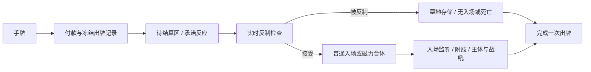

# M5-13d-02c-01：整次随从出牌反制

本批扩展公共出牌窗口，版本prototype-v76/core-effects-v76、snapshot75、观察player-view-v45、命令7，代表包39。已通过43项专项与3874项全量验证，结果以[项目状态](project-status.md)为准。该原批仅建立13d-02c共同窗口；后续奥卡尼的秘密选择与载体存续已由[独立反制政策](m5-counter-policies.md)实现。真实战吼抑制来源、13d-03历史重演和完整源卡覆盖按各自契约与最新台账维护，不能从本窗口或本批旧数字推定整族完成。

## 执行契约

手动随从先完成合法性检查、费用支付与冻结PlayRecord，随后离开手牌进入Zone.PLAY（玩家pending_plays），打开kind=minion的ActionWindow。该区不属于手牌、战场或墓地，不触发召唤、死亡、亡语、复生、尸体或星舰组件积累。双方观察可见承诺的随从牌面，内部窗口/附件/历史ID不公开。

card_committed反应先结算；MinionCounterPhase设置counter_phase并发送minion_counter_check，奥秘按既有顺序逐一重新判断。CounterCard支持手动法术和随从窗口，CounterSpell与CounterMinion是限制类型的公共效果；过时、类型不符或已经被反制的窗口不产生第二次结果。异议使用后者，通过实时条件保证一个随从不会消耗多份反制。

ResolveMinionPlay关闭窗口：被反制的实体进入墓地存储，不产生死亡记录；成功的磁力分支在此时才合体；其余随从按原位置入场，再处理巨型附肢、通用主体与独立战吼。PlayRecord.minion_result区分summoned/magnetized/countered/board_full；它记录这次出牌的结果，不由实体之后的区域反推。

成功普通入场与磁力合体发送minion_play_accepted，并携带原PlayRecord。依赖已存在实体的被动监听（如无限祝福）改在此时捕获受益者；承诺监听保持用于支付后、入场前的条件。入场事件与反制检查均为宿主调度事实，不额外暴露内部ID。54项被动技能回归保持原行为断言，终局、替换、转控、复制和磁力仍走来源守卫。

磁力目标在承诺时冻结。检查时目标仍合格才合体；目标已消失则尝试普通入场。如果承诺反应填满战场，支付保留、实体进入墓地存储、记board_full，没有主体或战吼；不伪造反制或死亡。它们均为R-116待校准的异常组合，不代表完整官方时序。

普通出牌完成仍调用一次FinishPlay。已承诺出牌保留在现有played_cards查询、连击和观察计数内，事件订阅者可通过countered筛选；这不代表每个正式“使用后”效果都应触发，具体来源必须明确条件。微缩/巨化不从被反制或入场失败的主体生成；回响仍在承诺时生成临时副本。普通回溯遇到反制/入场失败不提供重试，保留结果也不伪造实际战吼。

## 战吼与恢复边界

v75及以前的普通随从在card_committed反应前已入场并捕获战吼；本批纠正这一执行位置。普通随从现在通过反制并入场后才捕获战吼计划，故承诺反应中新授予或移除的战吼政策会影响当前被接受的主体。被反制、入场失败或入场前终局不消费有限政策；一旦捕获，后续入场反应不追溯改写计划。巨型仍在附肢后捕获，法术/武器/英雄的已有入口保持各自契约。

旧的“入场后杀死/沉默/转控/变形/回手仍执行已捕获战吼”测试改订阅minion_summoned，保留行为断言；普通承诺反应不应能对尚未入场的实体施放战场操作。新增专项分别测试承诺前后政策、原身份、取消整次入场及无伪造激活。

待选时保存pending_plays、窗口阶段、反制标志和类型化继续步骤；状态校验要求待结算区与窗口一一对应，窗口与未完成PlayRecord一致，帧中的阶段标记类型/数量/顺序匹配，不能跳过反制直接FinishPlay。失败事务回滚费用、秘密揭示、区域、政策与随机状态；待选后的失败只回滚到已提交的待选边界。终局清理待结算区和窗口，把未完成出牌标为interrupted。

## 证据与未完成范围

冻结本地MAW_006中英文卡文说明反制对手打出的随从；[25.4官方补丁说明](https://news.blizzard.com/en-gb/article/23913671/25-4-patch-notes)明确修复奥卡尼和异议同时消耗于同一随从的问题；[36.4官方补丁说明](https://news.blizzard.com/en-gb/article/24293283/36-4-patch-notes)明确修复异议抢在Double Cross之前结算的问题。这支持实时复核及区分承诺/反制阶段，但没有证明本原型全部细节符合国服。

R-116：随从承诺/入场的通用反应顺序、所有出牌后条件、费用/过载、磁力目标失效、满场、微缩/回响、回溯、战吼有限政策与终局组合仍需集中国服校准。未接入Double Cross，不宣称已完成该卡；奥卡尼不能借用公开抉择泄漏私选，其载体生命周期作为13d-02c-02继续实现。没有依据的“禁止战吼”开关不作为真实机制实现。

代码：[公共窗口](../hs_sim/engine/minion_plays.py)、[反制效果](../hs_sim/engine/interrupts.py)、[专项](../tests/test_m5_minion_counters.py)、[代表组合](../examples/minion_counter_windows.py)。

本批审查另修正磁力的入场能力排除表：显式battlecry与通用on_play同样不转移给宿主。专项验证宿主不会获得磁力材料的战吼，且回手重打不会凭空激活它。原有身材/亡语/关键词等合体贡献仍按原生命周期处理。

最终验证：43专项（3.723秒）、3874全量（552.867秒）、59示例和36台账检查通过。代表组合8动作39事件、1次反制/2次战吼/1批次，保存恢复和回放一致，摘要`4ee0c8f6b627962606f984d7752779089fe679b5dbb85dd9935512ee83691b5e`。见[全量日志](../outputs/v76-full-tests.txt)与[示例比较](../outputs/v76-example-count-check.json)。
