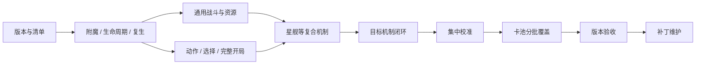

# 传统炉石对战模拟器：长期实施计划

计划版本：2.01　制定日期：2026-09-23　当前阶段按2026-10-09用户新目标执行

本文是项目目标、阶段依赖和开发优先级的主要依据。执行进度、下一项任务与已知差异维护在 [项目状态](project-status.md)；已落地的实现契约见 [架构文档](architecture.md)，扩展用法见 [扩展指南](extensions.md)。用户后续明确指示优先于本文，改变方向时同步更新相关记录。

## 1. 最终目标与范围

制作一个无需动画、无需启动官方客户端，能够独立执行**最新正式版本传统炉石构筑对战**的模拟器。支持合法操作生成、完整对局、机制组合、可复现随机、快照、回放，以及供后续分析或 AI 使用的接口。

本计划将用户所说的“经典对战”解释为传统双人构筑玩法，不限定为历史上的 Classic 模式。用户已确认以**国服**为最终规则验收地区。首个完整交付范围是锁定补丁的**标准模式**，最终覆盖同一当前补丁下的**标准与狂野**。狂野卡牌采用目标补丁的有效版本，不意味着复刻每张牌的所有历史版本。

### 1.1 必须覆盖

- 从卡组合法性、先后手、起始手牌、换牌和硬币，到正常回合、选择流程、结束对局的完整生命周期。
- 目标卡池所需的全部卡牌类型、职业资源、关键词、非关键词规则和卡牌特殊效果。
- 可收藏卡牌，以及对局中可达的衍生物、生成卡、升级形态、英雄/技能、附魔和动态组合状态。
- 与目标补丁匹配的构筑限制、禁限、轮换、随机生成与发现候选池。
- 全知引擎状态与玩家可见信息分离；代码不能因为模拟器知道对方手牌而泄漏给行动方。
- 明确标识支持范围、未实现内容、原型假设和已知规则差异。
- 每次更新都能判断新补丁改变了什么、哪些模块和测试受影响，以及何时可以宣布支持。

### 1.2 不作为本主线的完成条件

动画、音效、完整客户端界面、账号/联网匹配、操控官方客户端、商店和收藏经济；酒馆战棋、佣兵、冒险专属规则；竞技场选牌系统、乱斗专属规则和幻变轮换规则。后面这些模式可另建规则包，不能无记录地挤占构筑主线。竞技场若复用普通战斗内核，也不等于本项目已经实现它的选牌和卡池规则。

高强度 AI、训练平台和大规模搜索优化是后续消费者；首版只需可调用接口和演示策略。先保证规则表达与正确性，再依据基准优化吞吐。

## 2. “最新版本”的定义

“持续跟上最新正式版本”是长期目标；每轮实际交付必须绑定一个**固定、可复现的目标版本**。线上更新不能让正在实施的验收标准无声变化。

### 2.1 每个目标版本必须登记

| 字段 | 要求 |
| --- | --- |
| 目标标识 | 补丁号、地区/服务器规则范围、规则生效时间及核查日期 |
| 客户端来源 | 游戏构建号、关键文件指纹、提取器版本；Unity 引擎版本不能代替游戏版本 |
| 热修集合 | 服务端及客户端相关热修列表，生效时间、来源与受影响机制 |
| 卡牌数据 | 数据快照哈希、有效卡牌版本、标准/狂野合法性清单 |
| 执行语义 | 内核规则版本、卡牌实现包版本、生成池版本 |
| 可复现环境 | 回放/快照 schema、随机算法版本、Python 运行版本 |
| 覆盖声明 | 支持的模式、完整/受限/未支持范围、证据及已知差异 |

这些字段初期维护在项目状态中，M0 将设计可机器读取的目标清单；字段未确认必须写“待确认”，不可猜填。读取数据库成功、拥有最新安装文件、看到新卡预告，均不能单独证明支持最新玩法。

### 2.2 本次规划的版本核查

2026-09-23 核查到：官方 **36.6** 公告发布于 2026-09-15，包含构筑模式修复，并说明 **36.6.1** 的酒馆内容于 9 月 22 日上线。本项目据此将 **36.6.x** 作为首次目标清单的核查起点；精确地区、构建号和构筑热修集合仍需 M0 锁定，当前原型没有获得该版本的支持认证。[官方 36.6 公告](https://hearthstone.blizzard.com/en-us/news/24294373)

本地提取清单已有文件哈希，但其 `client_executable_version` 当前显示 Unity 格式版本，不能把它用作炉石补丁号。正式目标清单应纠正这一来源区分。

已公布但尚未正式上线的资料片只进入候选任务。例如上述公告中的后续资料片预告不自动进入当前已上线卡池；提前赠送且已可用的牌则需依据实际可用性单独登记。新职业、新关键词和预告内容也遵循此原则。

## 3. 计划制定时的起点

以下保留计划制定时 `prototype-v1` 的审计基线，不是后续代码的实时状态。当前实现与实际测试结果见 [项目状态](project-status.md)。原型不是任何正式补丁的完整实现。

- 已有状态/操作/效果/事件分层、事务回滚、固定随机、快照、分叉、回放和 CLI。
- 已有基础出牌、攻击、回合、伤害/护甲/治疗、抽牌/疲劳、召唤/消灭、死亡批次、亡语、场上触发和攻击力光环。
- 已有嘲讽、圣盾、冲锋、突袭、风怒、剧毒、免疫的基础子集。
- 2026-09-23 最近一次完整测试为 75 项通过，包含旧数据工具测试；这不是 75 种机制，也不是官方一致性证明。
- 当前增益主要是扁平数值，能力主要从静态卡牌定义读取；缺少通用附魔、动态能力和完整生命周期语义。
- 当前只能从场景开始，只有出牌/攻击/结束回合动作；结算中不能暂停等待选择。
- 当前场景与演示主要使用合成测试定义，真实卡池执行覆盖率尚未建立，不能用提取记录数当作分母。

## 4. 固定开发原则

1. **先补齐各类公共机制，每阶段仅接入验证所需的少量代表卡。** 这是用户在 2026-09-24 再次明确的主线。卡牌通常以声明和公共效果组合实现；遇到现有能力无法表达的特殊规则，补入机制缺口，不许把所有特殊卡都预先假定为参数组合。大规模卡池接入安排在机制基本齐全及集中校准之后。
2. **复生先于星舰。** 复生用于检验实体生命周期；星舰依赖动态能力、长期建造状态和额外主动操作。
3. **集中官方时序校准后置，但结算阶段和自身测试从现在就维护。** 暂定规则登记为假设；已知错误不因“以后再校准”而故意保留。缺少边界证据时可以先保留明确的原型契约。
4. 玩家操作、效果指令、已发生事件保持分离；卡牌代码只组合效果和声明条件，公共死亡检查、资源支付、区域迁移等由内核处理。
5. 机制内部状态、未完成选择、动态能力与候选池版本必须进入可序列化状态，不能藏在可变回调闭包中。
6. 未实现内容必须明确拒绝。不能让未知牌默认为白板，也不能为运行演示悄悄删去随机候选中的未实现卡。
7. 优先级按依赖和验证价值决定。完成几十张功能重复的卡，不应优先于解决阻塞许多卡的共用能力。 新机制或组合必须先证明真实卡/可达衍生物需求、合法效果组合的具体过程，或已确认公共缺陷，并说明现有模块不能表达的点。注册表拒绝某形状、缺少某接口或自造测试卡不构成必做规则依据；合成卡仍可用于验证已证明需要的公共能力。无依据组合不进入主线或目标机制分母；用户明确要求撤下的抉择专用扩展从运行时代码和专项测试移除，见[反向审计](mechanism-combination-audit.md)。 用户2026-10-09明确：给手牌追加新战吼/连击等无明确必要性的特殊授予和组合先不处理，后续实现具体真实卡牌时按需判断。当前集中完善基础机制和已明确需要的公共能力，不以穷举组合、提前造通用接口或持续调查这些可选组合阻塞主线。真实卡接入时先尝试组合现有模块；确实无法表达才补所需公共能力和受影响测试，不预先扩大到所有载体/目标/来源。已确认会阻塞基础机制或必要代表的公共缺陷仍按依赖处理；后续按卡补充不影响最终完整支持目标。
8. 演示操作上限、工程结算预算与官方回合/连锁规则分别建模。工程预算耗尽应报错或标记中止，不能冒充官方平局或判负。
9. **按可验证行为衡量机制进度。** 当前基础阶段分别检查单个机制的行为、适用生命周期、选择/恢复/回放、玩家信息和官方证据；不适用项说明理由。跨机制组合后置到具体真实卡需要时处理，不作为单个基础机制的退出条件。测试数量、代表卡数量及模块数量不能替代这些验收门槛。
10. 卡池与版本调查用于发现缺失机制、区分标准/狂野依赖和确认证据。正式池分母尚未确定时继续推进版本无关的公共机制；同时保留“目标机制尚未穷尽”的标记，不能凭标签盘点宣称全部完成。
11. **2026-10-09当前目标只补独立基础机制，不开发组合机制。** 先对照代码核实真实缺口，避免依照旧清单重复实现；不穷举“抉择＋某机制”、任意授予或更多载体/来源。仅接必要代表，验证本机制自身的完整路径和实际受影响行为。跨机制组合、特殊牌需求和批量接卡后置；已经实现的普通能力继续保留。单个机制依赖既有支付、死亡、区域等内核能力不等于另立一个组合机制。集中国服校准仍放在M6。
12. **开发增量以专项和受影响测试推进，阶段全量同一时间只有一个批次。** 用户2026-10-08明确要求减少全量频率，提高机制开发效率。每次修改先说明影响关系并运行必要测试，覆盖公共语义变化实际影响的事务、支付、生命周期、选择恢复、回放和信息边界；通过后继续机制开发，如实登记为限定内部验证，不把每个小增量升级为完整阶段验收。阶段整体/发布验收集中完成全量，不以反复全量阻塞开发。批次内可按独立模块分进程，保留模块/类级初始化并核对方法无漏重；结果只有在实际依赖不变且完整成功时复用，独立测试修正重跑受影响模块。及时停止已失败或被替代的旧批次并保留原输入、日志和未验收状态；方法清单保留不能代替实际运行通过。

机制优先的执行顺序与具体退出条件见 [机制工作清单](mechanism-backlog.md)。本次优化不以增加卡牌数量为近期目标；源码重构和性能优化由已发现的维护问题或测量结果驱动。

## 5. 阶段总览与依赖

阶段编号表示交付顺序，卡牌清单调查、证据整理和代表卡验证可以并行。每阶段按验收标准完成，不能仅因代码已存在就勾选完成。

| 阶段 | 交付物 | 前置 | 状态 |
| --- | --- | --- | --- |
| M0 | 目标版本清单、机制/卡牌盘点和覆盖口径 | 现有原型 | 最小清单已建立；热修和完整卡池待核实 |
| M1 | 附魔、动态能力、实体生命周期、复生及代表卡 | M0 的初始清单 | prototype-v2 基础实现；验收见状态台账 |
| M2 | 通用战斗、费用/职业资源、武器与英雄技能 | M1 | 通用原型机制已内部验收；特殊规则/正式常量与官方校准仍待 M0/M5/M6 |
| M3 | 完整开局、扩展操作、挂起选择、信息视图和生成池 | M1；完整对局验收依赖 M2 | 选择、普通构筑/开局、信息视图与受限动作内部验收通过；静态生成池及区域操作内部验收通过；继续扩展主动操作及跨层对局验收 |
| M4 | 星舰等复合实体、长期进度与组合机制 | M1–M3 | 星舰基础、发射减费/部分真实效果、协议、铁鸦完整候选与地标/星港已内部验收；英雄牌/雷诺发射历史已内部验收；一般休眠与泰坦能力已内部验收，任务/任务线、持续目标/咒符与玩家长期效果已内部验收，奥秘/打断窗口也已内部验收，进入 M5 依赖盘点 |
| M5 | 目标版本其余机制闭环和交互测试 | M2–M4 | M5-01 初始盘点、出牌史、连击/流放内部验收；M5-02 法术迸发/暴怒与有限次触发已内部验收，M5-03 存储升级、手牌进度/腐蚀/注能已内部验收，M5-04 额外出牌条件已内部验收，M5-05 磁力已内部验收，M5-06 巨型已内部验收，M5-07a 兆示基础已内部验收，M5-07b-01 相邻光环/生成费用及三职业代表已内部验收，M5-07b-02 术士相邻牺牲已内部验收，M5-07b-03a 死亡之翼/奥卓克希昂已内部验收，M5-07b-03b-01 古加尔牌库销毁已内部验收，M5-07b-03b-02 关键词光环/艾萨拉已内部验收，M5-07b-03b-03 奥拉基尔已内部验收，M5-07b-03b-04 希奈丝特拉已内部验收，M5-07b-03b-05 奥妮克希亚已内部验收，M5-07c 兆示组合收尾与 M5-08 裂变普通法术公共子集已内部验收；M5-09a 印刷回响与临时手牌已内部验收；M5-09b/c 双生法术与微缩/巨化已有 44 项内部测试；M5-09d 动态回响/手牌关键词光环已有 55 项内部测试；M5-10a 招募/死亡历史复活已有 62 项内部测试；M5-10b 自动施法与独立历史已有 54 项内部测试；M5-10c 抽到时施放与抽取链已有 60 项内部测试；M5-10d 历史重施/历史发现与池内批量施法已有 68 项内部测试；M5-11a 回溯检查点通过 58 项专项；M5-11b 次数卡面与生命周期通过 45 项专项；M5-11c 保留多结果通过 55 项专项；M5-12a 探底通过 51 项专项；M5-12b-01 发掘进度与奖励循环通过 57 项专项；M5-12b-02a 死亡费用筛选与复活续接通过 51 项专项；M5-12b-02b 特殊生成与连续发现召唤通过 48 项专项；M5-12b-02c 跨区域增益与变形通过 55 项专项；M5-12b-02d 英雄生命转移与上限变化通过 48 项专项；M5-12c-01 灌注累计与技能成长通过 58 项专项；M5-12c-02a 技能激活来源与独立历史通过 50 项专项；M5-12c-02b 英雄技能回溯与结果保留通过 51 项专项；M5-12c-03a 被动技能与首张匹配通过 54 项专项；M5-12c-03b 随机手牌增益与定向变形通过 57 项专项；M5-12c-03c 传送门来源与成长捕获通过 55 项专项；M5-12c-03d 支付能力候选、分组选择与临时交付通过 60 项专项；多技能组合已内部验收，当前执行位置见 [项目状态](project-status.md) |
| M6 | 集中官方时序与语义校准 | 拟发布范围机制基本齐全 | 待实施 |
| M7 | 分批接入标准、狂野真实卡池及可达内容 | 对应机制已实现并通过 M6 | 待实施 |
| M8 | 完整交付验收、覆盖报告、性能基线 | 对应模式 M7 完成 | 待实施 |
| M9 | 补丁、热修、轮换和新资料片的持续维护 | 首个模式正式交付后持续执行 | 持续阶段 |



优先建立标准模式的完整支持，再扩大当前补丁下的狂野支持。M5–M8 可分别为标准和狂野执行一轮；不必等待所有狂野专属机制才交付标准，但不能因此把狂野从最终目标中删去。扩卡时发现新共用机制，返回相应机制阶段补齐并校准，再继续该批卡牌。

## 6. 各阶段实施与验收

### M0：冻结目标并建立覆盖台账

工作：核实补丁/地区/热修、区分已上线与预加载内容；盘点目标卡牌及其依赖，登记机制、卡牌类型、生成池、资源及特殊规则；将规则争议关联到证据和待办。确定运行时版本清单与支持矩阵的字段和生成方式。

覆盖盘点既从关键词入手，也检查没有关键词的卡牌文本与已知行为。数据库标签只帮助发现候选能力，不自动生成可执行规则。

验收：

- 每个候选内容可以归入目标内、目标外或待核实，原因可追溯；待核实不算已支持。
- 所有已识别机制均有 ID、前置依赖、实现/验证状态与负责阶段。
- 至少选定一批覆盖不同机制的真实代表卡，并锁定具体版本。数量建议约 10–20 张，优先考虑覆盖价值。
- 建立目标版本清单；来源无法确认的字段形成显式阻塞项，同时不妨碍版本无关的 M1 底座开发。

### M1：附魔、动态能力、生命周期与复生

工作：

- 将数值修改扩展为有 ID、来源、获得顺序、持续时间、作用区域和移除条件的附魔记录。先支持普通增益、临时增益和能力授予，预留设值/交换/翻倍策略；不提前假定所有附魔共用一种排序。
- 区分印刷能力和实体当前能力实例，支持附加多个亡语/触发/光环，记录一次性能力的使用状态、禁用和移除。沉默统一作用于相应实例。
- 明确移动、回手、洗入牌库、复制、变形、控制权转移和重新召唤的保留/重置规则。建立生命周期语义表，未知项标记证据缺口。
- 在死亡移出前保留不可变记录：实体和来源身份、控制者、位置、属性、有效能力、死亡批次。分别保存原始与派生状态，避免离场后光环消失导致信息丢失。
- 基于这些原语实现复生的能力消耗、创建实体、生命设置、召唤位置与满场处理。复生和亡语进入可配置的死亡反应阶段。
- 接入少量增益、沉默、回手、亡语和复生代表卡；边界组合继续使用合成卡。

复生的基础定义参考 [官方说明](https://news.blizzard.com/en-us/article/23076826/hearthstone-update-august-1-saviors-of-uldum)；复制、沉默、光环和死亡阶段等细节另建用例，不能仅由这一简短定义推断。

验收：

- 增益叠加、到期、沉默、离场与重新入场不会残留错误属性或能力。
- 复生与亡语、圣盾、光环、满场、沉默、复制的组合按已记录契约运行；一次性状态不会错误继承。
- 新状态在克隆、快照、回放中完整保留；任何中途失败均不污染原局面或 RNG。
- 通用结算层无需按具体卡牌 ID 写复生或沉默特判。

### M2：战斗、费用与职业资源

工作：完善伤害类别、修正、防止、替换、重定向、治疗转换及批次语义；补齐法术伤害、吸血、冻结/解冻、潜行等通用能力。完善生命光环、临时攻击、属性设值和攻击限制。

加入武器装备/替换/耐久、英雄攻击与英雄技能/技能替换/使用次数。统一费用计算和支付，覆盖临时法力、上限改变、过载/锁定及目标版本所需的非普通法力资源。将尸体等对局资源与符文等构筑限制分别放到正确层。

本阶段同时交付基本 `UseHeroPower` 动作、编解码、合法枚举和回放，确保技能通过公开操作可用；M3 再推广到更多主动能力及挂起选择。目标选择也要从当前“活体角色”限制扩展为显式对象类别和区域条件，支持合法的非角色目标、可选目标及无合法目标时的出牌规则；具体卡牌的目标语义依据版本清单实现。

验收：

- 合法操作枚举与执行使用同一费用、目标和攻击规则。
- 支付失败没有副作用，替代费用与费用修正不只写进卡牌文本。
- 武器消耗、英雄替换、技能重置、回合状态清理有完整场景验证。
- 伤害、防止、治疗、生命光环与死亡检查交互有独立测试。
- 当前 `max_mana=10`、`max_turns=200` 等仅是原型设置；正式版本数值和变更方式必须从目标规则核对，不能直接沿用为官方常量。

### M3：完整对局、选择、信息与生成池

工作：加入构筑合法性、初始洗牌、先后手、换牌及开局效果；定义数据驱动的职业、种族、法术派系、牌组限制和相关元数据。补齐牌库/手牌的检索、弃牌、加入、洗入、排序、复制及生成操作。

在 M2 已有基本英雄技能操作的基础上扩展玩家操作入口，使额外主动能力、交易/锻造和选择提交共用校验与枚举。增加可序列化结算帧、`PendingChoice`、选择玩家、稳定选项 ID 和恢复点，用于发现、效果中选择、多目标或分段选目标等流程；出牌前抉择由动作分支声明负责。运行中的 Python 回调不是可序列化恢复点。

这里需要升级事务契约：**等待玩家选择可以成为明确的提交边界**，保存挂起帧；处理器正在执行时仍禁止快照。非法选择不得改变已提交帧、选项或 RNG。新快照 schema 与旧原型版本明确区分。

增加玩家观察投影和日志过滤；建立版本化的发现/随机生成候选池。构筑合法池与生成池独立配置，不能认为“不可加入卡组”就“绝不能被生成”。

验收：

- 可从合法卡组运行到终局；错误卡组在对局开始前得到明确原因。
- 嵌套或连续选择可挂起、恢复、存档、分叉与回放；候选与随机结果不会在恢复时重抽。
- 正在等待选择时只允许适当行动方提交合法选择，其他动作明确拒绝。
- 对手观察和普通玩家日志不泄漏手牌身份、牌库顺序、隐藏选择或 RNG 状态。
- 候选池过滤有版本、模式和排除条件用例；未实现候选不能被偷偷过滤来冒充完整支持。

M3 通用原型现已完成交易/锻造的动作、费用、玩家指令与跨层实验对局验收，契约见 [额外手牌操作](m3-hand-actions.md)。正式完整池与特殊构筑仍保持联合验收门槛，实际批次状态以项目台账为准。

### M4：星舰及复合实体、跨回合机制

星舰作为首个重点复合机制：组件死亡贡献记录、建造状态、属性/能力累积、发射费用、发射动作和新星舰建造。发射后使用通用实体能力执行，不另写一套专属亡语/光环解释器。基础行为参考 [官方星舰介绍](https://hearthstone.blizzard.com/zh-tw/expansions-adventures/the-great-dark-beyond/)；占位、死亡属性取值、满场及特殊交互按目标版本单独核查。

M4-01a 星舰基础、M4-01b-01 专属减费与部分真实发射效果，以及 M4-01b-02 埃索达三个协议已通过内部验收，详见 [星舰契约](m4-starships.md) 和 [协议契约](m4-protocols.md)。M4-01b-03a 已补齐魔免、八种额外效果的原型候选、人族筛选、铁鸦与升空，详见 [额外效果契约](m4-bonus-effects.md)。M4-01b-03b 已完成地标通用类型、出牌/使用、共享场位、耐久/冷却、玩家接口与存档，并以星港及赤红深渊通过内部验收，见 [地标契约](m4-locations.md)。M4-01b-03c 已建立英雄牌出牌、护甲/英雄技能替换、当前职业和可序列化发射历史，并接入雷诺与强化剂，见 [英雄牌契约](m4-heroes-history.md)。M4-01b 的这些内部依赖门槛已完成，不代表完整星舰卡池或官方一致性。M4-02a 已完成一般休眠/唤醒、占位与生效资格、回合倒计时、唤醒行为、生命周期和玩家信息，并用四张真实代表卡内部验收，见 [休眠契约](m4-dormancy.md)。M4-02b 已建立有限次能力声明/实例、泰坦策略、使用次数/攻击限制、玩家接口及恢复/回放，以艾欧娜尔通过内部验收，见 [随从能力契约](m4-minion-abilities.md)。M4-03a 已建立任务/任务线/支线任务区域、长期进度计数、阶段推进/奖励、开局保证及恢复/回放，见 [任务契约](m4-quests.md)。M4-03b 已建立独立玩家效果、整局法伤/属性光环、重复持续目标/咒符与可恢复回合计时，见 [玩家效果契约](m4-player-effects.md)。M4-04 已接入奥秘注册、隐藏信息、共享区域检查与攻击/施法打断和替换窗口，见 [奥秘契约](m4-secrets.md)。M5-01 已建立初始依赖清单和出牌历史/连击/流放，M5-02 法术迸发/暴怒与有限次触发已内部验收，M5-03 存储升级、手牌进度/腐蚀/注能已内部验收，M5-04 额外出牌条件已内部验收，M5-05 磁力已内部验收，M5-06 巨型已内部验收，M5-07a 兆示基础已内部验收，M5-07b-01 相邻光环/生成费用及三职业代表已内部验收，M5-07b-02 术士相邻牺牲已内部验收，M5-07b-03a 死亡之翼/奥卓克希昂已内部验收，M5-07b-03b-01 古加尔牌库销毁已内部验收，M5-07b-03b-02 关键词光环/艾萨拉已内部验收，M5-07b-03b-03 奥拉基尔已内部验收，M5-07b-03b-04 希奈丝特拉已内部验收，M5-07b-03b-05 奥妮克希亚已内部验收，M5-07c 兆示组合收尾与 M5-08 裂变普通法术公共子集已内部验收；M5-09a 印刷回响与临时手牌已内部验收；M5-09b/c 双生法术与微缩/巨化已有 44 项内部测试；M5-09d 动态回响/手牌关键词光环已有 55 项内部测试；M5-10a 招募/死亡历史复活已有 62 项内部测试；M5-10b 自动施法与独立历史已有 54 项内部测试；M5-10c 抽到时施放与抽取链已有 60 项内部测试；M5-10d 历史重施/历史发现与池内批量施法已有 68 项内部测试；M5-11a 回溯检查点通过 58 项专项；M5-11b 次数卡面与生命周期通过 45 项专项；M5-11c 保留多结果通过 55 项专项；M5-12a 探底通过 51 项专项；M5-12b-01 发掘进度与奖励循环通过 57 项专项；M5-12b-02a 死亡费用筛选与复活续接通过 51 项专项；M5-12b-02b 特殊生成与连续发现召唤通过 48 项专项；M5-12b-02c 跨区域增益与变形通过 55 项专项；M5-12b-02d 英雄生命转移与上限变化通过 48 项专项；M5-12c-01 灌注累计与技能成长通过 58 项专项；M5-12c-02a 技能激活来源与独立历史通过 50 项专项；M5-12c-02b 英雄技能回溯与结果保留通过 51 项专项；M5-12c-03a 被动技能与首张匹配通过 54 项专项；M5-12c-03b 随机手牌增益与定向变形通过 57 项专项；M5-12c-03c 传送门来源与成长捕获通过 55 项专项；M5-12c-03d 支付能力候选、分组选择与临时交付通过 60 项专项；多技能组合已内部验收，当前执行位置见 [项目状态](project-status.md)；地标特殊复制/转控/变形与自动激活仍需对应代表卡和契约，不因基础通过而清除待办。31.6 的战列巡航舰升级池属于酒馆战棋，已从构筑要求中移除；没有真实目标卡依据时不预设“直接添加组件”系统。集中官方校准仍在 M6。

地标和英雄牌入口作为上述星舰代表卡的前置提前实施；随后按目标清单完善休眠/唤醒、泰坦等有限次主动能力、特殊英雄替换、任务/任务线、持续目标和玩家长期效果。补齐奥秘注册、隐藏信息、匹配条件和打断/替换阶段，并以独立用例记录暂定时序。

验收：

- 星舰支持多组件、重复能力、组件增益/沉默、死亡批次、发射限制，以及发射后重新建造。
- 建造状态、进度、冷却和能力使用次数均进入快照、哈希和回放。
- 非普通随从对象具有明确的占位、可选中、攻击和受伤规则，不能简单塞入随从列表后假定规则相同。
- 主动操作能被合法枚举，不通过伪造手牌或隐式调用绕开费用和动作记录。
- 跨回合/隐藏机制能与 M1–M3 共用状态及效果系统。

### M5：补齐目标版本机制，形成可校准内核

用 M0 的清单逐项收口。代表性机制族包括：连击、流放等出牌条件；回合/整局历史计数；法术迸发等一次性触发；腐蚀、注能、灌注或升级形态；磁力等属性/能力组合；交易、锻造等替代行动；招募、复活、发现与随机生成；任务、奥秘、牌库污染及目标补丁新增机制。

M5-01 已建立 [初始 26 组、现扩展为 29 组的依赖清单](m5-inventory.md) 及 [出牌历史/连击/流放](m5-play-history.md)，通过内部验收。M5-02 [有限次触发、法术迸发与暴怒](m5-limited-triggers.md) 已通过内部验收。M5-03a [区域引用、存储增益与升级基础](m5-hand-upgrades.md) 已内部验收，锻造复用公共升级；M5-03b [手牌进度、腐蚀与注能](m5-hand-progress.md) 及七组真实形态已内部验收；M5-04 [压轴/法力渴求/快枪手与获取历史](m5-play-conditions.md) 已内部验收；M5-05 [磁力合体与附件归属](m5-magnetic.md) 已内部验收；M5-06 [巨型与独立附肢](m5-colossal.md) 已内部验收。依据国服“大地的裂变”上线证据，原候选标签 HERALD/SHATTER 拆为明确依赖：M5-07a 兆示基础已内部验收，M5-07b-01 相邻光环/生成费用及三职业代表已内部验收，M5-07b-02 术士相邻牺牲已内部验收，M5-07b-03a 死亡之翼/奥卓克希昂已内部验收，M5-07b-03b-01 古加尔牌库销毁已内部验收，M5-07b-03b-02 关键词光环/艾萨拉已内部验收，M5-07b-03b-03 奥拉基尔已内部验收，M5-07b-03b-04 希奈丝特拉已内部验收，M5-07b-03b-05 奥妮克希亚已内部验收，M5-07c 兆示组合收尾与 M5-08 裂变普通法术公共子集已内部验收；M5-09a 印刷回响与临时手牌已内部验收；M5-09b/c 双生法术与微缩/巨化已有 44 项内部测试；M5-09d 动态回响/手牌关键词光环已有 55 项内部测试；M5-10a 招募/死亡历史复活已有 62 项内部测试；M5-10b 自动施法与独立历史已有 54 项内部测试；M5-10c 抽到时施放与抽取链已有 60 项内部测试；M5-10d 历史重施/历史发现与池内批量施法已有 68 项内部测试；M5-11a 回溯检查点通过 58 项专项；M5-11b 次数卡面与生命周期通过 45 项专项；M5-11c 保留多结果通过 55 项专项；M5-12a 探底通过 51 项专项；M5-12b-01 发掘进度与奖励循环通过 57 项专项；M5-12b-02a 死亡费用筛选与复活续接通过 51 项专项；M5-12b-02b 特殊生成与连续发现召唤通过 48 项专项；M5-12b-02c 跨区域增益与变形通过 55 项专项；M5-12b-02d 英雄生命转移与上限变化通过 48 项专项；M5-12c-01 灌注累计与技能成长通过 58 项专项；M5-12c-02a 技能激活来源与独立历史通过 50 项专项；M5-12c-02b 英雄技能回溯与结果保留通过 51 项专项；M5-12c-03a 被动技能与首张匹配通过 54 项专项；M5-12c-03b 随机手牌增益与定向变形通过 57 项专项；M5-12c-03c 传送门来源与成长捕获通过 55 项专项；M5-12c-03d 支付能力候选、分组选择与临时交付通过 60 项专项；多技能组合已内部验收，当前执行位置见 [项目状态](project-status.md)。M5-07a [公共计数与捕获强化](m5-herald.md) 以及战士/恶魔猎手十二条代表已内部验收；M5-07 整体仍未完成。M5-08 裂变普通法术公共子集也已通过内部验收，具体卡族与 R-083 留待后续适配/校准。原回响/双生法术/微缩等待办保留；优先接续已有巨型与获取历史基础，覆盖目标版本已上线机制。

M5 全面收口仍须完善有来源、模式范围和前置依赖的缺口表，分别记录已实现的公共机制、缺失原语和单卡例外。后续历史与条件复用已有出牌记录，成功手牌获取已接入，继续补全抽牌尝试、施放和其他条件各自的取值时点，覆盖反制、选择恢复和回放。正式池仍未冻结时，盘点保留不完整标记，不能宣布目标机制全部收口。

这些名称只是盘点提示，不是穷尽清单，也不保证全部属于同一目标模式。没有关键词的特殊规则同样必须有实现位置与验证项。新增机制先映射到状态、原语和依赖，再接入代表卡。

验收：拟发布模式的机制依赖没有未分配项或已知无法表达的机制；每类能力至少有代表卡、关键边界和组合场景；严重问题与原型规则假设全部登记，足以进入集中校准。若仍缺底层能力，M5 保持未完成并返回对应阶段补齐；已完成部分可并行校准。明确只属于狂野的缺口可以不阻塞标准轮次，但须保留在狂野任务清单中。

### M6：集中校准真实时序与行为

对出牌各阶段、召唤、攻击宣告/伤害、替换与阻止、触发资格、事件快照与实时读取、同批死亡、亡语/复生、光环更新、英雄死亡、回合开始/结束及选择恢复点建立校准用例。

每个用例记录目标版本、起始局面、输入动作、可控随机结果、观察依据、期望关键事件/最终状态、当前差异与证据状态。优先用官方说明和可靠、可复现的对局记录；仅在资料不足时需要实际客户端实验。客户端日志通常只提供可观察结果，不能自动视为完整服务器执行栈。

模拟器固定种子只保证自身重现，不能假定与官方随机算法或种子一致。比对随机局面时使用可观测选择记录或受控随机接口，分清结果差异与随机分支不同。

验收：拟发布范围的核心时序无已知阻断偏差；所有有证据的校准用例通过；证据不足项单独列出，严重项阻止完整支持声明。修改结算策略时提升规则版本并检查代表卡回归。

### M7：规模化卡池接入

按目标模式、机制依赖和卡牌类型分批实现。先完成标准，再扩大狂野；每批包括根卡和其可达内容，既支持官方实体 ID，也保留当前实现版本信息。

定义“完成一张牌”：有效数据和目标筛选正确；效果可执行；衍生形态/生成内容依赖已处理；关键正反例和相关交互通过；随机、选择和回放可复现；已知限制已计入支持状态。纯数值牌可复用参数化机制测试，但仍须验证数据映射。

验收：每批交付覆盖报告和差异清单。遇到未支持生成结果、独特资源或新时序，回到相应机制阶段补齐，禁止靠单卡特判伪造通用支持。

### M8：范围明确的完整发布

分别验收“目标补丁标准完整支持”和“目标补丁狂野完整支持”。发布包包含目标清单、实现包、运行方式、覆盖报告、校准证据索引、已知差异和回放兼容说明。

最终门槛：

- 声明模式的合法根卡及可达内容无未处理定义、占位效果或运行时未实现分支。
- 完整开局到结束、关键交互、选择、隐藏信息、随机、克隆和回放验证通过。
- 没有范围内的阻断缺陷；未确认事项按影响评级，严重规则不确定性不能靠免责声明放行。
- 固定测试集中的官方证据对照通过；有限测试不等于数学证明所有组合与官方完全一致。
- 工程预算耗尽、输入非法、版本不匹配和真实胜负使用不同结果表示。
- 有可重复的性能基准，记录硬件、运行版本、场景和每动作/整局耗时及内存；先量化，再决定优化目标，不预先承诺虚假的吞吐。

### M9：持续版本维护

每次有新正式补丁、热修或轮换时执行：记录候选更新 → 冻结新目标 → 比较数据/规则/生成池/合法性差异 → 更新机制依赖 → 实现并测试最小切片 → 接入受影响卡牌 → 针对变化校准 → 全量回归和覆盖检查 → 发布新支持声明。

新补丁开发期间保留旧版本的精确支持标识。未完成新版本验证时，产品仍显示“支持至某版本”，不能自动改成“最新”。不因为热门新机制突然出现就丢弃已经确定的基础建设。

## 7. 建议的模块演进边界

以下是职责规划，不要求立刻创建全部目录或建立通用插件框架。可先放在少量清晰模块中，随实际复杂度拆分。

| 职责 | 规划边界 |
| --- | --- |
| 状态与定义 | 基础定义、运行实体、附魔/能力实例、死亡记录、玩家资源、进度和选择帧 |
| 操作与合法性 | 动作 schema、目标/支付/次数检查、合法操作枚举；保持执行与枚举规则一致 |
| 结算调度 | 阶段、工作帧、效果分发、触发资格、替换、死亡稳定化和终局 |
| 区域与生命周期 | 创建、迁移、复制、变形、重置、控制权与来源链 |
| 卡牌内容 | 按机制和版本组织的显式定义/行为；特殊效果也通过公共原语和扩展接口实现 |
| 格式与内容池 | 标准/狂野构筑、禁限、轮换、职业约束、发现/生成池 |
| 版本与证据 | 目标清单、热修、支持矩阵、兼容策略和校准用例 |
| 外部接口 | 全知调试、玩家观察、CLI/API、回放和未来 AI 适配 |

## 8. 验证体系与覆盖口径

### 8.1 两条独立状态轴

实现状态：`未开始 / 实现中 / 部分实现 / 实现完成`。

验证状态：`未验证 / 原型测试通过 / 有官方证据的对照通过 / 存在已知偏差`。

数据存在、代码存在、测试通过、规则校准分别记录，不能合并成一个模糊的“已支持”。项目状态中的表是初始摘要，M0 后用完整机器清单生成统计。

### 8.2 测试分层

| 层级 | 验证内容 |
| --- | --- |
| 数据与定义 | ID、版本、候选池、缺失引用、重复/冲突定义、模式合法性 |
| 原语 | 资源支付、伤害/治疗、区域迁移、附魔增减、能力实例化 |
| 机制交互 | 死亡×亡语×复生、光环×沉默、替换×护甲、选择×随机等关键组合 |
| 完整流程 | 开局、连续回合、多次选择、终局与真实代表卡对局 |
| 不变量与确定性 | 随机合法动作探索、失败回滚、状态隔离、快照/回放，失败样本可缩减并固化 |
| 官方对照 | 有版本和来源依据的规则事实、关键事件顺序和最终状态 |
| 发布回归 | 目标范围内容可达性、无未实现分支、已知阻断项、兼容与性能 |

交互矩阵优先覆盖共享状态和检查点的高风险组合，不承诺枚举所有卡牌排列。新增机制必须补充其交互边，不只测“单卡正常使用一次”。

### 8.3 卡池覆盖分母

根集合为目标模式可合法构筑的牌。递归加入其可能生成、召唤、发现、变形、升级和复制所需内容，以及有效候选池、英雄技能、附魔与动态组合规则，直到依赖闭合。

动态组合可能无法逐个枚举，须以组合模型及其可达基础能力证明覆盖，并测试代表及边界组合。候选池排除必须是目标规则事实；排除未知实现只是实验限制，不能计入完整覆盖。

至少分别报告：根卡执行覆盖、衍生内容覆盖、机制覆盖、生成池核验、官方证据对照、已知偏差数量。当前提取的 36,022 条混合记录不能用作传统构筑完整覆盖的分母。

## 9. 回放和旧版本策略

快照结构兼容与玩法语义兼容分开处理。正式发布版本的回放必须新增记录目标版本清单、规则/内容实现哈希、随机算法标识及 schema。当前原型只保存规则参数、定义/行为标识指纹、机制版本/效果类型签名、RNG 状态和 schema，尚无完整目标清单、实现代码哈希及 RNG 算法版本字段。初期可固定 Python 版本并保持现有 RNG；有跨版本复现需求时再引入明确版本的算法。

旧回放应使用原规则包执行。原规则包不可用时明确拒绝；迁移只能显式进行，并保留原始版本与迁移说明，不能用新规则静默重算并声称一致。最终目标要求支持当前版本，不要求保存全部历史服务器行为，但保留本项目已经发布的可复现版本很有价值。

## 10. 防止偏离方向的工作方式

每次继续开发：

1. 先读本计划和项目状态，确认目标版本、当前阶段、最靠前的未完成项。
2. 定义一个可验收增量，写清机制、前置、涉及模块和验证场景。发现缺前置时先补前置。
3. 实现最小完整链路：状态表示 → 操作/效果 → 结算 → 代表卡 → 回归 → 回放。
4. 运行与变更相关的专项和影响回归，覆盖实际受影响的公共语义边界；跨层变化的完整阶段验收集中安排全量，不在每个开发增量后重复执行。修复不相关失败需说明范围，未运行的检查明确登记。
5. 更新项目状态中的实现/验证状态、证据、已知问题和下一项。未完成部分不得因换任务而消失。
6. 用户改变范围或发现架构障碍时，更新优先级和决策记录，说明原因、影响阶段和退出条件。

原则上同时推进一个主要机制里程碑；独立的测试、证据调查和卡牌清单可以并行。无需对正常可逆实现反复请求审批；重要方向变化须留下可追溯说明。

不以新增代码行数、提取卡数或测试数量作为主要完成指标。UI、AI、自创玩法和重新反编译客户端只有在解决当前阶段明确问题时才进入工作范围。

### 每个任务的记录模板

```text
ID / 所属阶段 / 目标版本：
目标行为与不包含的范围：
前置机制与数据：
实现位置及受影响状态/schema：
代表卡、关键交互与失败场景：
规则依据 / 暂定假设 / 已知差异：
验收命令和实际结果：
实现状态 / 验证状态：
后续任务：
```

## 11. 紧接本计划的开发批次

以下保留制定计划时的首批顺序。当前已完成 M4 已列公共契约的内部验收并已推进到 M5-09a 印刷回响与临时手牌，一般休眠与唤醒已内部验收，泰坦能力也已内部验收，任务/任务线进度也已内部验收，持续目标与玩家长期效果也已内部验收，奥秘与打断窗口已内部验收，M5-01 初始依赖盘点、出牌历史/连击/流放已内部验收，M5-02 法术迸发/暴怒与有限次触发已内部验收，M5-03 存储升级、手牌进度/腐蚀/注能已内部验收，M5-04 额外出牌条件已内部验收，M5-05 磁力已内部验收，M5-06 巨型已内部验收，M5-07a 兆示基础已内部验收，M5-07b-01 相邻光环/生成费用及三职业代表已内部验收，M5-07b-02 术士相邻牺牲已内部验收，M5-07b-03a 死亡之翼/奥卓克希昂已内部验收，M5-07b-03b-01 古加尔牌库销毁已内部验收，M5-07b-03b-02 关键词光环/艾萨拉已内部验收，M5-07b-03b-03 奥拉基尔已内部验收，M5-07b-03b-04 希奈丝特拉已内部验收，M5-07b-03b-05 奥妮克希亚已内部验收，M5-07c 兆示组合收尾与 M5-08 裂变普通法术公共子集已内部验收；M5-09a 印刷回响与临时手牌已内部验收；M5-09b/c 双生法术与微缩/巨化已有 44 项内部测试；M5-09d 动态回响/手牌关键词光环已有 55 项内部测试；M5-10a 招募/死亡历史复活已有 62 项内部测试；M5-10b 自动施法与独立历史已有 54 项内部测试；M5-10c 抽到时施放与抽取链已有 60 项内部测试；M5-10d 历史重施/历史发现与池内批量施法已有 68 项内部测试；M5-11a 回溯检查点通过 58 项专项；M5-11b 次数卡面与生命周期通过 45 项专项；M5-11c 保留多结果通过 55 项专项；M5-12a 探底通过 51 项专项；M5-12b-01 发掘进度与奖励循环通过 57 项专项；M5-12b-02a 死亡费用筛选与复活续接通过 51 项专项；M5-12b-02b 特殊生成与连续发现召唤通过 48 项专项；M5-12b-02c 跨区域增益与变形通过 55 项专项；M5-12b-02d 英雄生命转移与上限变化通过 48 项专项；M5-12c-01 灌注累计与技能成长通过 58 项专项；M5-12c-02a 技能激活来源与独立历史通过 50 项专项；M5-12c-02b 英雄技能回溯与结果保留通过 51 项专项；M5-12c-03a 被动技能与首张匹配通过 54 项专项；M5-12c-03b 随机手牌增益与定向变形通过 57 项专项；M5-12c-03c 传送门来源与成长捕获通过 55 项专项；M5-12c-03d 支付能力候选、分组选择与临时交付通过 60 项专项；多技能组合已内部验收，当前执行位置见 [项目状态](project-status.md)；实时范围、验证和剩余缺口以 [项目状态](project-status.md) 为准。

1. M0-01：登记补丁、地区、构建来源和热修缺口；建立目标清单与覆盖字段。
2. M0-02：选定首批代表卡和复生相关交互清单，明确其版本。
3. M1-01：附魔实例与动态能力模型；迁移现有简单增益、触发和攻击光环。
4. M1-02：生命周期保留/重置契约与死亡前记录；补齐关键区域变换原语。
5. M1-03：沉默、能力授予/消耗与到期移除，验证状态和能力一致。
6. M1-04：实现复生，接入对应代表卡，验证与亡语、满场、光环等组合。
7. M1-05：完成回放/快照兼容处理和整个 M1 回归，更新支持矩阵后进入 M2。

工作量按里程碑评估。完成 M1 后，用实际实现与校准成本估计后续阶段；当前不承诺缺乏依据的“几天覆盖全部卡池”。

M5-07b 按公共依赖细分：b-01 [相邻光环与生成费用](m5-herald-extensions.md) 及三个职业代表已内部验收；b-02 术士相邻牺牲/条件增益；b-03 死亡之翼选择/奥卓克希昂减费及相关主体特殊效果。b-02 [相邻牺牲/条件增益](m5-sacrifice.md) 已内部验收，b-03a [有序选择/定向减费与死亡之翼](m5-deathwing.md) 已内部验收，b-03b-01 [古加尔牌库销毁与替换](m5-deck-destruction.md) 已内部验收，b-03b-02 [关键词光环与艾萨拉](m5-keyword-auras.md) 已内部验收；b-03b-03 [奥拉基尔动态生成](m5-alakir.md) 已内部验收；b-03b-04 [重复施放与希奈丝特拉](m5-spell-repeats.md) 已内部验收；b-03b-05 [生命损失替换与奥妮克希亚](m5-health-loss.md) 已内部验收；M5-07c 兆示组合收尾与 M5-08 裂变普通法术公共子集已内部验收；M5-09a 印刷回响与临时手牌已内部验收；M5-09b/c 双生法术与微缩/巨化已有 44 项内部测试；M5-09d 动态回响/手牌关键词光环已有 55 项内部测试；M5-10a 招募/死亡历史复活已有 62 项内部测试；M5-10b 自动施法与独立历史已有 54 项内部测试；M5-10c 抽到时施放与抽取链已有 60 项内部测试；M5-10d 历史重施/历史发现与池内批量施法已有 68 项内部测试；M5-11a 回溯检查点通过 58 项专项；M5-11b 次数卡面与生命周期通过 45 项专项；M5-11c 保留多结果通过 55 项专项；M5-12a 探底通过 51 项专项；M5-12b-01 发掘进度与奖励循环通过 57 项专项；M5-12b-02a 死亡费用筛选与复活续接通过 51 项专项；M5-12b-02b 特殊生成与连续发现召唤通过 48 项专项；M5-12b-02c 跨区域增益与变形通过 55 项专项；M5-12b-02d 英雄生命转移与上限变化通过 48 项专项；M5-12c-01 灌注累计与技能成长通过 58 项专项；M5-12c-02a 技能激活来源与独立历史通过 50 项专项；M5-12c-02b 英雄技能回溯与结果保留通过 51 项专项；M5-12c-03a 被动技能与首张匹配通过 54 项专项；M5-12c-03b 随机手牌增益与定向变形通过 57 项专项；M5-12c-03c 传送门来源与成长捕获通过 55 项专项；M5-12c-03d 支付能力候选、分组选择与临时交付通过 60 项专项；多技能组合已内部验收，当前执行位置见 [项目状态](project-status.md)；M5-07 不提前整体验收。

M5-07c 的普通来源收尾已通过 12 项组合验证，见 [收尾范围与保留缺口](m5-herald-integration.md)。M5-08 的普通法术裂变公共子集通过 36 项合成定义测试，见 [裂变契约](m5-shatter.md)。自动施法、特殊重复和生命设值的公共缺口仍明确保留在 M5；正式池归 M0、官方窗口归 M6、未适配内容归 M7，发现缺失原语应返回 M5。当前 M5-09a 印刷回响/临时手牌已内部验收，双生法术/微缩/巨化公共子集已有内部验收，动态回响/手牌关键词光环已内部验收，招募/死亡历史复活公共子集已内部验收，自动施法与独立历史公共子集已内部验收，抽到时施放与抽取链已有内部验收，历史重施/历史发现与池内批量施法已有内部验收，M5-11a 回溯检查点已内部验收，当前接续 M5-13d-02 战吼重复、目标策略与抑制，不宣称已有机制整族获得国服认证。

M5-12c 拆为 01 灌注累计/替换基础（58 项专项内部验收）、02 技能激活来源/独立历史/回溯、03 被动技能及职业能力公共依赖；另将额外英雄技能列为 M5-12d。12d-01 的第二技能位置与动作、12d-02/03 的定向生命周期和列明组合均已内部验收；见 [灌注契约及依据](m5-imbue.md)。不以部分技能适配代替整族完成。

M5-12c-02a 统一激活来源与独立历史（50 项专项）和 02b 技能回溯与结果保留（51 项专项）均已内部验收。多技能组合已内部验收，当前执行位置见 [项目状态](project-status.md)；额外技能位置仍归 12d，特殊间接来源继续登记 M5。见 [技能回溯契约](m5-power-rewind.md)。


M5-12c-03a 被动技能及首张匹配出牌通过 54 项专项；03b 手牌种族筛选/增益与定向费用档变形已通过 57 项专项；03c 传送门抽取与成长捕获通过 55 项专项；03d 支付能力候选与临时交付通过 60 项专项。八个灌注技能已有实验适配，特殊来源和额外技能的完整生命周期仍有缺口；见 [被动技能契约](m5-passive-powers.md)。

M5-12c-03b 复用区域、费用附件和变形内核，加入随机物理随从筛选、原子属性/费用修改、指定目标费用档变形；猎人/萨满为必要代表，见 [R-104 契约](m5-directed-modification.md)。

M5-12c-03c 复用物理洗入、抽到施放与玩家累计，补充按版本池执行且检查场位的单次召唤；圣骑士传送门为必要代表。八职业技能实验适配，额外位置和已列组合已内部验收，正式来源仍有缺口，见 [R-105 契约](m5-imbue-portals.md)。

M5-12c-03d 明确将支付能力筛选与完整出牌合法性分开，分组抽样和临时交付已有 60 项专项。月亮的祝福仅组合公共接口；八个已声明灌注技能均为实验适配，整族保持 partial。多技能组合已内部验收，当前执行位置见 [项目状态](project-status.md)，见 [R-106 契约](m5-pool-offers.md)。

M5-12d-01 多技能位置与玩家动作通过 42 项专项：新增额外实体集合和安装入口，统一操作/费用/次数/被动监听/玩家观察与恢复；真实卡包数量保持。多技能组合已内部验收，当前执行位置见 [项目状态](project-status.md)，数量及重复获得等国服策略仍待确认，见 [R-107 契约](m5-multiple-powers.md)。

M5-12d-02 定向技能生命周期通过 48 项专项：捕获引用、指定替换/移除/刷新/次数/间接激活、安装费用及英雄替换策略。多技能组合已内部验收，当前执行位置见 [项目状态](project-status.md)；数量、重复获得和正式来源策略仍待证据，见 [R-108 契约](m5-power-lifecycle.md)。

M5-12d-03 的 37 项组合专项已内部通过，该批验收时运行时 v68 保持。多技能支付/回溯、来源替换、嵌套保留结果、终局与事务/信息边界见[验收记录](m5-power-combinations.md)。M5-13a-01 伤害与治疗结果条件已内部验收，下一项 **M5-13d-02c 真实抑制与整次出牌反制**；完整拆分与验收见[机制清单](mechanism-backlog.md)。

M5-13a-01 通过 49 项专项：不可变逐段结果、超杀/荣誉消灭/过量治疗共享条件、一次效果续接及组合恢复。仅增加三张必要代表，见 [结果契约](m5-health-outcomes.md)。科尔拉克的亡语暴露的死亡归因缺口已由 13a-02 补齐；不能把最终血量当作致死原因。

M5-13a-02 通过 52 项专项：冻结首次致死、来源和结果，处理救回/跨区/变形/复生，并让亡语查询事实。仅接入科尔拉克作必要代表；见 [契约与 R-110](m5-death-attribution.md)。下一项 **M5-13d-02c 真实抑制与整次出牌反制**，在已完成激励和抉择的基础上补齐战吼身份和调度。

M5-13b 通过55项专项：复用手动技能完成记录，不新增计数或队列，验证主/额外、间接、生命周期、选择、回溯与终局。仅接入低阶侍从和奥格瑞玛狼骑士；见[激励契约与R-111](m5-inspire.md)。下一项 **M5-13d-02c 真实抑制与整次出牌反制**，之后再完善战吼身份和重复调度。

M5-13c 通过62项专项：动作明确分支、分支目标合法性、冻结记录、显式合并主体、自动/重复/回溯和玩家边界；迁移滋养并增加三张必要代表，见[抉择契约与R-112](m5-choose-one.md)。长期/一次性合并能力及特殊根组合仍归M5；下一项 **M5-13d-02c 真实抑制与整次出牌反制**。

M5-13d-01：56项专项验证显式战吼身份、手动激活记录、普通/巨型与回溯累计结果、恢复和玩家边界；迁移44条已有代表，未新增卡牌。见[战吼契约与R-113](m5-battlecries.md)。下一项 **M5-13d-02c 真实抑制与整次出牌反制**；动态授予、间接/历史、长期/一次性规则仍留在M5，不能宣布整族完成。

M5-13d-02a：场上重复光环、冻结次数计划、独立批次/重复索引与回溯结果组合通过47项专项；新增铜须这一必要代表，见[契约](m5-battlecry-repeats.md)。下一项13d-02c真实抑制与整次出牌反制，随后真正抑制/反制与13d-03间接/历史来源；M0/M6/M7顺序保持。全量结果见项目状态。

M5-13d-02b：玩家有限次/本回合/长期次数政策通过55项专项，低语元素和维尔纳尔之心为两条必要代表；消费/到期、来源独立和回溯/星舰组合见[契约](m5-battlecry-modifiers.md)。下一项13d-02c真实抑制与整次出牌反制，随后13d-03间接/历史来源。实际全量结果见项目状态。

计划1.61补充：13d-02c按依赖推进共同反制窗口，再实现秘密选择与载体存续；当前事实见项目状态。本拆分保留整族验收范围，不将异议窗口视为奥卡尼或战吼抑制已完成。

计划1.62补充：13d-02c秘密载体机制以实例/窗口/信息隔离验收，下一项13d-02d先补战吼身份条件与双方费用光环，避免固定ID穷举；特殊历史来源仍按13d-03独立实施。此顺序不改变机制优先及M0/M6/M7门槛。

计划1.63补充：13d-02d统一能力条件及双方费用关系后，13d-02e将条件复用到跨区物理候选；动态主体授予先核实真实构筑来源，避免为数据引用标签或非构筑模式新增错误抽象。机制优先及M0/M6/M7门槛不变。

计划1.64补充：13d-02e将能力条件贯通物理/生成/历史候选后，13d-03a按已确认构筑来源补间接战吼及独立记录；02系列剩余动态授予/条件重复保留具体缺口，正式校准与批量接卡门槛不变。

计划1.65补充：13d-03a间接执行与成功激活历史先完成共享来源/恢复契约；13d-03b再以一个必要代表明确“使用过”的卡牌政策，不把实际激活次数直接等同出牌历史。M0/M6/M7门槛保持。

计划1.66补充：13d-03b将提交声明和实际激活拆开，卡牌历史政策显式登记R-121；13d-03c接续触发式首次历史重演组合验收，能复用现有原语时不另造接口。机制优先与M0/M6/M7门槛保持。

计划1.67：13d-03c先复用现有原语完成触发式首个战吼组合验证，不为代表卡另造引擎。随后13d-02f区分起始卡组事实与当前牌库条件，再组合永久次数政策；使用现有original_deck和deck_identity，未知局面起始事实不得猜填。细节见[前置审计](m5-deck-conditions-audit.md)，正式验收仍按M0/M6/M7门槛。

计划1.68：13d-02f复用构筑开局事实，区分起始卡组与当前牌库，条件分支作为通用可恢复效果。随后13d-03d-01明确历史序列的主体单位、筛选与规则上限；官方历史20次上限和工程步数预算分别建模，不能为通过测试混为一谈。见[前置审计](m5-bounded-battlecry-audit.md)，整族和M0/M6/M7门槛保持。

计划1.69：13d-03d-01补齐按历史战吼主体计数、身份筛选、独立抽样/执行顺序及恢复续接。下一项13d-03d-02核对具体来源政策，再作必要代表组合验收，不提前增加正式支持范围。动态授予、连击/种族重复及M0/M6/M7门槛保持。见[序列契约](m5-battlecry-sequences.md)。

计划1.70：13d-03d-02a先补历史归属与执行玩家分离、载体续接和控制者政策；这属于必要公共依赖，不把卡牌回调中的玩家替换当作完整机制。随后13d-03d-02b审计具体来源并作必要真实组合，见[来源契约](m5-sequence-lifecycle.md)。M0/M6/M7及其他机制退出门槛保持。

计划1.71：13d-03d-02b只接沙德沃克作为公共序列/来源组合代表，明确R-126暂定参数及历史窗口。之后转向13d-02g独立连击主体、重复与次数消费，先修复on_play条件分支不足以表达重复的结构，再接必要代表，见[审计](m5-combo-repetition-audit.md)。动态战吼/种族及M0/M6/M7退出门槛保持。

计划1.72：13d-02g-01明确独立连击声明与可恢复激活，并迁移既有特工/艾德温；纯法术条件分支保持原施法主体，R-127待校准。下一项02g-02按独立主体实现重复、范围与有限次消费，避免把整次出牌或普通回调一并重复。见[连击契约](m5-combo-activations.md)。M0/M6/M7门槛保持。

计划1.73：13d-02g-02完成独立连击次数、批次及玩家消费窗口；下一项13d-02g-03先补临时潜行等来源公共依赖，再接必要鲨鱼/彗星组合，见[审计](m5-combo-sources-audit.md)。已存在的关键词发现筛选直接复用；独立池与国服政策不由内部测试推定。M0/M6/M7门槛保持。

计划1.74：13d-02g-03a完成临时关键词的公共期限与生命周期，见[契约](m5-timed-keywords.md)。13d-02g-03b继续接必要鲨鱼之灵组合并冻结幸运彗星实验候选/来源政策。53专项、4511全量及72示例内部通过。转控/当前复制与失效阶段仍是R-129；不从机制可组合推定正式卡已完整适配，M0/M6/M7门槛保持。

计划1.75：13d-02g-03b用必要真实来源验证临时潜行、战吼/连击次数和独立发现池组合；38专项、4549全量及73示例内部通过，详见[契约](m5-combo-sources.md)。下一项13d-02h优先补玩家法术次数/消费/期限，依据风潮与泰兰德冻结资料；纳迦手牌历史、特定牌授予及戴欧斯多类重复保持独立依赖，见[审计](m5-spell-modifier-audit.md)。不为尚未确认构筑来源的动态主体或种族筛选先造任意开关，M0/M6/M7顺序保持。

计划1.76：13d-02h玩家法术次数/用途/期限57专项、4606全量及74示例内部通过。手牌提交收据与场上光环晚窗口分开、自动来源明确排除、回溯/恢复和公开投影进入公共契约，必要代表为风潮/泰兰德，见[实现](m5-spell-modifiers.md)。下一项13d-02i持牌期间施法历史条件，基于双弓积骇纳迦；特定实体授予和多类触发仍独立审计，M0/M6/M7保留。

计划1.77：13d-02i持牌施法条件54专项、4660全量及75示例内部通过。复用手牌进度，明确接受窗口、驻留/复制、冻结判定与历史来源，必要代表为双弓积骇纳迦，见[契约](m5-held-spells.md)。下一项13d-02j特定卡动态授予重复，先审计JAIL_123；混合触发、条件/种族范围、历史效果持牌战吼及M0/M6/M7保留。

计划1.78：13d-02j-01特定法术重复附件/使用捕获54专项、4714全量及76示例内部通过。复用附件身份与重复结算，物理绑定、生命周期和冻结收据进入公共契约；没有新增真实卡，见[实现](m5-card-spell-repeats.md)。下一项13d-02j-02生成时原子附加与发现交付，之后j-03来源实验池；JAIL_123国服上线与合法性未确认，混合触发、条件/种族范围、历史效果持牌战吼及M0/M6/M7保留。

计划1.79：13d-02j-02生成/发现原子附加50专项、4764全量及77示例内部通过，见[契约](m5-creation-repeats.md)。下一项j-03必要来源及实验池审计；JAIL_123可能预加载，不能以未知候选静默删减得到正式池。M0/M6/M7门槛保持。

计划1.80：13d-02j-03来源组合与候选审计39专项、4803全量及78示例内部通过，见[契约](m5-card-spell-sources.md)。保留436原始候选，不用可执行卡替代完整池；六项实验范围和四项必要适配只验证公共机制。下一项02k-01亡语激活身份与来源记录，逐步补混合触发；M0/M6/M7门槛保持。

计划1.81：亡语身份与来源54专项、4857全量及79示例内部通过。先保留回调捕获和死亡窗口，再基于独立激活增加重复计划；不把排队当作执行，不以DeathRecord伪造主动触发死亡。下一项02k-02亡语重复政策，见[契约](m5-deathrattle-activations.md)。M0/M6/M7门槛保持。

计划1.82：场上亡语次数与完整计划44专项、4901全量及80示例内部通过；R-137明确来源、合并和执行窗口。下一项02k-03玩家期限，再补固定次数/授予范围。只用男爵验证机制，正式池/国服校准/批量适配门槛保持。

计划1.83：玩家亡语次数与期限46专项、4947全量及81示例内部通过；R-138明确来源范围、owner计时及边界到期。下一项02k-04固定主动次数，再补自身/授予范围。机制优先、代表验证及M0/M6/M7门槛保持。

计划1.84：固定主动亡语次数46专项、4993全量及82示例内部通过；R-139明确两类次数、完整位置、接受窗口与目标范围。下一项02k-05自身/获得亡语范围，随后混合触发类别。机制优先、代表验证及M0/M6/M7门槛保持。

计划1.85：自身/获得亡语逐项计划40专项、5033全量及83示例内部通过。R-140登记自身自然冻结、能力来源分类、次数合并和代表范围。02l-01前置审计已完成，下一项02l-02技能主体身份与可恢复激活，随后回合结束重复、TIME_064混合声明。机制优先与M0/M6/M7门槛保持。

计划1.86：02l-02技能主体身份与可恢复激活已内部验收，70专项、505相关回归、5103全量及84示例内部通过；保留原窗口、一次支付/使用/根完成和激励，R-141待国服校准。下一项02l-03场上技能重复，其后回合结束身份/次数/期限和TIME_064混合声明。无新增次数机制或真实卡；机制优先及M0/M6/M7门槛保持。

计划1.87：02l-03场上英雄技能效果重复已内部验收，74专项、505相关回归、5177全量及85示例内部通过；R-142登记max来源、接受窗口、首次原窗/额外最新局面、一次根完成与共享保留计划。只新增伴唱机必要代表；下一项02l-04回合结束主体类别与身份，其后次数/期限与TIME_064混合。机制优先与M0/M6/M7门槛保持。

计划1.88：02l-04自然回合结束主体分类与身份已内部验收，83专项、620相关回归、5260全量及86示例内部通过；R-143登记显式自然资格、完整有序接受、旧窗口和诊断控制。无新真卡、无结束重复/主动API；下一项02l-05结束次数/期限，TIME_064混合后置，M0/M6/M7保留。

计划1.89：02l-05a自然结束重复公共机制已内部验收，83专项、887相关回归、5343全量及87示例内部通过；R-144登记每主体场上/玩家期限max计划、共享原守卫、额外新局面、旧混合位置与完整挂起证明。无新真卡；下一项02l-05b ICC_901/CATA_480必要代表，L05未整族完成，主动/异阶段/TIME_064混合与M0/M6/M7保留。

计划1.89补充：02l-05b仅接ICC_901/CATA_480必要代表，34专项、1176相关回归、5377全量及88示例内部通过；内核100/schema97保持，代表包61。R-145是本地代表profile，依赖未CN校准R-144；下一项05c主动/异阶段结束能力公共入口保留scope，TIME_064混合更后，完整L05及M0/M6/M7未完成。

计划1.90补充：02l-05c主动与异阶段结束能力公共入口已内部验收，91专项、1094相关回归、5468全量及89示例内部通过；五类载体scope与资格profile分离，真实cause、双父嵌套与完整proof，时钟隔离，内核101/schema98，无新真实适配。下一项05d主动producer主体资格/选择政策与必要CATA_472代表，固定多轮特殊来源及TIME_064混合保留；R-146未CN校准，L05/M0/M6/M7未完成。

计划1.91：公共纯结构候选查询与随机一次producer已内部验收。五类载体owner/selected范围、current/printed/active依据、休眠/存活/消费与presence政策由注册profile声明；不执行主体条件、每物理载体一个权重。随机选择与主体/完整max计划同窗接受，外层每次实际亡语各自抽选，内层额外结束执行保持原选择；空池保存空根且不消耗RNG。producer_mode、原request、完整有序候选、完整selected及MT19937前后状态进入历史与Finish证明；原窗口重算池/主体/计划、局部重演抽样，允许后续主体合法推动RNG，不提供未签名存档来源认证。仅新增CATA_472灵感之槌完整raw/pin实验适配，active/live/unconsumed友方随从及选中后的全部结束主体为R-147本地政策，待CN校准。内核102/schema99拒旧1～98，代表包62及303记录/304定义/14choice-only；观察51/命令7/replay1保持。旧302完整行、历史前审和M0/frozen inventories保持；L05/M0/M6/M7及长期目标未完成。05e四族混合重复声明、共享生命周期和独立接受窗口组合，必要TIME_064来源由公共机制表达；固定多轮producer政策继续保留M5，当前仅有战棋固定两轮证据，不能借此宣称构筑来源已完成。

02l-05d实际终态：81专项、1316相关回归、5549全量及90示例内部通过；专项23.619秒、相关588.131秒、全量1883.387秒。原生8动作/53事件/3随机根/4位置/4选择，真实Maul外层两次独立抽选；全部waiting恢复、回放及模块CLI通过，owner时钟[3,3]。旧86示例摘要共同行为字段保持；仅内部证据，R-147未CN校准。

### 2026-10-03 M5-13d-02l-05e 四族混合重复组合（内部验收）

四族混合重复公共组合已内部验收。同一载体四个独立附件共用生命周期，各族分别捕获自己的max计划、主体和执行身份，跨族不共享次数或用途；已接受计划保留，后接受根按新局面重新捕获。保留各族不同首次窗口、额外新局面、既有检查点/支付/用途/时钟；补齐战吼整次出牌接受收据、亡语单调分配计数及贯穿整批的原接受证明和重复来源身份校验，拒绝中途裁队列/缩次数和跨族附件ID冒充。选择恢复、回溯、异常回滚及玩家隔离复用公共解释器。仅新增TIME_064必要静态四声明，无自身战吼/亡语/结束主体；TIME_064e只作独立原始证据，没有可执行附魔适配。内核103/schema100拒绝旧1～99，观察51/命令7/replay1保持，代表包63，304完整记录/305定义/14choice-only。旧303完整行、历史前审与M0/frozen inventories保持。R-148为内部组合契约，依赖各族既有规则，未国服校准。下一项02m-01：条件/种族重复来源前审与公共匹配契约，先确定条件对象、印刷/当前依据和接受窗，再补必要机制；动态主体授予、固定多轮结束producer、特殊来源及M0正式池/M6国服校准/M7批量接卡继续保留，不能以本批归档宣称重复整族完成。

02l-05e实际终态：65公共专项、16代表专项、1611相关回归、5630全量及91示例内部通过；公共57.706秒、代表18.090秒、相关727.359秒、全量2009.161秒。旧87示例摘要共同行为字段保持，schema及摘要哈希变化另行登记；原生全部waiting恢复、独立注册表回放与模块CLI通过。仅内部证据，R-148未国服校准。

### 2026-10-03 M5-13d-02m-01-A1 法术学派公共匹配（内部验收）

M5-13d-02m-01-A1法术学派匹配及双窗口接受证明已内部验收。match与既有职业条件取交集，玩家提交与场上较晚窗口分别捕获全部匹配来源；单位/空/反制及FinishPlay后续接保持明确接受义务，嵌套真实出牌按有序帧义务关闭。完整状态仅存活动证明，历史保留紧凑收据；原提交目标绑定，较晚合法重定向保持。内核104/schema101/观察52，命令7/replay1及代表包63/304记录/305定义/14choice-only保持。本批未接代表卡，R-149未国服校准。下一项必要RLK_541 A2，再做持续条件/另一物理实体及逐族匹配；其他费用/主体/周期/+1/CAST轴与M0/M6/M7继续保留，不能宣称条件重复整族或最新正式池完整。

33专项、67信息/操作回归、892相关回归、5663全量及92示例内部通过；专项84.739秒、信息11.487秒、相关527.004秒、全量2274.395秒。原生合成6动作/37事件/6施法/2真实待选，max次数[3,1,2]、护甲8，waiting独立注册表恢复/clone/回放及模块CLI通过。88旧/89当前摘要的共同行为及字段保持；1129历史文件字节保留。较早schema99/core102的19新增字段及2控制清单经针对复核，前批迁移与A1变化分别登记。仅内部证据，R-149未国服校准。

完整合同见[法术学派与双窗口](m5-spell-match.md)，实际证据见[验收记录](../outputs/v108-verification.json)。

### 2026-10-04 M5-13d-02m-01-A2 必要法术学派代表

M5-13d-02m-01-A2必要RLK_541代表已内部验收。仅新增完整维萨鲁斯raw/PIN与奥术any总2的公共声明；旧304完整行、M0历史runtime及冻结inventories保持，公共内核没有新增分支。内核104/schema101/观察52/命令7/replay1不变，代表64及305记录/306定义/14choice-only。真实同职业奥术、非奥术/无学派、完整max来源、反制、离场、晚窗口、恢复/回放及玩家隔离已验证。R-150仍只覆盖真实付费手牌profile并依赖R-149，自动/effect/draw/history来源及CN/正式池未覆盖。下一项持续来源条件/另一实体B1，再做逐族匹配B2；其他费用/主体/周期/+1/CAST轴及M0/M6/M7继续保留。

合同见[必要代表验证](m5-spell-match-representatives.md)。

实际验收：[终态证据](../outputs/v109-verification.json)。15代表专项、770相关回归、5678全量及93示例内部通过；代表8.390秒、相关245.647秒、全量1177.607秒。原生10动作/49事件/7casts/2真实待选，次数[2,1,1,1,2]，每根仅支付一次；waiting独立注册表恢复/clone/回放与模块CLI一致。89旧/90当前摘要共同行为与字段保持，1265历史文件字节保留，历史v105存档与A1实际after逐字段比对，仅命名identity不同。只覆盖manual paid hand profile，R-150未国服校准，自动CAST与完整合法池未覆盖。


## 2026-10-04 M0后续核查候选（未锁定）

2026-10-04后续核查新增[国服补丁候选](../outputs/v114-M0-CN-patch-followup-candidate.json)、[根独立核对](../outputs/v114-root-M0-candidate-independent-check.json)及[两张卡完整raw/机制观察](../outputs/v114-cn-36-6-3-card-mechanism-observation.json)。[国服36.6.3公告](https://hs.blizzard.cn/news/24303864/index.html)明确2026-10-01上线及两项构筑数值调整；仅确认本公告，不证明完整国服热修集合、有效卡牌版本或标准/狂野合法池已锁定。36.6.2国际公告不代替国服生效时间。2026-09-23本地客户端/build/data、既有rules与M0历史runtime/frozen起点均保留；未新增卡牌适配或更新正式池。

具体缺口与实际执行位置只在[项目状态](project-status.md)和[机制清单](mechanism-backlog.md)维护；机制优先、集中校准与批量接卡后置顺序保持。

## 公共历史继承的扩展约束

历史来源逐次绑定自己原记录；是否继承分支必须由实际producer声明，新的合并政策、目标/随机和付款各守原窗口。批量接卡继续后置，特殊来源不得仅借另一个producer的参数宣称完整。接口见[历史分支契约](m5-history-branch-replays.md)，实际验收和下一项仍只维护在两份主台账。

## 生成与替换的选择状态

生成配方和技能替换必须声明是否保留物理预选、是否冻结真实原激活，以及完整分支映射；不能以同名、最近历史或旧引用自动继承。新实体安装前原子装入，已接受根不借后来技能覆盖。接口见[生成及技能分支契约](m5-choose-branch-producers.md)，开发仍只补公共能力和必要载体，实际进度与下一项仅在两份主台账维护。
