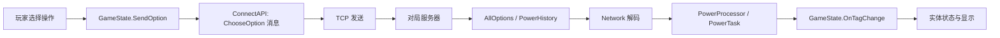

# 传统炉石战斗逻辑：本地反编译结果

本次目标是寻找可执行的战斗机制，不是提取卡牌数据。检查对象为 `D:\游戏\Hearthstone`，日期 2026-09-23。`GameState.DebugPrintGame` 中的编译常量为 build **251952**。

## 结论

**确实能从客户端反编译出部分战斗相关算法，并将其中的纯计算方法离线运行；但本次没有发现能直接抽离并计算完整传统炉石对局的规则引擎。**

区别在于：客户端能计算部分数值预览、预测法力消费，保存和应用实体状态；已追踪的实际出牌、攻击、死亡流程仍需要网络发回的合法操作和结算事件。不能把接收这些结果的代码去掉动画后，就视为独立模拟器。

这不是仅凭函数名字作出的判断：本轮完整反编译了主程序集，并对关键方法追踪了输入来源、状态写入及调用者；同时检查了练习、教程、AI 调试、相关辅助 DLL 和疑似本地脚本入口。

## 出牌到结算的实际调用链



以下行号对应本机保留的反编译文件：

| 环节 | 证据 | 实际行为 |
| --- | --- | --- |
| 选择操作 | `reports/decompiled/network/GameState.cs:5444` | `SendOption` 提交 options ID、操作序号、目标、子选项、位置 |
| 封装请求 | `reports/decompiled/network/ConnectAPI.cs:1521` | 构造 `ChooseOption`，包类型为 2；没有在这里执行卡牌效果 |
| 实际发送 | `reports/decompiled/network/QueueDispatcher.cs:314` | 编码后调用 `m_gameRpcController.SendData(data)` |
| TCP 层 | `reports/decompiled/network/RpcController.cs:171` | 最终调用 `m_tcpController.Send(data)`；连接创建于 117–130 行 |
| 合法操作来源 | `reports/decompiled/network/ConnectAPI.cs:761` | 从收到的游戏包解码 `AllOptions`（类型 14） |
| 效果结果来源 | `reports/decompiled/network/ConnectAPI.cs:836` | 从收到的游戏包解码 `PowerHistory`（类型 19） |
| 出牌错误与目标 | `reports/decompiled/network/Network.cs:10149` | 拷贝消息中的 PlayError、可选目标和子选项；`GameState.GetErrorType:3556` 查询这份列表 |
| 应用状态 | `reports/decompiled/network/GameState.cs:4532` | 将 `netChange.Value` 写入指定实体的 `netChange.Tag`，再触发变更回调 |

结束回合也走选项提交：`InputManager.cs:3585` 的 `DoEndTurnInternal` 找到选项后调用 `SendOption`。在这条路径中没有看到客户端独立进行抽牌、疲劳、解冻、法力刷新和回合触发的完整计算。

## 找到的真实本地规则片段

| 片段 | 可以复用什么 | 为什么还不是完整结算 |
| --- | --- | --- |
| `Player.TotalSpellpower` | 通用/派系法伤、负法伤、单卡额外法伤；奥秘/符咒对临时加成的处理 | 输入是已有实体 tags；未在此执行随从光环、亡语或持续效果去生成这些 tags |
| `TextUtils.TransformCardTextImpl` | 基础数值加成后翻倍、整数饱和处理等 | 输出是描述文本；本次验证的是客户端数值显示规则 |
| `Entity.GetCurrentHealth` | `HEALTH - DAMAGE - PREDAMAGE` | 不能据此产生伤害事件或决定死亡结算顺序 |
| `Entity.CanBeDamagedRealTime` / `WouldAnAttackZeroHealth` | 部分免疫/圣盾判断及血甲门槛比较 | 调用者是攻击时的骷髅预览，依赖已有即时状态 |
| `InputManager.ShowSkull` | 攻击预览考虑重甲限伤、剧毒/烈毒、英雄武器等 | 只显示致死提示，没有施加伤害或触发死亡 |
| `PredictSpentMana` / `RollbackSpentMana` | 费用、临时法力与部分替代费用的本地预测 | 服务器拒绝后回滚；不能将这套预测当作权威消费和效果结算 |

特别有辨别力的证据：`InputManager.cs:3896` 附近会本地设英雄技能 `EXHAUSTED=1`；`OnOptionRejected:3676` 会设回 0，并调用 `RollbackSpentMana`。`PredictSpentMana:5190` 和 `RollbackSpentMana:5213` 是明确成对的预测/撤销流程。

攻击致死预测的上下文在 `InputManager.cs:4305–4384`：`ShowSkullIfNeeded` 使用服务器提供的可选目标；`ShowSkull` 调用上述实体函数后激活伤害/骷髅图标。因此这里有真实规则片段，但未形成独立攻击解析器。

## 伤害、死亡、亡语

详见 `combat-effects-analysis.md`。关键区别是：

- `AttackSpellController` 最终让 `GameUtils.DoDamageTasks` 执行已有 `PowerTaskList` 中的伤害、治疗、EXHAUSTED 等事件。
- `PowerTask.DoTask` 把网络属性变化转给 `GameState.OnTagChange`；不是从攻击者攻击力自动生成一整套伤害、护甲、圣盾、剧毒、死亡与触发事件。
- `DeathSpellController` 从任务列表寻找 `ZONE=GRAVEYARD`，据此处理死亡。
- `DeathrattleSummonSpell` 等名字中虽有“亡语”，实际追到的是已给定实体/目标的表现与位置处理。未发现用它们计算“亡语应召唤什么、如何安排触发优先级”的通用引擎。

完整主程序集中的火球术 `CS2_029`、麦田傀儡 `EX1_556` 字符串命中也已检查：代表命中为冒险 Boss 对这些牌播放特定台词，不是卡牌的伤害/亡语实现。不能用“找到卡牌 ID”替代调用链证据。

## 已离线运行的原方法片段

从本次反编译输出直接取出 `Player.TotalSpellpower`、`TextUtils.TransformCardTextImpl` 和 `SafeAddInt` 的原方法体，补上最小标签容器与参数桩，以 C# 编译执行。主任务复跑 **9 项全部通过**。验证没有加载或运行整份游戏 DLL。

例如文本基础伤害 6、法伤 2、翻倍次数 2 得到 32；测试标签下普通火焰法术法伤为 19，改为奥秘/符咒后为 10；还验证了 int32 溢出饱和。另一个重要边界是该文本处理器可以输出负治疗量，这不能直接推广为服务器允许负治疗。

复现方法：

```powershell
pwsh -NoProfile -File tools/client_rule_probe/verify_formula_fragments.ps1
```

详见 `tools/client_rule_probe/README.md`。`reports/client-rule-verification.json` 保存本轮复跑的输入案例、实际输出和方法片段指纹；这证明局部方法可执行，不是完整对局一致性验证。

## 练习、教程和疑似备用引擎

详见 `local-rules-analysis.md`。

- 练习模式 `GT_VS_AI` 进入 `GameMgr.FindGame` / `Network.FindGame`。
- 教程 `GT_TUTORIAL` 同样请求创建对局；存在教学节奏、提示和对白脚本，但这不等于教程内置完整规则引擎。
- AI 调试类显示从网络收到的评价数据，不能据此认定客户端带有可调用的 AI 对局搜索器。
- 已检查的 `Blizzard.T5.Game`、PlayMaker 自定义动作、FakeUtilHandler、MockGIServer、DebugConnectionManager 等没有补上缺失的完整结算链。
- `LuaLogs` 最终发服务器调试日志订阅命令，未见本地 Lua 效果解释器；这条路径只作静态检查，没有实际调用。
- 全文直接写 `DAMAGE=1/999` 的候选位于 `Cheats.OnProcessCheat_PlayFinisher`，用固定数值手工制造终结动画预览；另一处 `DAMAGE=0` 是隐藏实体清理。二者均不是传统攻击结算。

## 本轮产物与复现

- `reports/decompiled/full/Assembly-CSharp.decompiled.cs`：主程序集完整反编译文本，约 38 MB，保留在本地并被 Git 忽略。
- `reports/decompiled/network/`、`effects/`、`entity/`、`local-rules/`：关键类型的独立文件，便于直接定位方法。
- `reports/entity-rules-analysis.md`：纯数值规则及离线编译验证的详情。
- `reports/combat-effects-analysis.md`：伤害、攻击、死亡、触发链路的源码定位。
- `reports/local-rules-analysis.md`：练习、教程、AI、辅助 DLL 和疑似备用引擎的检查。
- `reports/decompilation-manifest.json`：工具版本、来源文件 SHA256 和反编译输出统计。

使用 ILSpy CLI 11.1.0.9782 静态反编译；未运行或修改炉石程序。比如在 PowerShell 中重新导出一个关键类型：

```powershell
& "$env:TEMP\hs-inspect-tools\ilspycmd.exe" -t Networking.ConnectAPI `
  'D:\游戏\Hearthstone\Hearthstone_Data\Managed\Assembly-CSharp.dll'
```

## 对模拟器路线的影响

反编译适合复用和核对上述局部算法、实体状态结构、操作协议以及事件结果格式。要计算任意传统炉石局面的下一步，仍需要独立的规则核心：合法操作生成、伤害替换和修正、死亡处理、触发队列、光环重算、随机选择、回合转换及逐卡效果。

本次没有把“反编译到的代码”宣传为完整模拟器，也没有把“没找到”扩大为对所有文件和未来版本的数学证明。结论基于这个安装版本的实际代码与已追踪调用链。
